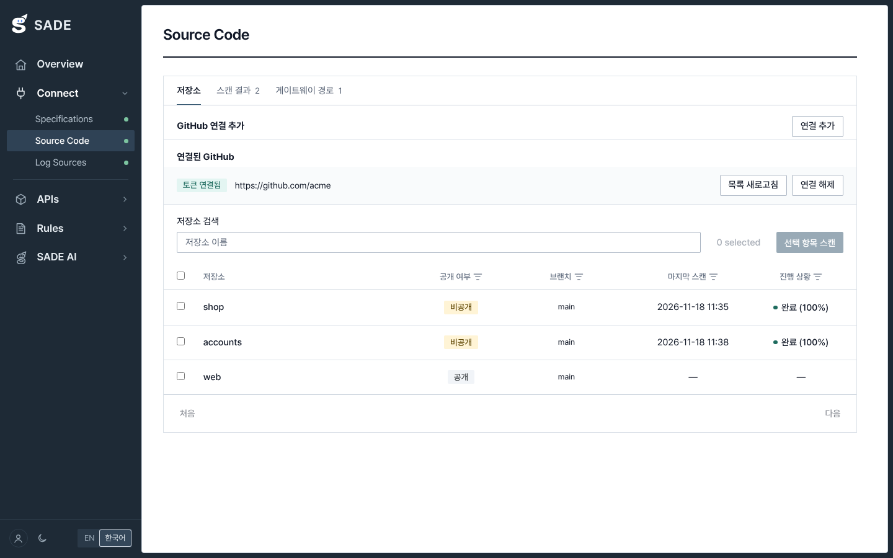
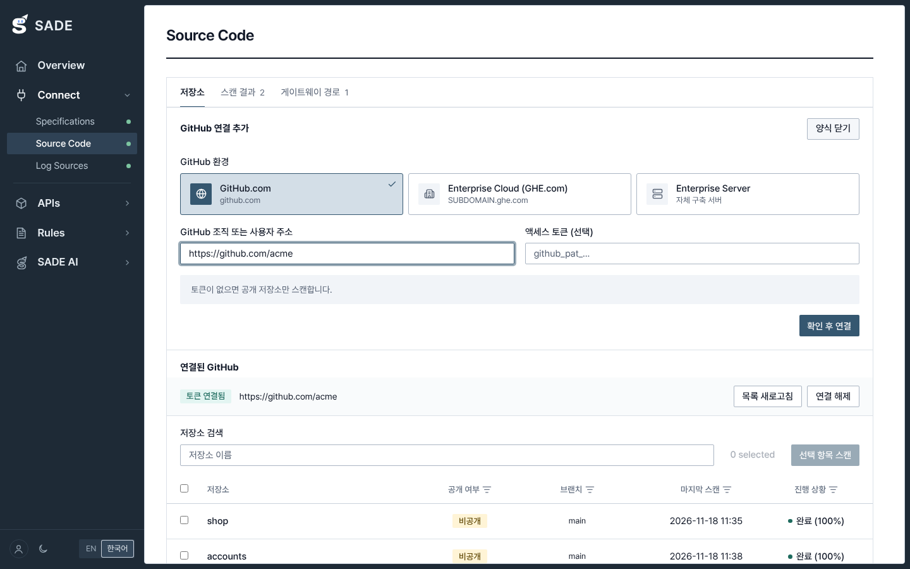
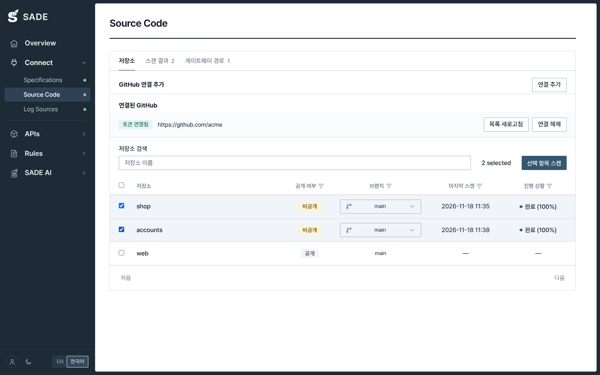
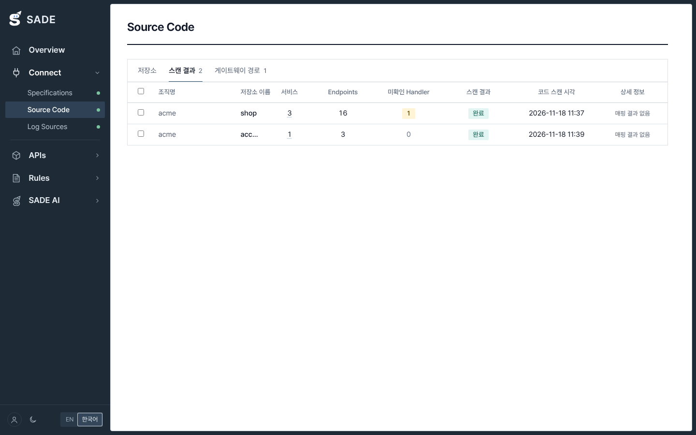

# 소스 코드 (GitHub)

Connect > Source Code에서 GitHub 저장소를 연결해 스캔합니다.

코드 스캔은 Java Spring Boot 서비스를 읽습니다. 코드는 읽기만 하고 저장소에 쓰지 않습니다.

<div class="sade-slides sade-walk" markdown>

<div class="sade-slide" markdown data-title="연결 추가" data-spot="88.7,20.77,5.73,3.78" data-url="/#/code">

<p class="sade-say">Connect > Source Code의 저장소 탭에서 연결 추가를 누릅니다.</p>

[{ loading=lazy }](../../assets/screens/w-code-1.png)

</div>

<div class="sade-slide" markdown data-title="주소와 토큰" data-spot="19.81,42.71,36.72,3.78" data-url="/#/code">

<p class="sade-say">GitHub 환경을 고르고 조직 주소와 액세스 토큰을 넣습니다.</p>

[{ loading=lazy }](../../assets/screens/w-code-2.png)

</div>

<div class="sade-slide" markdown data-title="연결" data-spot="87.81,55.36,6.61,3.78" data-url="/#/code">

<p class="sade-say">확인 후 연결을 누릅니다. SADE가 GitHub에 토큰을 확인한 뒤 저장합니다.</p>

[{ loading=lazy }](../../assets/screens/w-code-3.png)

</div>

<div class="sade-slide" markdown data-title="저장소 고르기" data-spot="18.33,51.98,77.57,6.25" data-url="/#/code">

<p class="sade-say">스캔할 저장소를 체크하고 브랜치를 고릅니다.</p>

[{ loading=lazy }](../../assets/screens/w-code-4.png)

</div>

<div class="sade-slide" markdown data-title="스캔" data-spot="86.94,41.59,7.48,3.78" data-url="/#/code">

<p class="sade-say">선택 항목 스캔을 누릅니다.</p>

[{ loading=lazy }](../../assets/screens/w-code-5.png)

</div>

<div class="sade-slide" markdown data-title="결과 확인" data-spot="24.26,13.7,4.83,5.18" data-url="/#/code">

<p class="sade-say">스캔 결과 탭에서 서비스 수, API 수, 상태를 확인합니다.</p>

[{ loading=lazy }](../../assets/screens/w-code-6.png)

</div>

</div>

## 스캔으로 채워지는 것

| 결과 | 쓰는 화면 |
|---|---|
| 코드에 선언된 API(서비스, 메서드, 경로)와 핸들러 위치(파일, 줄) | Inventory의 `Code` 출처, API 상세 |
| 서비스별 OpenAPI (코드에서 만든 명세) | Specifications의 코드에서 만든 명세 탭 |
| 인증 선언, HTTP 메서드 | 관리 우선순위의 인증 선언과 변경 기능 근거 |
| 서비스 사이 HTTP 호출, DB 접근 | Flows의 코드 근거 선 |
| 게이트웨이 경로 규칙 | Source Code의 게이트웨이 경로 탭, 바깥 경로와 서비스 API 연결 |
| CODEOWNERS 담당 후보, API 코드의 최초, 최근 변경 커밋 | API 상세 요약 탭의 담당자 |
| 요청, 응답 필드의 민감 유형 | 민감정보 판정 |

무엇을 어떻게 읽는지는 [코드 스캔](../how-it-works/code-scan.md)에 있습니다.

## 준비

| 환경 | 주소 예 | 토큰 |
|---|---|---|
| GitHub.com | `https://github.com/OWNER` (조직이나 개인 계정 주소) | 선택. 토큰이 없으면 공개 저장소만 스캔합니다 |
| Enterprise Cloud (GHE.com) | `https://SUBDOMAIN.ghe.com` | 필수 |
| Enterprise Server | `https://github.company.example` | 필수 |

토큰 권한은 아래처럼 최소로 줍니다.

- Fine-grained 토큰: 스캔할 저장소만 고르고 Contents: Read-only, Metadata: Read-only
- 쓰기 권한은 주지 않습니다. SADE는 저장소에 쓰지 않습니다.
- SADE 서버에서 GitHub 주소로 HTTPS(443)가 나가야 합니다.

!!! note "토큰 없는 GitHub.com"
    GitHub는 토큰 없는 요청을 IP마다 시간당 60회로 제한합니다.

    파일이 많은 저장소는 스캔 중에 한도에 걸릴 수 있습니다. 비공개 저장소가 없어도 토큰을 쓰기를 권합니다.

??? note "다른 팀에 요청할 것: GitHub 관리자"

    저장소 이름만 바꿔 보냅니다.

    ```text
    [요청] API 점검 도구(SADE) 코드 스캔용 GitHub 읽기 토큰 발급

    - 용도: 사내 설치형 도구가 Java Spring Boot 저장소의 API 선언을 읽어 API 목록을 만듭니다.
    - 대상 저장소: <저장소 이름 목록>
    - 권한: Fine-grained 토큰, 위 저장소만, Contents Read-only, Metadata Read-only
    - 쓰기 권한은 필요 없습니다. 저장소를 복제하지 않고 GitHub API로 파일만 읽습니다.
    - 토큰은 설치 서버에 암호화해 보관하며 화면과 로그에 나오지 않습니다.
    - 네트워크: 설치 서버에서 GitHub 주소로 HTTPS(443) 나가는 연결이 필요합니다.
    ```

## 1. GitHub 연결

<div class="sade-steps" markdown>

1. Connect > Source Code의 저장소 탭에서 연결 추가를 누릅니다. 연결이 하나도 없으면 GitHub 연결 추가 양식이 바로 열려 있습니다.

2. GitHub 환경에서 GitHub.com, Enterprise Cloud (GHE.com), Enterprise Server 중 하나를 고릅니다.

3. 주소를 넣습니다. GitHub.com은 조직이나 개인 계정 주소(`https://github.com/OWNER`), 나머지는 서버 주소입니다.

4. 액세스 토큰을 넣습니다. GitHub.com에서 공개 저장소만 볼 때는 비워 둡니다.

5. 확인 후 연결을 누릅니다. SADE가 GitHub에 토큰을 확인한 뒤 저장합니다.

</div>

- 토큰은 `SADE_SECRET_KEY`로 암호화해 저장합니다. 화면, API 응답, 로그에 내보내지 않습니다.
- 연결되면 연결된 GitHub에 "토큰 연결됨" 또는 "공개 저장소만"이 나옵니다.
- 토큰에 저장소 권한을 새로 줬다면 목록 새로고침을 누릅니다.
- `SADE_SECRET_KEY`가 비어 있으면 연결 저장에서 오류가 납니다. [설치](../getting-started/quickstart.md)의 2단계를 확인합니다.

## 2. 저장소와 브랜치 고르기

<div class="sade-steps" markdown>

1. 연결된 GitHub 아래 저장소 목록이 나옵니다. 저장소 검색으로 이름을 찾습니다.

2. 스캔할 저장소를 체크합니다. 여러 개를 함께 고를 수 있습니다. 선택한 항목만 보기로 고른 것만 봅니다.

3. 저장소마다 브랜치를 고릅니다. 비우면 기본 브랜치입니다.

4. 선택 항목 스캔을 누릅니다.

</div>

토큰 없이 GitHub.com에 연결했다면 목록 대신 공개 저장소 URL에 `https://github.com/OWNER/REPO` 또는 `OWNER/REPO`를 넣고 저장소 불러오기를 누릅니다.

### 스캔 방식

- 요청할 때의 브랜치 최신 커밋 하나를 고정해 읽습니다. 스캔 중에 커밋이 올라와도 섞이지 않습니다.
- `git clone`을 하지 않습니다. GitHub API로 필요한 파일만 읽습니다.
- 화면에서는 저장소 전체를 스캔합니다.
- 한 저장소는 가장 최근 스캔 하나만 결과에 씁니다. 같은 저장소의 다른 브랜치를 스캔하면 앞선 스캔을 대신합니다.

## 3. 진행 확인

진행 중인 스캔에 저장소마다 단계가 나옵니다.

| 단계 | 하는 일 |
|---|---|
| 대기 중 | 순서를 기다림 |
| 저장소 읽는 중 | GitHub에서 파일 목록과 필요한 파일을 읽음 |
| 코드 분석 중 | API, 호출, 인증 선언, 필드를 분석함 |
| 결과 저장 중 | 결과를 저장하고 다음 작업(민감 판정, 매핑)을 등록함 |

스캔이 끝나면 아래 순서로 자동 처리가 이어집니다.

1. 민감 판정이 요청, 응답 필드의 민감 유형을 정합니다.
2. 매핑이 코드, 명세, 로그를 합쳐 Inventory, Flows, 관리 우선순위를 새로 만듭니다.
3. 코드에서 만든 명세는 Specifications의 코드에서 만든 명세 탭에 따로 쌓입니다. 직접 등록한 명세를 덮어쓰지 않습니다.

## 4. 결과 확인 {#results}

| 탭 | 내용 | 확인할 것 |
|---|---|---|
| 스캔 결과 | 저장소별 서비스 수, API 수, 핸들러를 찾지 못한 API(미확인 Handler), 상태, 커밋, 마지막 스캔 | 이슈가 있는지, 서비스 수가 예상과 맞는지 |
| 게이트웨이 경로 | 게이트웨이와 BFF 설정에서 읽은 경로 규칙. 라우트 ID, 경로, 경로 변환, 전달 대상, 규칙이 적힌 파일과 줄 | 바깥 경로가 어느 서비스로 가는지 |
| 저장소 | 연결한 저장소와 스캔 상태 | 마지막 스캔 시각과 커밋 |

스캔 결과에서 저장소를 열면(자세히) 서비스와 API 목록, 스캔 이슈가 나옵니다. 민감정보 API 보기는 민감 유형이 있는 API만 Inventory에서 엽니다.

### 스캔 결과 상태

| 상태 | 뜻 |
|---|---|
| 완료 | 정한 규칙을 끝까지 수행함 |
| 부분 | 읽지 못한 파일, 해석하지 못한 코드, 탐색 한도 때문에 일부가 빠졌을 수 있음. 확인한 결과는 쓰고, 빠진 위치는 이슈에 남김 |
| 실패 | 커밋이나 필요한 파일을 얻지 못함. 이전 결과를 그대로 둠 |

## 다시 스캔하기와 지우기

- 같은 저장소를 다시 스캔하면 새 커밋으로 결과를 바꿉니다.
- 스캔 결과를 지우면(선택 항목 삭제) 그 스캔의 Flow, 생성 OpenAPI, 민감 판정 결과도 함께 지워집니다. 스캔 작업 기록과 매핑 이력은 남습니다.
- 연결 해제는 연결과 저장한 토큰을 지웁니다. 이미 스캔한 결과는 남습니다.

## 제한

- 지원 언어는 Java Spring Boot입니다.
- 서비스 주소는 Spring 설정과 docker compose 설정에서 찾습니다. Kubernetes, Helm 설정은 읽지 않습니다.
- 실행 중에 정해지는 주소(환경 변수, 설정 서버)로 부르는 호출은 대상을 확정하지 못하고 미확인으로 남습니다.
- 인증 선언은 코드에 적힌 선언입니다. 요청이 실제로 막히는지는 확인하지 않습니다.
- 테스트 코드(`src/test`)와 빌드 결과물(`target`, `build`)은 읽지 않습니다.
