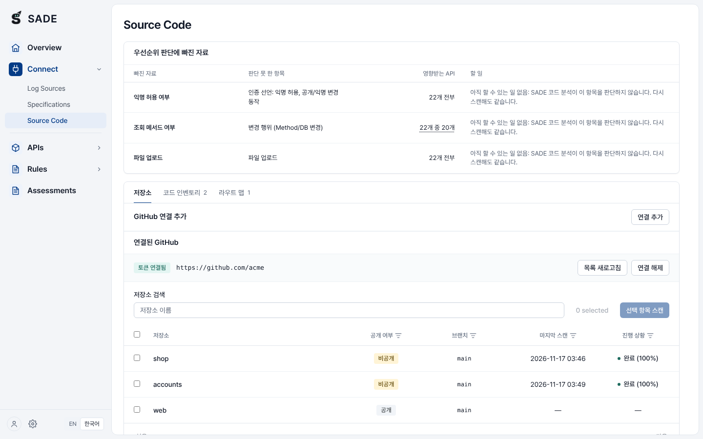
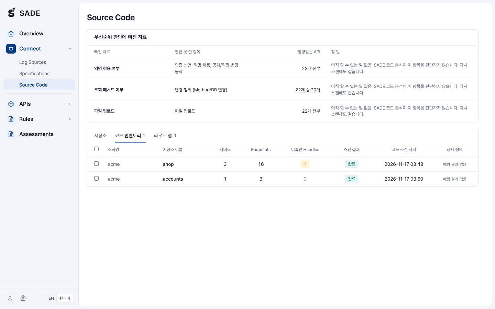

# 소스 코드 (GitHub)

Connect > Source Code에서 GitHub 저장소를 연결해 스캔합니다. 코드 스캔은 Java Spring Boot 서비스를 읽습니다.

## 스캔 결과

| 결과 | 쓰는 화면 |
|---|---|
| 코드에 선언된 API(서비스, 메서드, 경로)와 핸들러 위치(파일, 줄) | Inventory의 `Code` 출처, API 상세의 Code 탭 |
| 서비스별 OpenAPI (코드에서 만든 명세) | Specifications의 Generated from Code |
| 인증 선언, HTTP 메서드 | 관리 우선순위의 인증 선언과 변경 기능 근거 |
| 서비스 사이 HTTP 호출, DB 접근 | Flows의 코드 근거 선 |
| 게이트웨이 경로 규칙 (라우트 맵) | 게이트웨이 경로와 서비스 API 연결 |
| CODEOWNERS 담당 후보, API 코드의 최초, 최근 변경 커밋 | API 상세의 Owners 탭 |
| 요청, 응답 필드의 민감 유형 | 민감정보 판정 |

[{ loading=lazy }](../../assets/screens/code.png)
<small>예시 화면 (가상 데이터)</small>

위쪽 "우선순위 판단에 빠진 자료" 표는 이 자료가 없어 관리 우선순위를 판단하지 못한 항목과 영향받는 API 수를 보여 줍니다.

## 1. GitHub 연결

Add GitHub connection에서 환경을 고르고 주소와 토큰을 넣습니다. SADE는 저장하기 전에 GitHub에 토큰을 확인합니다.

| 환경 | 주소 예 | 토큰 |
|---|---|---|
| GitHub.com | `https://github.com/OWNER` | 선택. 토큰이 없으면 공개 저장소만 스캔합니다. GitHub는 토큰 없는 요청을 IP마다 시간당 60회로 제한합니다 |
| Enterprise Cloud (GHE.com) | `https://company.ghe.com` | 필수 |
| Enterprise Server | `https://github.company.com` | 필수 |

!!! note "토큰 권한"
    - 스캔할 저장소의 Contents: Read-only 권한만 줍니다. SADE는 저장소에 쓰지 않습니다.
    - SADE는 토큰을 `SADE_SECRET_KEY`로 암호화해 저장하고, API 응답과 로그에 내보내지 않습니다.
    - Disconnect는 연결과 토큰을 지웁니다. 이미 스캔한 결과는 남습니다.

## 2. 저장소와 브랜치를 골라 스캔

저장소 목록에서 저장소를 고르고 브랜치를 정한 뒤 스캔을 요청합니다. 여러 저장소를 한 번에 고릅니다. 토큰 없이 GitHub.com에 연결했다면 `https://github.com/OWNER/REPO` 또는 `OWNER/REPO`로 공개 저장소를 불러옵니다.

- 스캔은 요청할 때의 브랜치 최신 커밋 하나를 고정해 읽습니다.
- 저장소를 `git clone`하지 않고 GitHub API로 필요한 파일만 읽습니다.
- 저장소 일부만 스캔하려면 scan root에 `services/api` 같은 상대 경로를 넣습니다. 비우면 저장소 전체를 읽습니다.
- 진행 상황은 Scans in progress와 작업 상태에 나옵니다.

## 3. 결과 확인

[{ loading=lazy }](../../assets/screens/code-inventories.png)
<small>예시 화면 (가상 데이터)</small>

| 탭 | 내용 |
|---|---|
| Code inventories | 저장소별 서비스 수, API 수, 핸들러를 찾지 못한 API, 커밋, 마지막 스캔 |
| Route maps | 게이트웨이와 BFF 설정에서 읽은 경로 규칙. 바깥 경로를 넘기는 서비스, 규칙이 적힌 파일과 줄 |
| Repositories | 연결한 저장소와 스캔 상태 |

코드 인벤토리를 지우면 그 스캔의 Flow, 생성 OpenAPI, 민감 판정 결과도 함께 지워집니다. 스캔 작업 기록과 매핑 이력은 남습니다.

## 스캔 뒤 자동 처리

1. 코드 스캔이 끝나면 민감 판정이 돕니다.
2. 민감 판정이 끝나면 매핑이 다시 돌아 Inventory, Flows, 관리 우선순위를 새로 만듭니다.
3. 코드에서 만든 명세는 Specifications에 `Code`로 따로 쌓입니다. 직접 등록한 명세를 덮어쓰지 않습니다.

## 제한

- 지원 언어는 Java Spring Boot입니다.
- 서비스 주소는 docker compose 설정에서 찾습니다. Kubernetes, Helm 설정은 읽지 않습니다.
- 실행 중에 정해지는 주소(환경 변수, 설정 서버)로 부르는 호출은 대상을 확정하지 못하고 Not resolved로 남습니다.
- 인증 선언은 코드에 적힌 선언입니다. 요청이 실제로 막히는지는 확인하지 않습니다.
