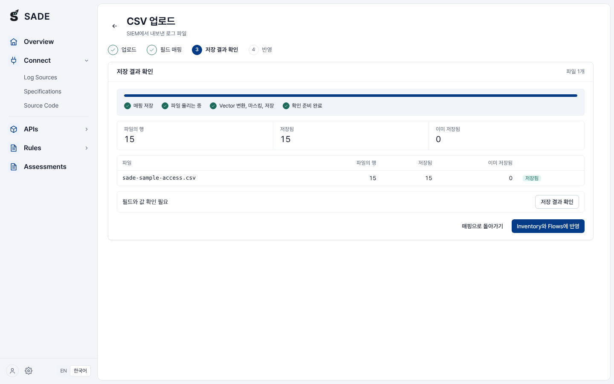
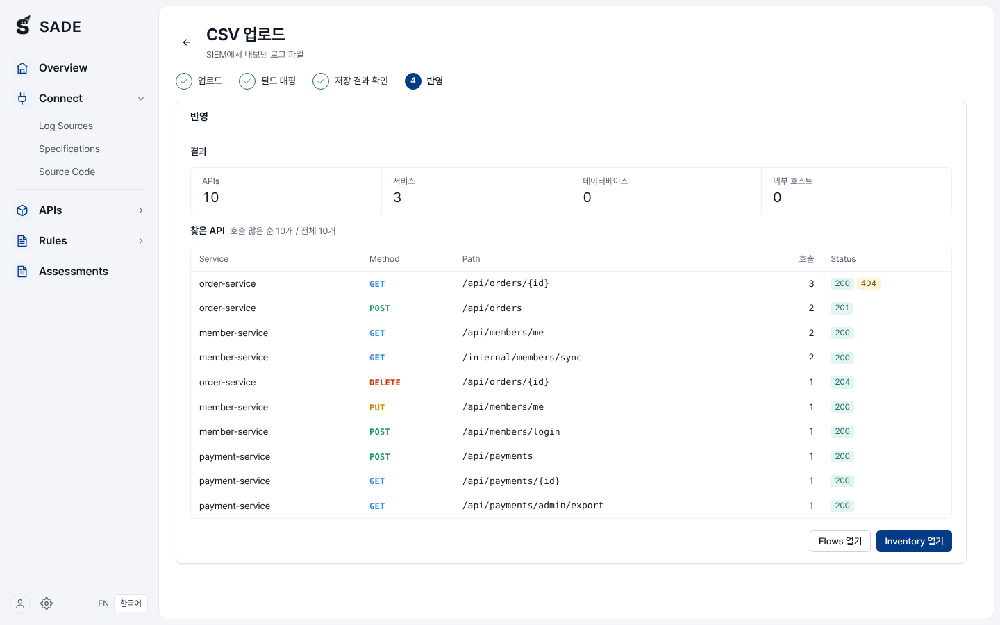

# CSV 업로드

SIEM, 게이트웨이, 서비스에서 기간을 정해 내보낸 CSV를 올립니다.

연동 승인 전에 기업 로그 형식을 확인할 때 씁니다. 처음이면 [샘플 로그로 첫 결과 보기](../getting-started/first-run.md)로 화면 흐름을 먼저 익힙니다.

<div class="sade-slides sade-walk" markdown>

<div class="sade-slide" markdown data-title="CSV 업로드 열기" data-spot="54.02,77.77,6.19,3.56" data-url="/#/logs">

<p class="sade-say">Connect > Log Sources에서 CSV 업로드를 누릅니다.</p>

[{ loading=lazy }](../../assets/screens/w-csv-1.png)

</div>

<div class="sade-slide" markdown data-title="파일 고르기" data-spot="54.21,31.15,5.82,2.26" data-url="/#/csv">

<p class="sade-say">CSV 파일 선택을 눌러 파일을 고릅니다. 5개까지 한 번에 고릅니다.</p>

[{ loading=lazy }](../../assets/screens/w-csv-2.png)

</div>

<div class="sade-slide" markdown data-title="매핑 확인" data-spot="41.22,37.37,25.71,3.56" data-url="/#/csv">

<p class="sade-say">추천된 매핑을 확인합니다. 틀린 칸은 다른 열로 바꿉니다.</p>

[{ loading=lazy }](../../assets/screens/w-csv-3.png)

</div>

<div class="sade-slide" markdown data-title="로그 저장" data-spot="90.07,90.9,5.14,3.56" data-url="/#/csv">

<p class="sade-say">맨 아래 로그 저장을 누릅니다.</p>

[{ loading=lazy }](../../assets/screens/w-csv-4.png)

</div>

<div class="sade-slide" markdown data-title="못 채운 필드" data-spot="73.84,67.03,5.95,3.56" data-url="/#/csv">

<p class="sade-say">빠지는 결과를 확인합니다. 맞는 열이 없으면 그대로 진행을 누릅니다.</p>

[{ loading=lazy }](../../assets/screens/w-csv-5.png)

</div>

<div class="sade-slide" markdown data-title="저장된 줄 확인" data-spot="74.65,87.5,5.14,3.56" data-url="/#/csv">

<p class="sade-say">값이 맞는 필드에 들어갔는지 보고 확인 완료를 누릅니다.</p>

[{ loading=lazy }](../../assets/screens/w-csv-6.png)

</div>

<div class="sade-slide" markdown data-title="반영" data-spot="83.33,57.15,11.88,3.56" data-url="/#/csv">

<p class="sade-say">Inventory와 Flows에 반영을 누릅니다.</p>

[{ loading=lazy }](../../assets/screens/w-csv-7.png)

</div>

<div class="sade-slide" markdown data-title="결과 보기" data-spot="87.67,84.82,7.54,3.56" data-url="/#/csv">

<p class="sade-say">찾은 API를 확인하고 Inventory 열기로 목록을 엽니다.</p>

[{ loading=lazy }](../../assets/screens/w-csv-8.png)

</div>

</div>

## 파일 조건

| 조건 | 내용 |
|---|---|
| 개수와 크기 | 한 번에 5개, 파일당 200 MB |
| 첫 줄 | 열 이름 |
| 문자 인코딩 | UTF-8 또는 CP949. 자동으로 판단합니다 |
| 구분자 | 쉼표, 탭, `;`, `|`. 자동으로 판단합니다 |
| 시간대 | 시각에 시간대가 없으면 `.env`의 `SADE_LOG_TIMEZONE`(기본 Asia/Seoul)으로 읽습니다 |
| 시각 형식 | ISO 8601(`2026-11-16T09:00:01+09:00`), `2026-11-16 09:00:01`, `2026/11/16 09:00:01`, 접근 로그 형식(`16/Nov/2026:09:00:01 +0900`), 초, 밀리초, 나노초 단위 숫자 |

SIEM에서 내보낼 때는 아래 열을 포함합니다. 열 이름은 기업에서 쓰는 이름 그대로 두어도 됩니다.

- 꼭 필요: 시각, 서비스(또는 호스트), 메서드, 경로
- 있으면 좋음: 응답 코드, 출발지 IP, `X-Forwarded-For`, 서버 이름, 요청과 응답 본문
- 서비스 사이 흐름까지 보려면: 방향(inbound, outbound), 목적지, trace ID

??? note "다른 팀에 요청할 것: 관제(SIEM) 담당"

    기간은 하루치로 시작하기를 권합니다.

    ```text
    [요청] API 접근 로그 CSV 내보내기

    - 용도: 사내 설치형 API 점검 도구(SADE)에서 실제로 호출된 API를 찾습니다.
    - 기간: <시작일 ~ 종료일> (하루치부터)
    - 대상: 게이트웨이 또는 서비스 접근 로그
    - 열: 시각(시간대 포함), 서비스 이름 또는 호스트, 메서드, 경로, 응답 코드, 출발지 IP, X-Forwarded-For
    - 가능하면 추가: 요청, 응답 본문 (도구가 저장 전에 값을 가리고 유형 이름만 남깁니다)
    - 형식: 첫 줄에 열 이름, UTF-8 또는 CP949, 파일당 200 MB 이하
    ```

## 1. 업로드

<div class="sade-steps" markdown>

1. Connect > Log Sources에서 CSV 카드의 Upload CSV(CSV 업로드)를 누릅니다.

2. Choose CSV files(CSV 파일 선택)로 파일을 고릅니다. 5개까지 한 번에 고릅니다.

3. 파일마다 읽은 방식이 나옵니다. 예: "UTF-8로 읽었고 쉼표로 나눴습니다." 글자가 깨졌으면 파일 인코딩을 확인합니다.

</div>

열 이름이 같은 파일들은 하나의 매핑을 같이 씁니다. 노드별로 나눠 내보낸 같은 형식의 파일은 한 번만 매핑하면 됩니다.

## 2. 필드 매핑 {#mapping}

열 이름을 보고 SADE가 필드를 추천합니다. 왼쪽이 SADE 필드, 가운데가 고를 CSV 열, 오른쪽이 그 열의 샘플 값과 값이 들어 있는 줄 수입니다.

<div class="sade-steps" markdown>

1. 맨 위 "API 목록에 필요" 네 칸(`@timestamp`, `service.name`, `http.request.method`, `url.path`)이 맞는지 먼저 봅니다.

2. 추천이 틀린 칸은 다른 열로 바꿉니다. 예: `svc` → `service.name`, `src` → `client.ip`

3. 파란색으로 표시된 줄("입력 필요")은 아직 열을 고르지 못한 필드입니다. 맞는 열이 있으면 고르고, 없으면 그대로 둡니다.

4. 열 하나로 채울 수 없는 필드는 아래 방법을 고릅니다.

    | 방법 | 쓰는 필드 | 예 |
    |---|---|---|
    | 고정 값(Fixed value) | 모든 필드 | 서비스 열이 없는 파일에 `order-service`를 넣음 |
    | 경로 첫 구간(First part of url.path) | `service.name` | `/order/api/items` → `order` |
    | 날짜 열 + 시각 열(Date + time columns) | `@timestamp` | `date`와 `time` 열이 따로 있을 때 |
    | 요청 줄에서(From a request line) | 메서드, 경로 | `GET /api/items?page=2 HTTP/1.1` 한 열에서 메서드와 경로를 나눔 |

5. 같은 열 이름이 다른 파일에도 있으면 같은 선택을 적용할지 묻습니다. 같은 뜻이면 Apply to these files too를 고릅니다.

6. 맨 아래 Send to Vector(로그 저장)를 누릅니다.

</div>

못 채운 필드가 있으면 저장 전에 영향을 알려 줍니다.

- 필드마다 비어 있으면 무엇이 빠지는지 나옵니다. 예: `destination.address`가 없으면 다른 서비스, DB, 외부 호스트로 가는 호출이 빠짐
- 맞는 열이 있으면 못 채운 필드 채우기(Fill missing fields)로 돌아갑니다.
- 로그에 그 정보가 없으면 그대로 진행을 누릅니다. Inventory는 만들어지고 Flows만 덜 나옵니다.

!!! note "시각 열을 매핑하세요"
    `@timestamp`를 매핑하지 않으면 저장 시각을 로그 시각으로 씁니다. 이때 같은 파일을 다시 올리면 같은 줄을 다시 저장합니다.

필드별로 무엇이 달라지는지는 [로그 필드](schema.md)에 있습니다.

## 3. 저장 결과 확인

저장이 끝나면 저장된 줄 하나가 SADE 필드 이름으로 바로 열립니다.

- 각 필드에 맞는 값이 들어갔는지 봅니다. 예: `url.path`에 경로, `client.ip`에 IP
- 파란색 줄("저장된 값 없음")은 열을 골랐는데 값이 비어 있는 필드입니다. 열을 잘못 골랐는지 봅니다.
- 본문은 값이 타입으로 바뀌어 있습니다. 예: `{"email":"<string>","phone":"<string>"}`
- 틀렸으면 매핑 수정(Fix mapping), 맞으면 확인 완료(Looks right)를 누릅니다.

창을 닫으면 파일별 저장 결과가 나옵니다.

| 구분 | 뜻 | 할 일 |
|---|---|---|
| 저장됨(Stored) | ClickHouse에 저장한 줄 | |
| 이미 저장됨(Already stored) | 같은 내용의 줄이 이미 있음 | 다시 올린 파일이면 정상입니다 |
| 보관 기간보다 오래됨(Older than retention) | 보관 기간(기본 30일)보다 오래돼 버린 줄 | 시각 열과 시간대를 확인합니다 |
| 빈 줄(Empty rows) | 매핑한 칸이 모두 비어 버린 줄 | 매핑한 열이 맞는지 확인합니다 |

## 4. 반영 {#apply}

Apply to inventory and flows(Inventory와 Flows에 반영)를 누르면 로그 분석이 시작됩니다.

끝나면 찾은 API, 서비스, 데이터베이스, 외부 호스트 수와 호출이 많은 API 목록이 나옵니다.

Inventory 열기(Open Inventory), Flows 열기(Open Flows)로 결과 화면을 엽니다.

## 다시 올릴 때

- 같은 파일을 다시 올리면 이미 저장된 줄은 다시 저장하지 않습니다(시각 열을 매핑한 경우).
- 기간을 이어 붙이려면 다음 기간 파일만 올리고 반영을 다시 누릅니다.
- 잘못된 매핑으로 올렸으면 Log Sources의 Recent uploads(최근 업로드)에서 Cancel this upload를 누릅니다. 그 업로드가 저장한 줄을 ClickHouse에서 지웁니다. 매핑을 고쳐 다시 올립니다.
    - 다른 업로드도 같은 줄을 보냈다면 그 줄도 함께 지워집니다. 필요하면 그 파일을 다시 올립니다.
    - 지운 뒤에는 되돌릴 수 없습니다.

## 문제가 생기면

??? question "첫 줄은 열 이름이어야 한다는 오류"

    첫 줄에 머리글이 없습니다. 내보내기 설정에서 머리글을 켭니다.

??? question "저장함이 0이고 보관 기간 초과가 많음"

    시각 열이 다른 열과 바뀌었거나 날짜가 오래됐습니다.

??? question "반영 뒤 API가 없음"

    `service.name`, `http.request.method`, `url.path` 매핑을 확인합니다.

??? question "호출 시각이 9시간 밀려 보임"

    시간대 없는 시각을 UTC로 찍는 서버입니다. 시간대가 붙은 형식(`Z`, `+09:00`)으로 내보내거나, `.env`의 `SADE_LOG_TIMEZONE`을 `UTC`로 바꿉니다.

