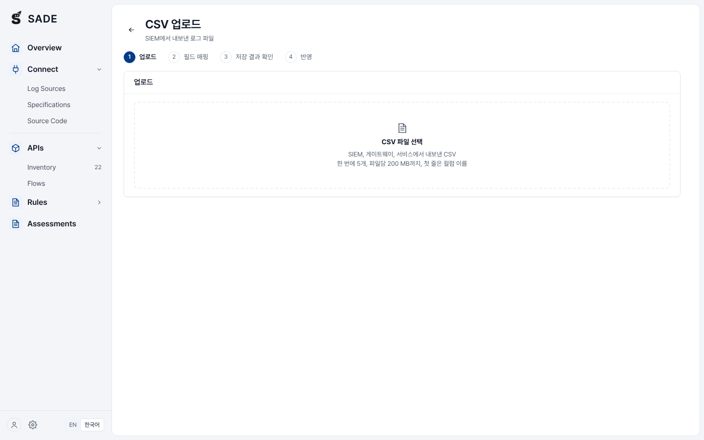

# CSV 업로드

SIEM, 게이트웨이, 서비스에서 기간을 정해 내보낸 CSV를 올립니다. 연동 승인 전에 기업 로그 형식을 확인할 때 씁니다. 처음이면 [샘플 로그로 첫 결과 보기](../getting-started/first-run.md)로 화면 흐름을 먼저 익힙니다.

[{ loading=lazy }](../../assets/screens/csv.png)
<small>예시 화면 (가상 데이터)</small>

## 파일 조건

| 조건 | 내용 |
|---|---|
| 개수와 크기 | 한 번에 5개, 파일당 200 MB |
| 첫 줄 | 열 이름 |
| 문자 인코딩 | UTF-8 또는 CP949. 자동으로 판단합니다 |
| 구분자 | 쉼표, 탭, `;`, `|`. 자동으로 판단합니다 |
| 시간대 | 시각에 시간대가 없으면 `.env`의 `SADE_LOG_TIMEZONE`(기본 Asia/Seoul)으로 읽습니다 |
| 시각 형식 | ISO 8601(`2026-11-16T09:00:01+09:00`), `2026-11-16 09:00:01`, `2026/11/16 09:00:01`, 접근 로그 형식(`16/Nov/2026:09:00:01 +0900`), 초, 밀리초, 나노초 단위 숫자 |

SIEM에서 내보낼 때는 아래 열을 포함합니다. 열 이름은 기업에서 쓰는 이름 그대로 두어도 됩니다.

- 꼭 필요: 시각, 서비스(또는 호스트), 메서드, 경로
- 있으면 좋음: 응답 코드, 출발지 IP, `X-Forwarded-For`, 서버 이름, 요청과 응답 본문
- 서비스 사이 흐름까지 보려면: 방향(inbound, outbound), 목적지, trace ID

## 1. 업로드

1. Connect > Log Sources에서 CSV 카드의 Upload CSV(CSV 업로드)를 누릅니다.

2. Choose CSV files(CSV 파일 선택)로 파일을 고릅니다. 5개까지 한 번에 고릅니다.

3. 파일마다 읽은 방식이 나옵니다. 예: "UTF-8로 읽었고 쉼표로 나눴습니다." 글자가 깨졌으면 파일 인코딩을 확인합니다.

열 이름이 같은 파일들은 하나의 매핑을 같이 씁니다. 노드별로 나눠 내보낸 같은 형식의 파일은 한 번만 매핑하면 됩니다.

## 2. 필드 매핑

열 이름을 보고 SADE가 필드를 추천합니다. 왼쪽이 SADE 필드, 오른쪽이 고를 CSV 열입니다.

1. 파란색 칸(채울 필드)부터 고릅니다. `service.name`, `http.request.method`, `url.path`를 먼저 채웁니다.

2. 추천이 틀린 칸은 다른 열로 바꿉니다. 예: `svc` → `service.name`, `src` → `client.ip`

3. 열 하나로 채울 수 없는 필드는 아래 방법을 고릅니다.

    | 방법 | 쓰는 필드 | 예 |
    |---|---|---|
    | 고정 값(Fixed value) | 모든 필드 | 서비스 열이 없는 파일에 `order-service`를 넣음 |
    | 경로 첫 구간(First part of url.path) | `service.name` | `/order/api/items` → `order` |
    | 날짜 열 + 시각 열(Date + time columns) | `@timestamp` | `date`와 `time` 열이 따로 있을 때 |
    | 요청 줄에서(From a request line) | 메서드, 경로 | `GET /api/items?page=2 HTTP/1.1` 한 열에서 메서드와 경로를 나눔 |

4. 같은 열 이름이 다른 파일에도 있으면 같은 선택을 적용할지 묻습니다. 같은 뜻이면 Apply to these files too를 고릅니다.

5. Send to Vector(로그 저장)를 누릅니다.

!!! note "시각 열을 매핑하세요"
    `@timestamp`를 매핑하지 않으면 저장 시각을 로그 시각으로 씁니다. 이때 같은 파일을 다시 올리면 같은 줄을 다시 저장합니다.

필드별로 무엇이 달라지는지는 [로그 필드](schema.md)에 있습니다.

## 3. 저장 결과 확인

보낸 뒤 파일마다 행을 나눠 보여 줍니다.

| 구분 | 뜻 | 할 일 |
|---|---|---|
| 저장함(Stored) | ClickHouse에 저장한 줄 | |
| 이미 저장돼 있음(Already stored) | 같은 내용의 줄이 이미 있음 | 다시 올린 파일이면 정상입니다 |
| 보관 기간보다 오래됨(Older than retention) | 보관 기간(기본 30일)보다 오래돼 버린 줄 | 시각 열과 시간대를 확인합니다 |
| 빈 줄(Empty rows) | 매핑한 칸이 모두 비어 버린 줄 | 매핑한 열이 맞는지 확인합니다 |

Check stored rows(저장 결과 확인)를 누르면 저장된 줄 하나가 SADE 필드 이름으로 나옵니다.

- 각 필드에 맞는 값이 들어갔는지 봅니다. 예: `url.path`에 `/api/orders/1001`, `client.ip`에 IP
- 본문은 값이 타입으로 바뀌어 있습니다. 예: `{"email":"<string>"}`
- 틀렸으면 Fix mapping(매핑 수정), 맞으면 Looks right(확인 완료)를 누릅니다.

## 4. 반영

Apply to inventory and flows(Inventory와 Flows에 반영)를 누르면 로그 분석이 시작됩니다. 끝나면 Inventory와 Flows가 바뀝니다. Open Inventory, Open Flows로 결과 화면을 엽니다.

## 다시 올릴 때

- 같은 파일을 다시 올리면 이미 저장된 줄은 다시 저장하지 않습니다(시각 열을 매핑한 경우).
- 기간을 이어 붙이려면 다음 기간 파일만 올리고 반영을 다시 누릅니다.
- 잘못된 매핑으로 올렸으면 Log Sources의 Recent uploads(최근 업로드)에서 Cancel this upload를 누릅니다. 그 업로드가 저장한 줄을 ClickHouse에서 지웁니다. 매핑을 고쳐 다시 올립니다.
    - 다른 업로드도 같은 줄을 보냈다면 그 줄도 함께 지워집니다. 필요하면 그 파일을 다시 올립니다.
    - 지운 뒤에는 되돌릴 수 없습니다.

## 문제가 생기면

| 증상 | 원인과 조치 |
|---|---|
| "첫 줄은 열 이름이어야 합니다" | 첫 줄에 머리글이 없습니다. 내보내기 설정에서 머리글을 켭니다 |
| 저장함이 0이고 보관 기간 초과가 많음 | 시각 열이 다른 열과 바뀌었거나 날짜가 오래됐습니다 |
| 반영 뒤 API가 없음 | `service.name`, `http.request.method`, `url.path` 매핑을 확인합니다 |
| 호출 시각이 9시간 밀려 보임 | 시간대 없는 시각을 UTC로 찍는 서버입니다. 시간대가 붙은 형식(`Z`, `+09:00`)으로 내보내거나, `.env`의 `SADE_LOG_TIMEZONE`을 `UTC`로 바꿉니다 |
