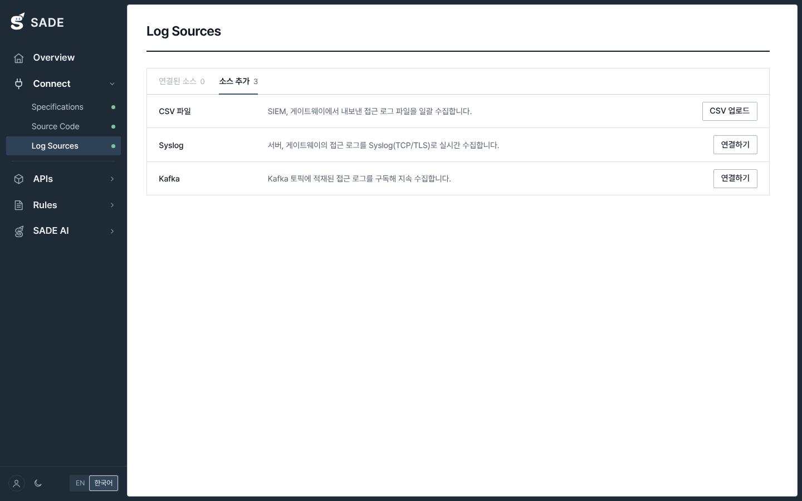
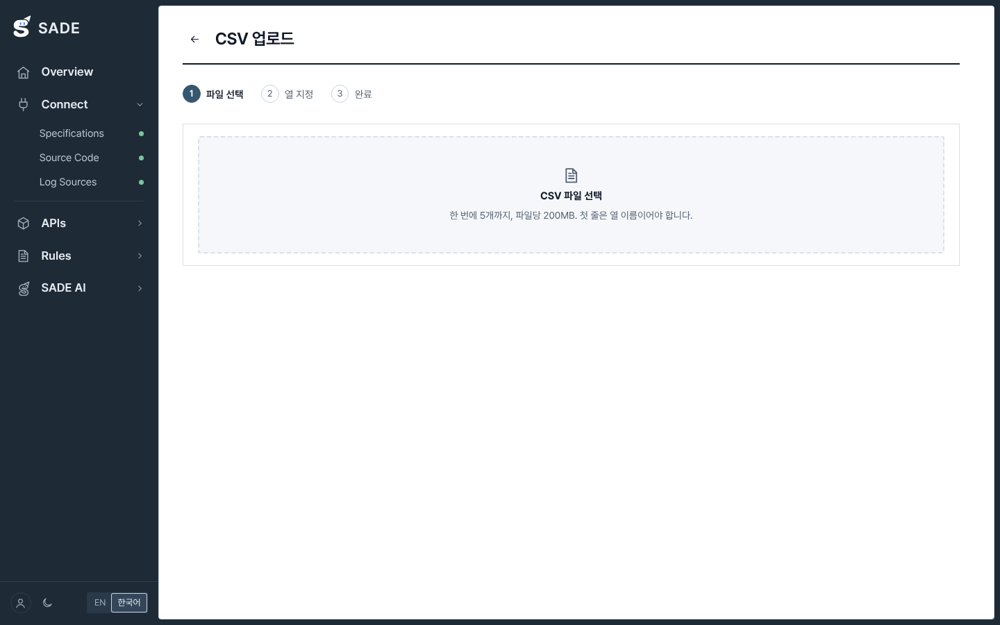
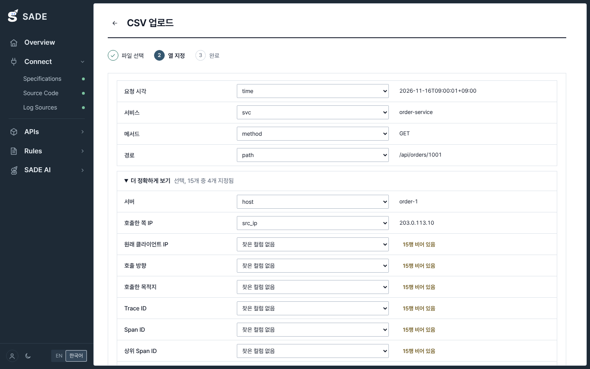
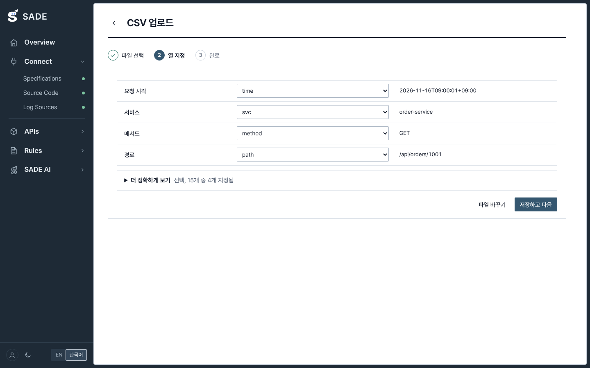
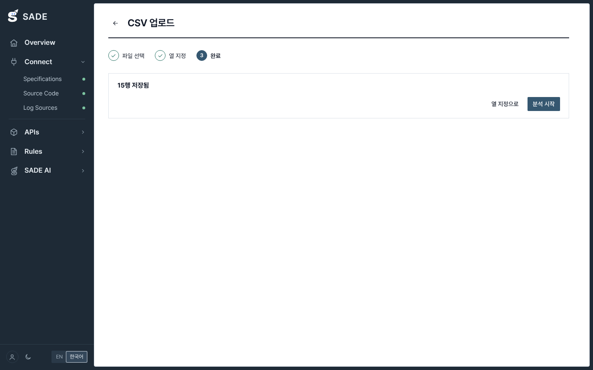

# CSV 업로드

SIEM, 게이트웨이, 서비스에서 기간을 정해 내보낸 CSV를 올립니다.

연동 승인 전에 기업 로그 형식을 확인할 때 씁니다. 처음이면 [샘플 로그로 첫 결과 보기](../getting-started/first-run.md)로 화면 흐름을 먼저 익힙니다.

<div class="sade-slides sade-walk" markdown>

<div class="sade-slide" markdown data-title="CSV 업로드 열기" data-spot="87.54,20.3,6.89,3.78" data-url="/#/logs">

<p class="sade-say">Connect > Log Sources의 소스 추가 탭에서 CSV 업로드를 누릅니다.</p>

[{ loading=lazy }](../../assets/screens/w-csv-1.png)

</div>

<div class="sade-slide" markdown data-title="파일 고르기" data-spot="54.03,30.21,6.18,2.4" data-url="/#/csv">

<p class="sade-say">CSV 파일 선택을 눌러 파일을 고릅니다. 5개까지 한 번에 고릅니다.</p>

[{ loading=lazy }](../../assets/screens/w-csv-2.png)

</div>

<div class="sade-slide" markdown data-title="필수 열 확인" data-spot="19.81,21.73,74.62,23.22" data-url="/#/csv">

<p class="sade-say">요청 시각, 서비스, 메서드, 경로 네 칸의 열과 오른쪽 샘플 값을 확인합니다.</p>

[{ loading=lazy }](../../assets/screens/w-csv-3.png)

</div>

<div class="sade-slide" markdown data-title="선택 열" data-spot="19.88,46.48,74.48,5.23" data-url="/#/csv">

<p class="sade-say">더 정확하게 보기를 펼쳐 IP, 목적지, 응답 코드, 본문 같은 선택 열을 고릅니다.</p>

[{ loading=lazy }](../../assets/screens/w-csv-4.png)

</div>

<div class="sade-slide" markdown data-title="저장" data-spot="87.19,53.71,7.24,3.78" data-url="/#/csv">

<p class="sade-say">저장하고 다음을 누릅니다.</p>

[{ loading=lazy }](../../assets/screens/w-csv-5.png)

</div>

<div class="sade-slide" markdown data-title="분석 시작" data-spot="88.93,26.19,5.5,3.78" data-url="/#/csv">

<p class="sade-say">저장된 행 수를 확인하고 분석 시작을 누릅니다.</p>

[{ loading=lazy }](../../assets/screens/w-csv-6.png)

</div>

<div class="sade-slide" markdown data-title="결과 보기" data-spot="86.35,91.31,8.08,3.78" data-url="/#/csv">

<p class="sade-say">찾은 API를 확인하고 Inventory 열기로 목록을 엽니다.</p>

[{ loading=lazy }](../../assets/screens/w-csv-7.png)

</div>

</div>

## 파일 조건

| 조건 | 내용 |
|---|---|
| 개수와 크기 | 한 번에 5개, 파일당 200 MB |
| 첫 줄 | 열 이름 |
| 문자 인코딩 | UTF-8 또는 CP949. 자동으로 판단합니다 |
| 구분자 | 쉼표, 탭, `;`, `|`. 자동으로 판단합니다 |
| 시간대 | 시각에 시간대가 없으면 `.env`의 `SADE_LOG_TIMEZONE`(기본 Asia/Seoul)으로 읽습니다 |
| 시각 형식 | ISO 8601(`2026-11-16T09:00:01+09:00`), `2026-11-16 09:00:01`, `2026/11/16 09:00:01`, 접근 로그 형식(`16/Nov/2026:09:00:01 +0900`), 초, 밀리초, 나노초 단위 숫자 |

SIEM에서 내보낼 때는 아래 열을 포함합니다. 열 이름은 기업에서 쓰는 이름 그대로 두어도 됩니다.

- 꼭 필요: 시각, 서비스(또는 호스트), 메서드, 경로
- 있으면 좋음: 응답 코드, 출발지 IP, `X-Forwarded-For`, 서버 이름, 요청과 응답 본문
- 서비스 사이 흐름까지 보려면: 방향(inbound, outbound), 목적지, trace ID

??? note "다른 팀에 요청할 것: 관제(SIEM) 담당"

    기간은 하루치로 시작하기를 권합니다.

    ```text
    [요청] API 접근 로그 CSV 내보내기

    - 용도: 사내 설치형 API 점검 도구(SADE)에서 실제로 호출된 API를 찾습니다.
    - 기간: <시작일 ~ 종료일> (하루치부터)
    - 대상: 게이트웨이 또는 서비스 접근 로그
    - 열: 시각(시간대 포함), 서비스 이름 또는 호스트, 메서드, 경로, 응답 코드, 출발지 IP, X-Forwarded-For
    - 가능하면 추가: 요청, 응답 본문 (도구가 저장 전에 값을 가리고 유형 이름만 남깁니다)
    - 형식: 첫 줄에 열 이름, UTF-8 또는 CP949, 파일당 200 MB 이하
    ```

## 1. 파일 선택

<div class="sade-steps" markdown>

1. Connect > Log Sources의 소스 추가 탭에서 CSV 파일 줄의 CSV 업로드를 누릅니다.

2. CSV 파일 선택을 눌러 파일을 고릅니다. 5개까지 한 번에 고릅니다.

3. 열 지정 화면 위에 파일을 읽은 인코딩과 구분자가 나옵니다. 글자가 깨졌으면 파일 인코딩을 확인합니다.

</div>

열 이름이 같은 파일들은 하나의 매핑을 같이 씁니다. 노드별로 나눠 내보낸 같은 형식의 파일은 한 번만 고르면 됩니다.

## 2. 열 지정 {#mapping}

SADE가 열 이름을 보고 열을 추천합니다. 왼쪽이 SADE 항목, 가운데가 고를 CSV 열, 오른쪽이 그 열의 첫 값입니다.

<div class="sade-steps" markdown>

1. 위쪽 네 칸(요청 시각, 서비스, 메서드, 경로)이 맞는지 봅니다. 이 네 칸이 있어야 API를 찾습니다.

2. 추천이 틀린 칸은 다른 열로 바꿉니다. 예: 서비스에 `svc`, 경로에 `path`

3. 더 정확하게 보기를 펼쳐 나머지 항목을 고릅니다. 고르지 않아도 저장할 수 있습니다.

4. 저장하고 다음을 누릅니다.

</div>

### 더 정확하게 보기의 항목

| 화면 이름 | 로그 필드 | 채우면 생기는 것 |
|---|---|---|
| 서버 | `host.name` | 서비스 이름이 없을 때 서버 이름으로 묶음 |
| 호출한 쪽 IP | `client.ip` | 접근 범위(Public, Internal) 판정 |
| 원래 클라이언트 IP | `network.forwarded_ip` | 게이트웨이 뒤 서비스 로그의 실제 출발지 (`X-Forwarded-For`) |
| 호출 방향, 호출한 목적지 | `network.direction`, `destination.address` | 서비스 사이 선, DB, 외부 목적지 |
| 목적지 포트 | `destination.port` | DB 호출을 포트로도 구분함 |
| Trace ID, Span ID, 상위 Span ID, 요청 ID | `trace.id`, `span.id`, `parent.id`, `http.request.id` | 같은 요청을 이어 서비스 사이 선을 찾음 |
| 로그 종류, 서비스 역할 | `event.category`, `service.type` | DB 로그(database)와 게이트웨이 로그(gateway)를 정확히 구분함 |
| 응답 코드 | `http.response.status_code` | 응답 코드별 호출 수, 404와 405만 있는 경로 거르기 |
| 요청 본문, 응답 본문 | `http.request.body.content`, `http.response.body.content` | 로그 근거의 민감 유형 |

- 고른 열에 값이 없는 행이 있으면 "n행 비어 있음"이 나옵니다.
- 필드별로 달라지는 결과는 [로그 필드](schema.md)에 있습니다.

### 열 하나로 채울 수 없을 때

| 방법 | 쓰는 항목 | 예 |
|---|---|---|
| 고정값 | 모든 항목 | 서비스 열이 없는 파일에 `order-service`를 넣음 |
| url.path 첫 구간 | 서비스 | `/order/api/items` → `order` |
| 날짜 + 시간 컬럼 | 요청 시각 | `date`와 `time` 열이 따로 있을 때 |
| 요청 줄에서 (GET /path HTTP/1.1) | 메서드, 경로 | `GET /api/items?page=2 HTTP/1.1` 한 열에서 메서드와 경로를 나눔 |

- 네 칸 중 비어 있는 칸이 있으면 저장하지 않고 그 칸을 파란색으로 표시합니다.
- 같은 열 이름이 다른 파일에도 있으면 같은 선택을 적용할지 묻습니다. 같은 뜻이면 이 파일들에도 적용을 고릅니다.

!!! note "요청 시각을 고르세요"
    요청 시각을 고르지 않으면 저장한 시각을 로그 시각으로 씁니다. 이때 같은 파일을 다시 올리면 같은 행을 다시 저장합니다.

## 3. 완료 {#apply}

저장이 끝나면 저장된 행 수가 나옵니다.

| 표시 | 뜻 | 할 일 |
|---|---|---|
| n행 저장됨 | ClickHouse에 저장한 행 | |
| 이미 저장된 n행은 건너뜀 | 같은 내용의 행이 이미 있음 | 다시 올린 파일이면 정상입니다 |
| 보관 기간 초과로 저장 제외 | 보관 기간(기본 30일)보다 오래된 행 | 시각 열과 시간대를 확인합니다 |
| 선택한 컬럼 값이 모두 비어 저장 제외 | 고른 열이 모두 빈 행 | 고른 열이 맞는지 확인합니다 |

<div class="sade-steps" markdown>

1. 분석 시작을 누릅니다. 로그 분석과 매핑이 이어서 돕니다.

2. 끝나면 API, 서비스, 데이터베이스, 외부 호스트 수와 호출이 많은 API 목록이 나옵니다.

3. Inventory 열기, Flows 열기로 결과 화면을 엽니다.

</div>

본문 값은 타입으로 바뀌어 저장됩니다. 예: `{"email":"<string>","phone":"<string>"}`

고른 열이 틀렸으면 분석 시작 전에 열 지정으로를 눌러 고친 뒤 다시 저장합니다.

## 다시 올릴 때

- 같은 파일을 다시 올리면 이미 저장된 행은 다시 저장하지 않습니다(요청 시각을 고른 경우).
- 기간을 이어 붙이려면 다음 기간 파일만 올리고 분석 시작을 다시 누릅니다.
- Log Sources의 연결된 소스 탭에서 CSV 파일 줄의 다시 업로드로 업로드 화면을 엽니다.

### 잘못 올린 파일 지우기

<div class="sade-steps" markdown>

1. CSV 업로드 화면 아래 최근 업로드에서 그 파일 줄의 데이터 삭제를 누릅니다. 그 업로드가 저장한 행을 ClickHouse에서 지웁니다.

2. 열을 고쳐 파일을 다시 올립니다.

</div>

- 다른 업로드도 같은 행을 보냈다면 그 행도 함께 지워집니다. 필요하면 그 파일을 다시 올립니다.
- CSV로 저장한 행을 모두 지우려면 연결된 소스 탭에서 저장된 로그 지우기를 누릅니다.
- 지운 뒤에는 되돌릴 수 없습니다. Inventory와 Flows는 다음 분석 뒤에 바뀝니다.

## 문제가 생기면

??? question "첫 줄은 열 이름이어야 한다는 오류"

    첫 줄에 머리글이 없습니다. 내보내기 설정에서 머리글을 켭니다.

??? question "저장된 행이 0이고 보관 기간 초과가 많음"

    시각 열이 다른 열과 바뀌었거나 날짜가 오래됐습니다.

??? question "분석 뒤 API가 없음"

    서비스, 메서드, 경로에 고른 열을 확인합니다.

??? question "호출 시각이 9시간 밀려 보임"

    시간대 없는 시각을 UTC로 찍는 서버입니다. 시간대가 붙은 형식(`Z`, `+09:00`)으로 내보내거나, `.env`의 `SADE_LOG_TIMEZONE`을 `UTC`로 바꿉니다.
