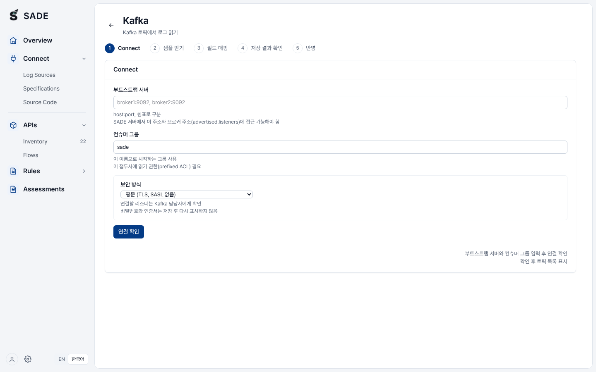
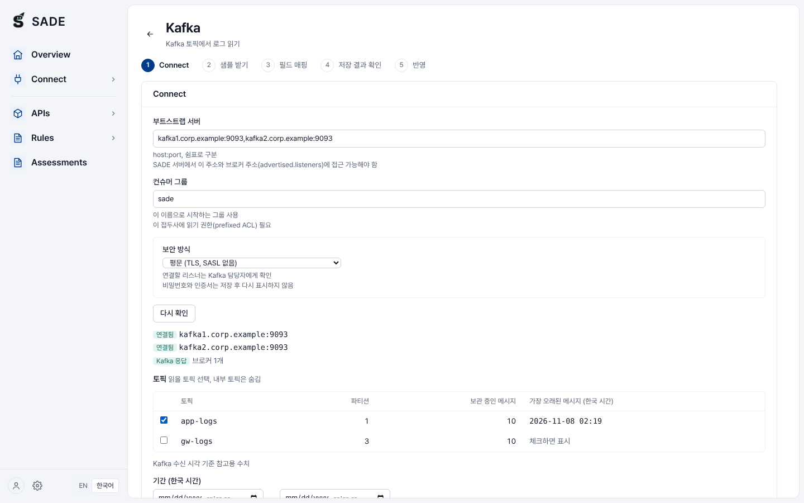
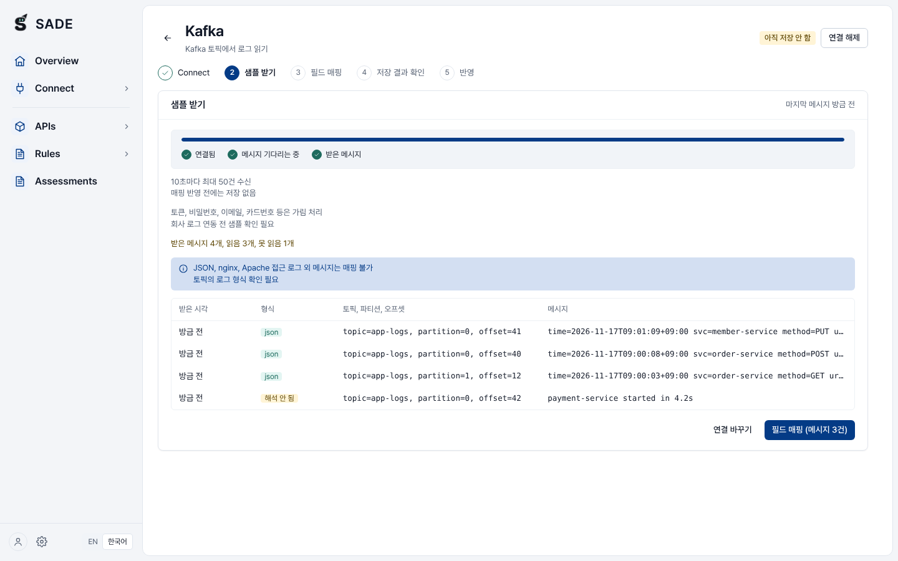
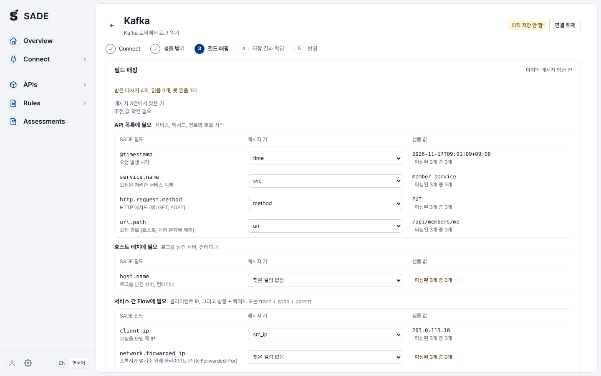
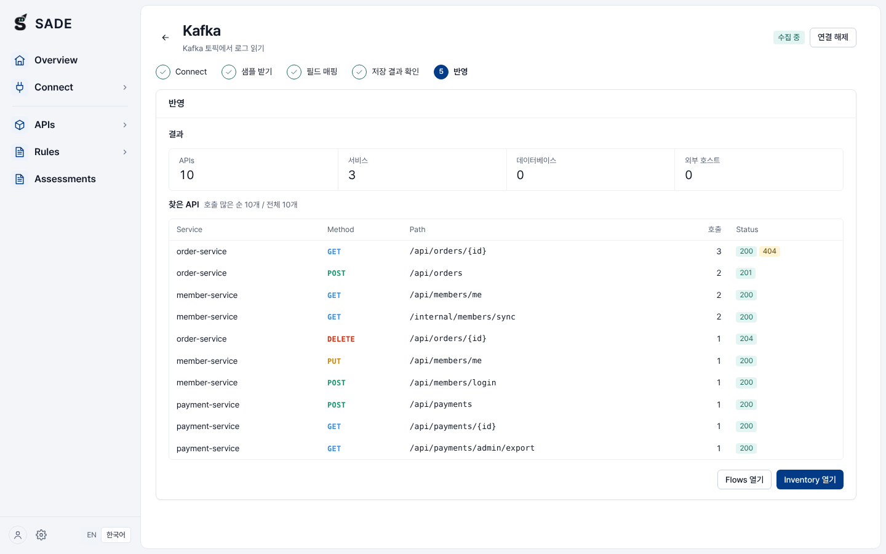

# Kafka 구독

로그가 Kafka 토픽에 모이는 기업이면 SADE가 토픽을 구독합니다.

SADE는 토픽을 읽기만 하고 쓰지 않습니다. 연결 뒤에는 새 메시지를 계속 저장합니다.

단계별 화면입니다. 좌우로 넘기거나 단계 이름을 눌러 봅니다.

<div class="sade-slides" markdown>

<div class="sade-slide" markdown data-title="Log Sources">

[{ loading=lazy }](../../assets/screens/kafka.png)

<small>Kafka 카드가 있는 연결 화면</small>

</div>

<div class="sade-slide" markdown data-title="Connect">

[{ loading=lazy }](../../assets/screens/kafka-connect.png)

<small>브로커 연결 확인 뒤 토픽 선택</small>

</div>

<div class="sade-slide" markdown data-title="샘플 받기">

[{ loading=lazy }](../../assets/screens/kafka-samples.png)

<small>토픽, 파티션, offset별 받은 메시지</small>

</div>

<div class="sade-slide" markdown data-title="필드 매핑">

[{ loading=lazy }](../../assets/screens/kafka-map.png)

<small>메시지 키를 SADE 필드에 맞춤</small>

</div>

<div class="sade-slide" markdown data-title="반영">

[{ loading=lazy }](../../assets/screens/kafka-apply.png)

<small>찾은 API와 서비스 수</small>

</div>

</div>

## 준비

Kafka 담당 팀에 아래를 요청합니다.

| 항목 | 내용 |
|---|---|
| 브로커 주소 | `host:port` 목록. SADE 서버에서 닿아야 합니다 |
| 리스너와 보안 방식 | SADE가 쓸 리스너와 보안 방식(아래 표) |
| 인증 정보 | SASL 계정 이름과 비밀번호, 또는 클라이언트 인증서와 키 |
| 사내 CA 인증서 | TLS를 쓰면 브로커 인증서를 발급한 CA |
| 권한 | 읽을 토픽의 읽기 권한. 컨슈머 그룹 이름으로 시작하는 모든 그룹의 읽기 권한(prefixed ACL) |

SADE는 컨슈머 그룹(기본 `sade`) 외에 `<그룹>-preview-…`(샘플용), `<그룹>-period-…`(기간 지정용) 그룹도 씁니다. 그래서 그룹 권한은 접두어로 받습니다.

| 항목 | 지원 | 미지원 |
|---|---|---|
| 보안 | 평문, TLS(사내 CA), mTLS, SASL PLAIN, SCRAM-SHA-256, SCRAM-SHA-512, SASL과 TLS 함께 | Kerberos(GSSAPI), OAUTHBEARER(AWS MSK IAM 등) |
| 메시지 | JSON, nginx와 Apache 접근 로그 한 줄, Filebeat, Fluent Bit, Logstash가 감싼 메시지(`message`, `log`) | Avro, Protobuf(Schema Registry) |

## 1. Connect

<div class="sade-steps" markdown>

1. Connect > Log Sources에서 Kafka 카드의 Connect를 누릅니다.

2. Bootstrap servers(부트스트랩 서버)에 브로커 주소를 쉼표로 이어 넣습니다. 예: `kafka1.corp.example:9093,kafka2.corp.example:9093`

3. Consumer group(컨슈머 그룹)을 정합니다. 기본은 `sade`입니다.

4. Security protocol(보안 방식)을 고르고 인증 정보를 넣습니다.

    - TLS: 사내 CA 인증서를 넣습니다.
    - mTLS: 클라이언트 인증서와 키를 함께 넣습니다. 키가 암호화돼 있으면 키 비밀번호도 넣습니다.
    - SASL: 방식(PLAIN, SCRAM-SHA-256, SCRAM-SHA-512), 계정 이름(SASL user name), 비밀번호를 넣습니다.

5. Check connection(연결 확인)을 누릅니다. 브로커마다 연결 결과가 나오고, 연결되면 토픽 목록이 나옵니다. 내부 토픽은 숨깁니다.

6. 읽을 토픽을 체크합니다. 파티션 수, 보관 중인 메시지 수, 가장 오래된 메시지 시각이 함께 나옵니다.

7. 필요하면 기간(Period start, Period end)을 정합니다.

8. 시간대를 고릅니다. 토픽마다 시간대가 다르면 토픽별로 정합니다.

9. 토픽 하나에 한 서비스의 로그만 있으면 Service name per topic(토픽별 서비스 이름)을 넣습니다. 메시지에 서비스 필드가 없을 때 씁니다.

10. Connect and receive samples(연결하고 샘플 받기)를 누릅니다.

</div>

!!! warning "SASL만 쓰는 연결"
    TLS 없이 SASL을 쓰면 비밀번호가 암호화되지 않고 갑니다. 기업이 믿는 내부망에서만 씁니다.

인증 정보는 SADE 서버로만 보내고, backend와 Vector만 읽는 `kafka-secrets` 볼륨에 둡니다. 저장한 뒤에는 화면에 다시 보여 주지 않습니다.

## 2. 샘플 받기

- 별도 미리보기 그룹으로 읽어서, 본 그룹의 읽은 위치(offset)는 바뀌지 않습니다.
- 10초마다 최대 50개씩 넘겨 받고, 최근 50개를 보여 줍니다. 이 단계에서는 저장하지 않습니다.
- 표에 토픽, 파티션, offset, 형식, 메시지 앞부분이 나옵니다.
- 형식을 읽지 못한 메시지가 섞여 있으면 그 토픽에 실리는 다른 형식의 샘플도 받아 봅니다. More samples로 더 받습니다.
- 화면에 오기 전에 Vector가 알려진 민감정보 형식(token, password 같은 키, 이메일, 카드번호, 전화번호, 주민등록번호 형식의 값)을 가립니다.

메시지가 오지 않으면 토픽에 메시지가 있는지, 브로커가 SADE 서버에서 닿는지 확인합니다.

## 3. 필드 매핑

Map fields(필드 매핑)를 누르면 받은 메시지의 키 목록(Keys in the received messages)에서 SADE 필드에 맞는 키를 고릅니다. 화면 구성은 [syslog](logs-syslog.md)와 같습니다.

- Filebeat, Fluent Bit, Logstash가 감싼 메시지는 안쪽 `message`, `log`를 자동으로 읽습니다(Read automatically from).
- 키 이름이 기업마다 다르면 고르기만 합니다. 예: `req.uri` → `url.path`, `src_ip` → `client.ip`
- 다 고르면 Apply and start storing(반영하고 저장 시작)을 누릅니다. 이때부터 본 그룹으로 읽고 저장합니다.

## 4. 저장 결과 확인

<div class="sade-steps" markdown>

1. 매핑을 적용한 뒤 저장된 줄 수가 나옵니다.

2. 저장 결과 확인(Check stored rows)을 눌러 저장된 줄을 열고, 값이 맞는 필드에 들어갔는지 봅니다.

3. 틀렸으면 매핑으로 돌아가기(Back to mapping), 맞으면 확인 완료를 누릅니다.

</div>

## 5. 반영

Apply to inventory and flows(Inventory와 Flows에 반영)를 누르면 로그 분석이 시작됩니다. 끝나면 찾은 API 목록이 나옵니다.

연결은 그 뒤에도 유지되고 새 메시지는 계속 저장됩니다. 새로 저장된 로그는 Log Sources에서 Analyze again을 눌러야 분석됩니다.

## 운영 중 상태

| 표시 | 뜻 |
|---|---|
| Received, stored, dropped | Vector가 매핑을 읽은 뒤 받은 메시지, 저장한 메시지, 버린 메시지 수 |
| Lag | 아직 읽지 않은 메시지 수 |
| Check needed(확인 필요) | 오래 저장하지 못했거나 Kafka가 수집 상태 확인에 답하지 않음 |
| Recent messages that were not stored | 저장하지 못한 최근 메시지와 이유 |

연결 설정을 바꾸면 매핑을 다시 적용할 때까지 저장을 멈춥니다.

??? info "기간을 정했을 때"

    - 기간은 저장 범위를 정합니다. 읽는 범위는 줄지 않습니다. Kafka에 남은 메시지를 처음부터 읽고, 기간 밖 메시지는 저장 전에 버립니다.
    - 큰 토픽은 첫 연결 때 읽는 양이 많습니다. Kafka 담당 팀과 시간을 맞춥니다.

??? question "브로커 이름을 찾지 못할 때"

    브로커 이름이 DNS에 없고 서버의 `/etc/hosts`에만 있으면 컨테이너가 찾지 못합니다. `.env`에 이름과 IP를 넣고 다시 시작합니다.

    ```bash
    SADE_EXTRA_HOSTS=kafka1.corp.example=10.0.0.5,kafka2.corp.example=10.0.0.6
    ```

    브로커가 돌려주는 주소(`advertised.listeners`)도 SADE 서버에서 닿아야 합니다. 처음 주소로는 연결되는데 토픽을 읽지 못하면 이 주소를 확인합니다.
