# Kafka 구독

로그가 Kafka 토픽에 모이는 기업이면 SADE가 토픽을 구독합니다.

SADE는 토픽을 읽기만 하고 쓰지 않습니다. 연결 뒤에는 새 메시지를 계속 저장합니다.

<div class="sade-slides sade-walk" markdown>

<div class="sade-slide" markdown data-title="Kafka 연결 열기" data-spot="88.95,33.74,5.48,3.78" data-url="/#/logs">

<p class="sade-say">Connect > Log Sources의 소스 추가 탭에서 Kafka 줄의 연결하기를 누릅니다.</p>

[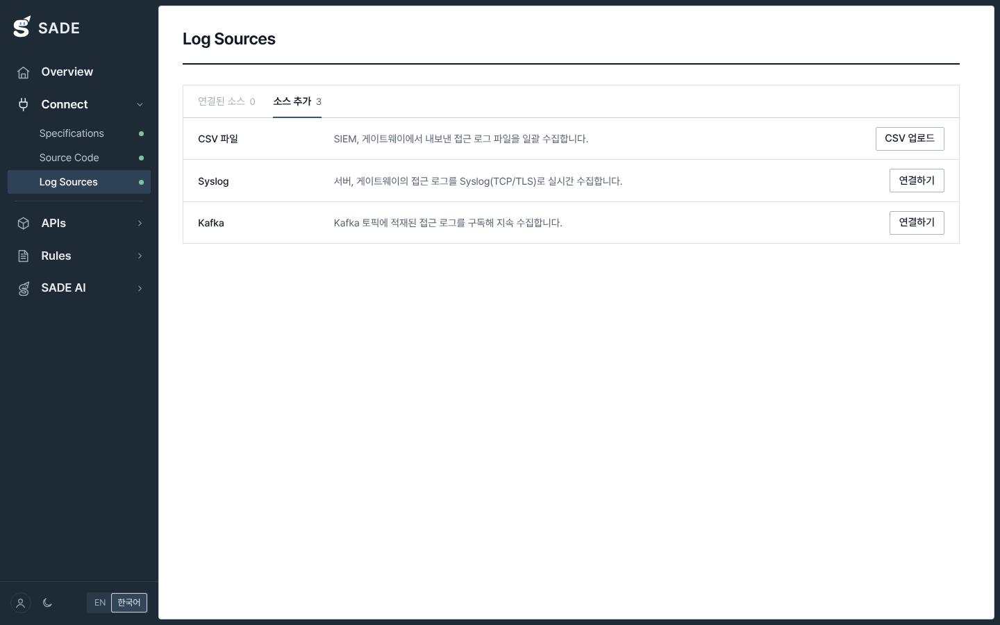{ loading=lazy }](../../assets/screens/w-kafka-1.png)

</div>

<div class="sade-slide" markdown data-title="브로커 주소" data-spot="19.81,31.28,74.62,3.78" data-url="/#/kafka">

<p class="sade-say">부트스트랩 서버에 브로커 주소를 쉼표로 이어 넣습니다. 보안 방식과 인증 정보도 넣습니다.</p>

[{ loading=lazy }](../../assets/screens/w-kafka-2.png)

</div>

<div class="sade-slide" markdown data-title="연결 확인" data-spot="19.81,68.43,5.5,3.78" data-url="/#/kafka">

<p class="sade-say">연결 확인을 누릅니다.</p>

[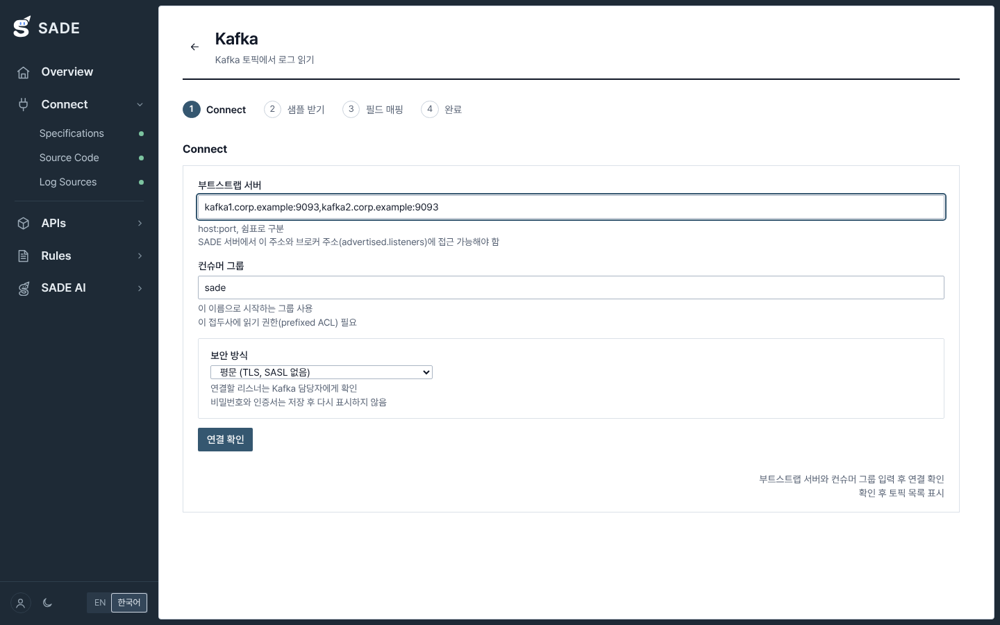{ loading=lazy }](../../assets/screens/w-kafka-3.png)

</div>

<div class="sade-slide" markdown data-title="토픽 고르기" data-spot="19.88,91.33,74.48,4.28" data-url="/#/kafka">

<p class="sade-say">브로커가 연결되면 토픽 목록이 나옵니다. 읽을 토픽을 체크합니다.</p>

[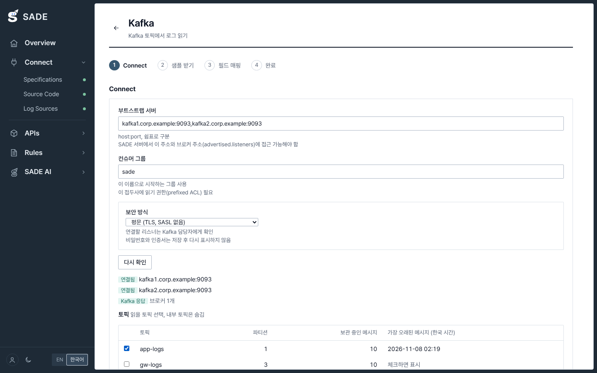{ loading=lazy }](../../assets/screens/w-kafka-4.png)

</div>

<div class="sade-slide" markdown data-title="샘플 받기" data-spot="85.2,89.86,9.23,3.78" data-url="/#/kafka">

<p class="sade-say">연결하고 샘플 받기를 누릅니다.</p>

[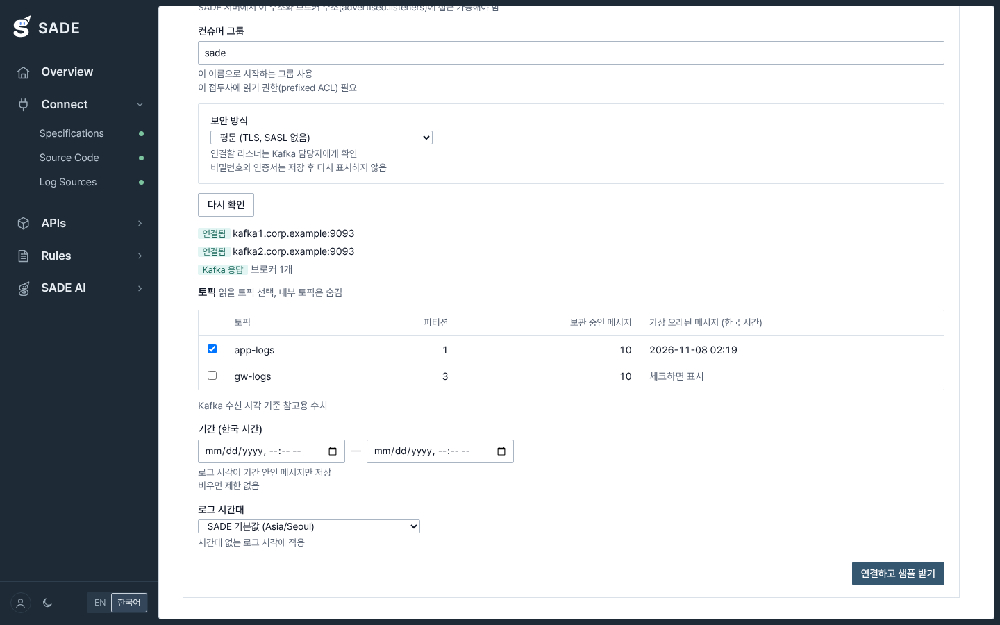{ loading=lazy }](../../assets/screens/w-kafka-5.png)

</div>

<div class="sade-slide" markdown data-title="샘플 확인" data-spot="83.61,75.95,10.82,3.78" data-url="/#/kafka">

<p class="sade-say">받은 메시지를 확인하고 필드 매핑을 누릅니다.</p>

[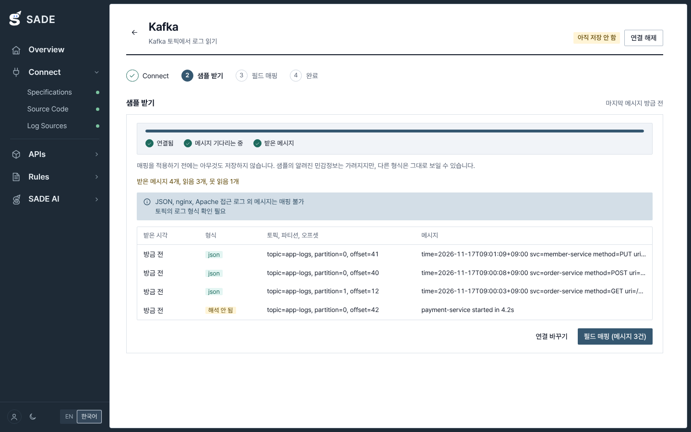{ loading=lazy }](../../assets/screens/w-kafka-6.png)

</div>

<div class="sade-slide" markdown data-title="매핑 확인" data-spot="19.81,38.07,74.62,23.22" data-url="/#/kafka">

<p class="sade-say">요청 시각, 서비스, 메서드, 경로 네 칸에 추천된 키와 값을 확인합니다. 틀린 칸은 다른 키로 바꿉니다.</p>

[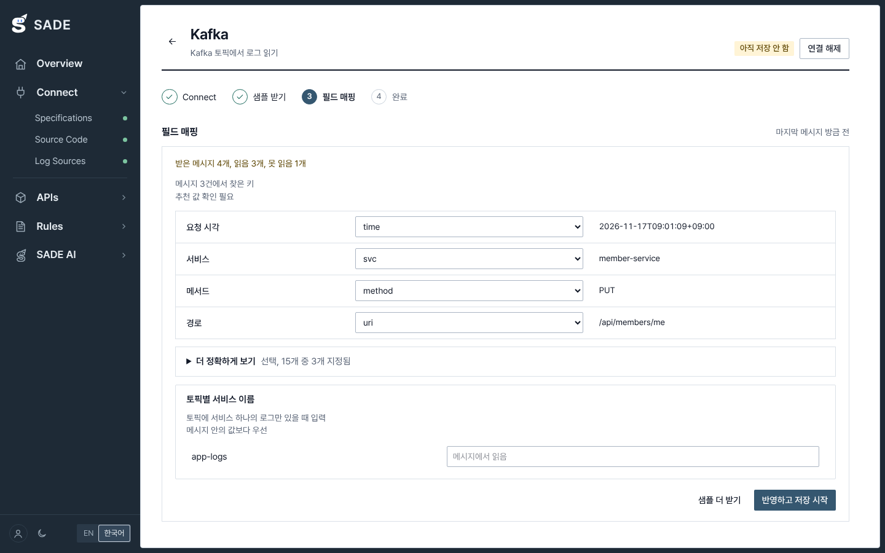{ loading=lazy }](../../assets/screens/w-kafka-7.png)

</div>

<div class="sade-slide" markdown data-title="저장 시작" data-spot="85.2,88.53,9.23,3.78" data-url="/#/kafka">

<p class="sade-say">반영하고 저장 시작을 누릅니다.</p>

[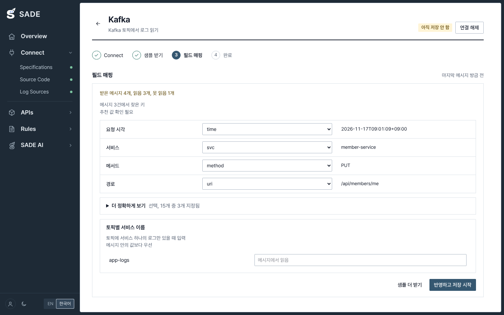{ loading=lazy }](../../assets/screens/w-kafka-8.png)

</div>

<div class="sade-slide" markdown data-title="저장 결과 확인" data-spot="67.92,41.7,7.62,3.78" data-url="/#/kafka">

<p class="sade-say">저장된 행 수가 나오면 저장 결과 확인을 눌러 저장된 행을 봅니다.</p>

[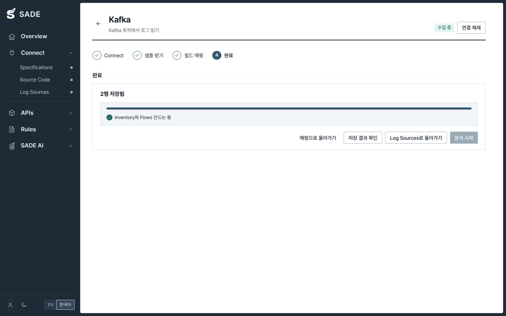{ loading=lazy }](../../assets/screens/w-kafka-9.png)

</div>

<div class="sade-slide" markdown data-title="저장된 줄 확인" data-spot="74.21,87.19,5.5,3.78" data-url="/#/kafka">

<p class="sade-say">값이 맞는 필드에 들어갔으면 확인 완료를 누릅니다.</p>

[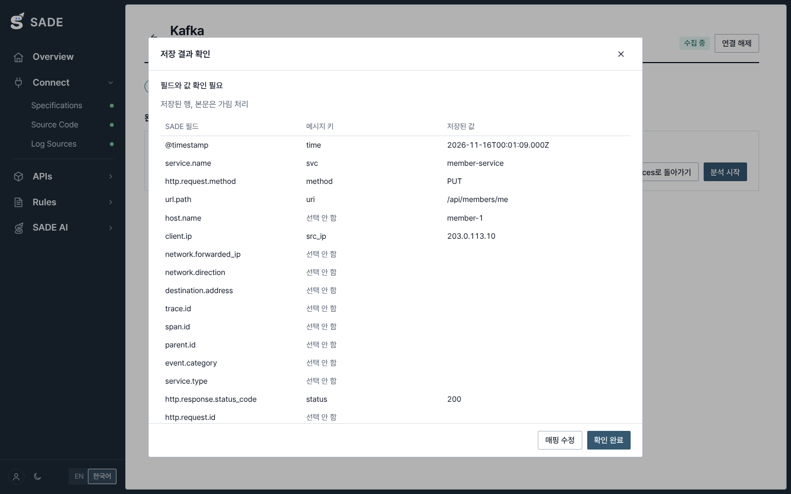{ loading=lazy }](../../assets/screens/w-kafka-10.png)

</div>

<div class="sade-slide" markdown data-title="분석 시작" data-spot="88.93,32.93,5.5,3.78" data-url="/#/kafka">

<p class="sade-say">분석 시작을 누릅니다.</p>

[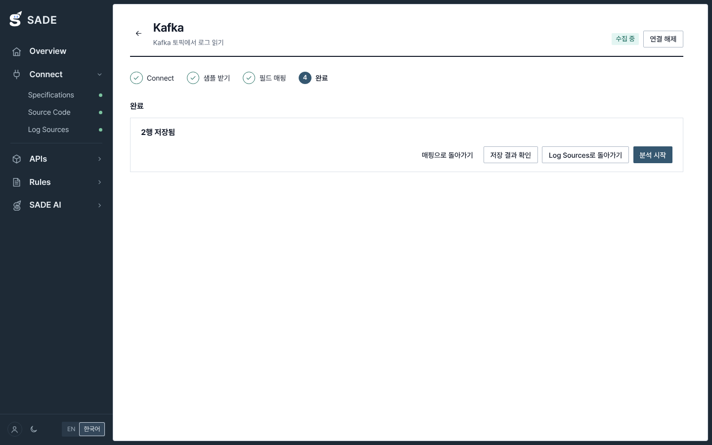{ loading=lazy }](../../assets/screens/w-kafka-11.png)

</div>

<div class="sade-slide" markdown data-title="결과 보기" data-spot="86.35,95.27,8.08,3.78" data-url="/#/kafka">

<p class="sade-say">찾은 API를 확인하고 Inventory 열기로 목록을 엽니다.</p>

[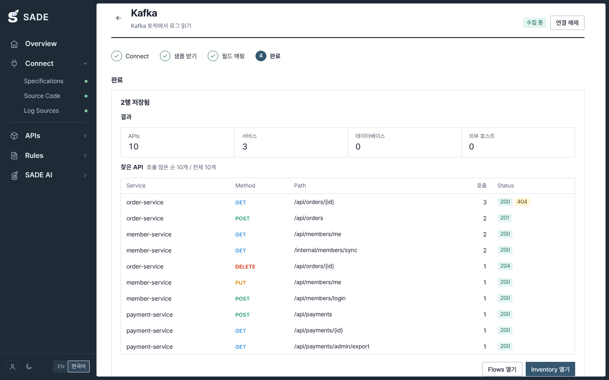{ loading=lazy }](../../assets/screens/w-kafka-12.png)

</div>

</div>

## 준비

Kafka 담당 팀에 아래를 요청합니다.

| 항목 | 내용 |
|---|---|
| 브로커 주소 | `host:port` 목록. SADE 서버에서 닿아야 합니다 |
| 리스너와 보안 방식 | SADE가 쓸 리스너와 보안 방식(아래 표) |
| 인증 정보 | SASL 계정 이름과 비밀번호, 또는 클라이언트 인증서와 키 |
| 사내 CA 인증서 | TLS를 쓰면 브로커 인증서를 발급한 CA |
| 권한 | 읽을 토픽의 읽기 권한. 컨슈머 그룹 이름으로 시작하는 모든 그룹의 읽기 권한(prefixed ACL) |

SADE는 컨슈머 그룹(기본 `sade`) 외에 `<그룹>-preview-…`(샘플용), `<그룹>-period-…`(기간 지정용) 그룹도 씁니다. 그래서 그룹 권한은 접두어로 받습니다.

| 항목 | 지원 | 미지원 |
|---|---|---|
| 보안 | 평문, TLS(사내 CA), mTLS, SASL PLAIN, SCRAM-SHA-256, SCRAM-SHA-512, SASL과 TLS 함께 | Kerberos(GSSAPI), OAUTHBEARER(AWS MSK IAM 등) |
| 메시지 | JSON, nginx와 Apache 접근 로그 한 줄, Filebeat, Fluent Bit, Logstash가 감싼 메시지(`message`, `log`) | Avro, Protobuf(Schema Registry) |

??? note "다른 팀에 요청할 것: Kafka 담당"

    토픽 이름을 채워 보냅니다.

    ```text
    [요청] 로그 토픽 읽기 계정 발급

    - 용도: 사내 설치형 API 점검 도구(SADE)가 접근 로그 토픽을 읽기만 합니다. 쓰지 않습니다.
    - 토픽: <토픽 이름>
    - 컨슈머 그룹: sade (sade로 시작하는 그룹 전체에 읽기 권한, prefixed ACL)
    - 필요한 것
      - 브로커 주소 (host:port)와 SADE가 쓸 리스너
      - 보안 방식: TLS, mTLS, SASL PLAIN, SCRAM-SHA-256, SCRAM-SHA-512 중 하나
      - 계정 또는 클라이언트 인증서, TLS면 사내 CA 인증서
    - 네트워크: SADE 서버 → 브로커 주소와 advertised.listeners 주소 연결 허용
    - 메시지 형식: JSON, nginx, Apache 접근 로그, 또는 Filebeat, Fluent Bit, Logstash가 감싼 메시지
    ```

## 1. Connect

<div class="sade-steps" markdown>

1. Connect > Log Sources의 소스 추가 탭에서 Kafka 줄의 연결하기를 누릅니다.

2. 부트스트랩 서버에 브로커 주소를 쉼표로 이어 넣습니다. 예: `kafka1.corp.example:9093,kafka2.corp.example:9093`

3. 컨슈머 그룹을 정합니다. 기본은 `sade`입니다.

4. 보안 방식을 고르고 인증 정보를 넣습니다.

    | 보안 방식 | 넣을 것 |
    |---|---|
    | 평문 (TLS, SASL 없음) | 없음 |
    | TLS | CA 인증서 (PEM). mTLS면 클라이언트 인증서와 키, 키가 암호화돼 있으면 클라이언트 키 비밀번호 |
    | SASL (TLS 없음) | SASL 방식(PLAIN, SCRAM-SHA-256, SCRAM-SHA-512), SASL 사용자 이름, SASL 비밀번호 |
    | SASL + TLS | 위 SASL 정보와 CA 인증서 |

5. 연결 확인을 누릅니다. 브로커마다 연결 결과가 나오고, 연결되면 토픽 목록이 나옵니다. 내부 토픽은 숨깁니다.

6. 읽을 토픽을 체크합니다. 파티션 수, 보관 중인 메시지 수가 나오고, 체크하면 가장 오래된 메시지 시각도 나옵니다.

7. 필요하면 기간 (한국 시간)을 정합니다. 비우면 제한 없이 저장합니다.

8. 로그 시간대를 고릅니다. 토픽마다 시간대가 다르면 일부 토픽은 다른 시간대로 읽기에서 토픽별로 정합니다.

9. 맨 아래 연결하고 샘플 받기를 누릅니다.

</div>

!!! warning "SASL (TLS 없음)"
    TLS 없이 SASL을 쓰면 비밀번호가 암호화되지 않고 갑니다. 기업이 믿는 내부망에서만 씁니다.

인증 정보는 SADE 서버로만 보내고, backend와 Vector만 읽는 `kafka-secrets` 볼륨에 둡니다. 저장한 뒤에는 화면에 다시 보여 주지 않습니다.

## 2. 샘플 받기

- 별도 미리보기 그룹으로 읽어서, 본 그룹의 읽은 위치(offset)는 바뀌지 않습니다.
- 10초마다 최대 50개씩 넘겨 받고, 최근 50개를 보여 줍니다. 이 단계에서는 저장하지 않습니다.
- 표에 받은 시각, 형식, 토픽과 파티션, offset, 메시지 앞부분이 나옵니다.
- 형식을 읽지 못한 메시지가 섞여 있으면 그 토픽에 실리는 다른 형식의 샘플도 받아 봅니다.
- 화면에 오기 전에 Vector가 알려진 민감정보 형식(token, password 같은 키, 이메일, 카드번호, 전화번호, 주민등록번호 형식의 값)을 가립니다.
- 메시지를 확인했으면 필드 매핑(메시지 n건)을 누릅니다.

메시지가 오지 않으면 토픽에 메시지가 있는지, 브로커가 SADE 서버에서 닿는지 확인합니다.

## 3. 필드 매핑

받은 메시지의 키 목록에서 SADE 항목에 맞는 키를 고릅니다. 화면 구성은 [CSV 열 지정](logs-csv.md#mapping)과 같습니다.

- Filebeat, Fluent Bit, Logstash가 감싼 메시지는 안쪽 `message`, `log`를 자동으로 읽습니다.
- 키 이름이 기업마다 다르면 고르기만 합니다. 예: `req.uri` → 경로, `src_ip` → 호출한 쪽 IP
- 토픽 하나에 한 서비스의 로그만 있으면 아래 토픽별 서비스 이름에 넣습니다. 메시지의 서비스 키보다 먼저 씁니다. 비우면 고른 키, 그것도 없으면 토픽 이름을 씁니다.
- 네 칸(요청 시각, 서비스, 메서드, 경로) 중 빈 칸이 있으면 저장하지 않고 그 칸을 표시합니다.
- 다 고르면 반영하고 저장 시작을 누릅니다. 이때부터 본 그룹으로 읽고 저장합니다.

## 4. 완료

<div class="sade-steps" markdown>

1. 매핑을 적용한 뒤 "n행 저장됨"이 나옵니다.

2. 저장 결과 확인을 눌러 저장된 행을 열고, 값이 맞는 필드에 들어갔는지 봅니다. 맞으면 확인 완료, 틀렸으면 매핑 수정을 누릅니다.

3. 분석 시작을 누릅니다. 끝나면 찾은 API 목록이 나옵니다.

</div>

연결은 그 뒤에도 유지되고 새 메시지는 계속 저장됩니다. 새로 저장된 로그는 Log Sources 위쪽 로그 분석에서 다시 분석을 눌러야 분석됩니다.

## 운영 중 상태

| 표시 | 뜻 |
|---|---|
| 받음, 저장, 버림 | Vector가 매핑을 읽은 뒤 받은 메시지, 저장한 메시지, 버린 메시지 수 |
| 밀린 메시지 n개 | 아직 읽지 않은 메시지 수 (연결된 소스 탭) |
| 확인 필요 | 오래 저장하지 못했거나 Kafka가 수집 상태 확인에 답하지 않음 |
| 최근에 저장하지 않은 메시지 | 저장하지 못한 최근 메시지와 이유, 해야 할 일 |

- 연결된 소스 탭의 매핑 수정으로 연결 화면을 다시 엽니다. 연결 설정을 바꾸면 매핑을 다시 적용할 때까지 저장을 멈춥니다.
- 연결 해제는 토픽 읽기를 멈춥니다. 이미 저장한 행과 저장한 매핑은 남습니다.

??? info "기간을 정했을 때"

    - 기간은 저장 범위를 정합니다. 읽는 범위는 줄지 않습니다. Kafka에 남은 메시지를 처음부터 읽고, 기간 밖 메시지는 저장 전에 버립니다.
    - 큰 토픽은 첫 연결 때 읽는 양이 많습니다. Kafka 담당 팀과 시간을 맞춥니다.

??? question "브로커 이름을 찾지 못할 때"

    브로커 이름이 DNS에 없고 서버의 `/etc/hosts`에만 있으면 컨테이너가 찾지 못합니다. `.env`에 이름과 IP를 넣고 다시 시작합니다.

    ```bash
    SADE_EXTRA_HOSTS=kafka1.corp.example=10.0.0.5,kafka2.corp.example=10.0.0.6
    ```

    브로커가 돌려주는 주소(`advertised.listeners`)도 SADE 서버에서 닿아야 합니다. 처음 주소로는 연결되는데 토픽을 읽지 못하면 이 주소를 확인합니다.
