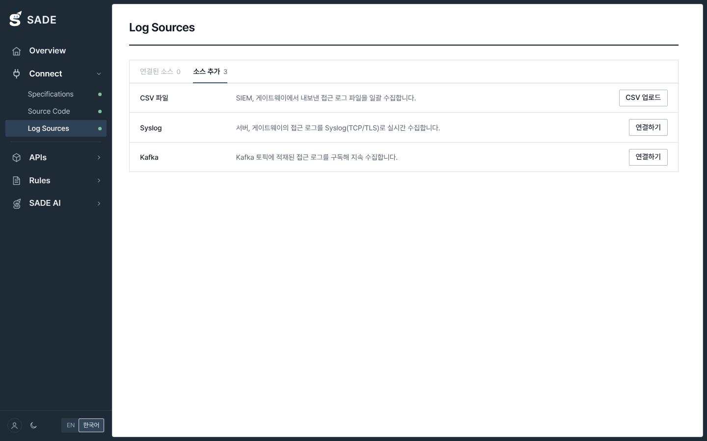
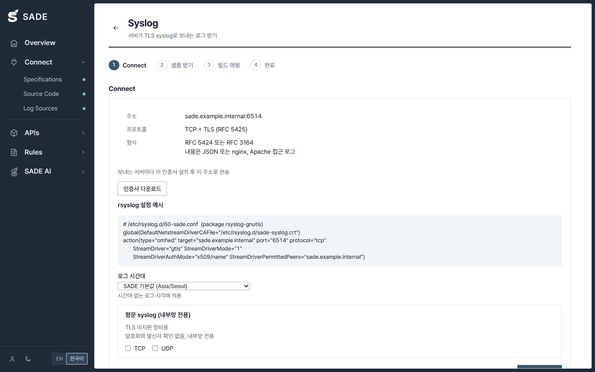
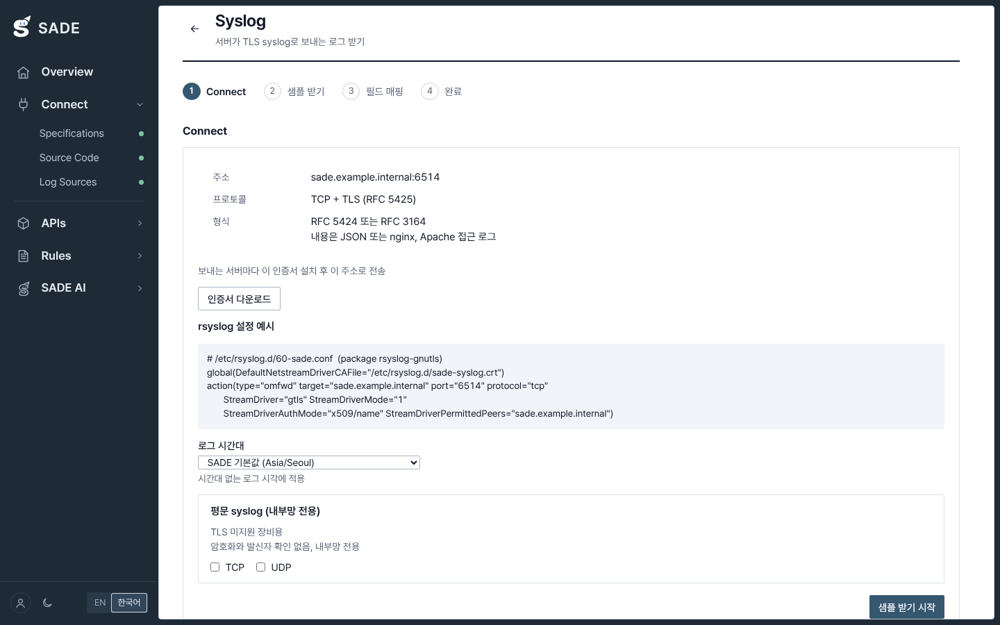
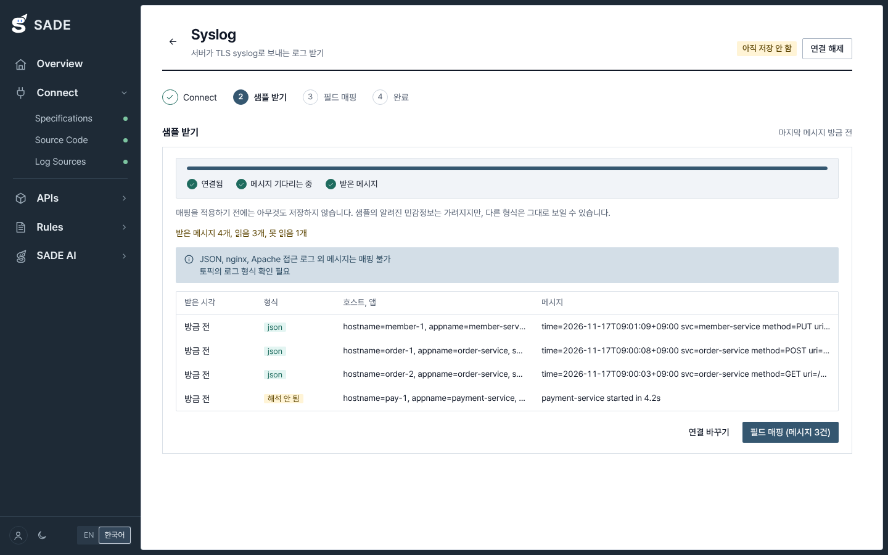
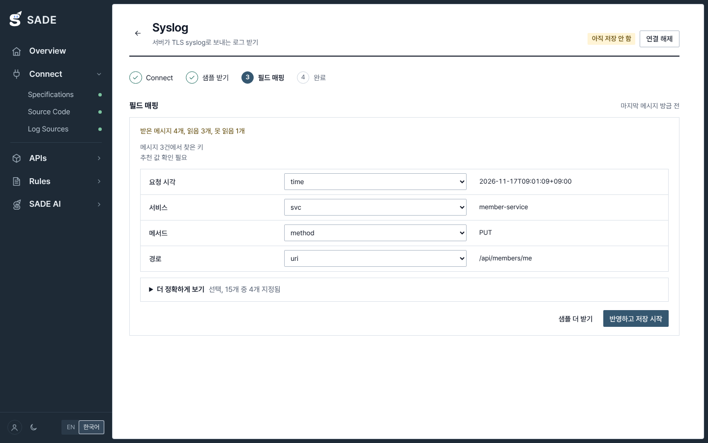
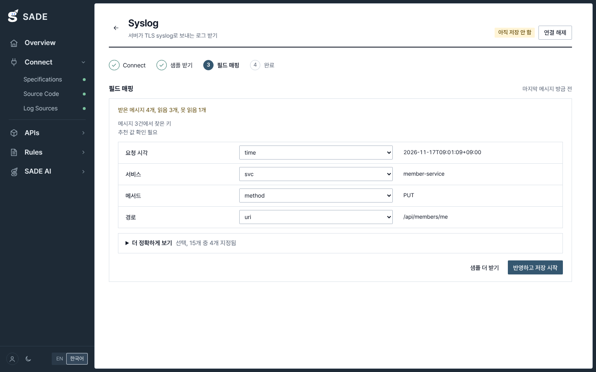
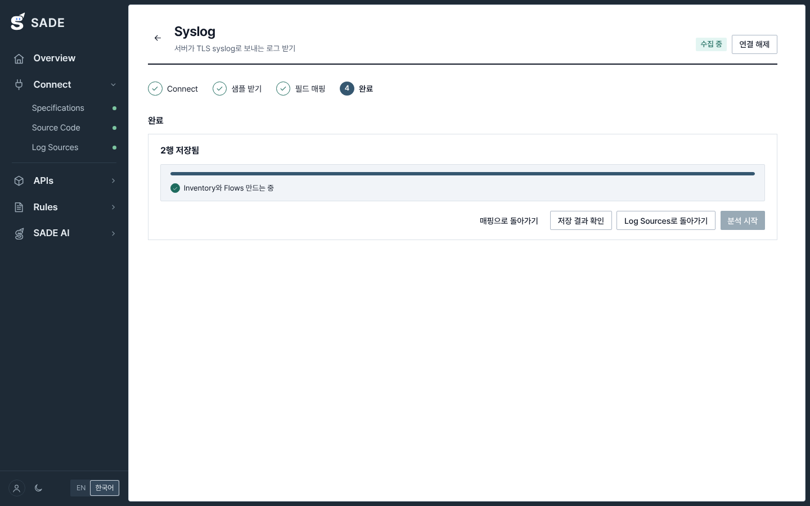
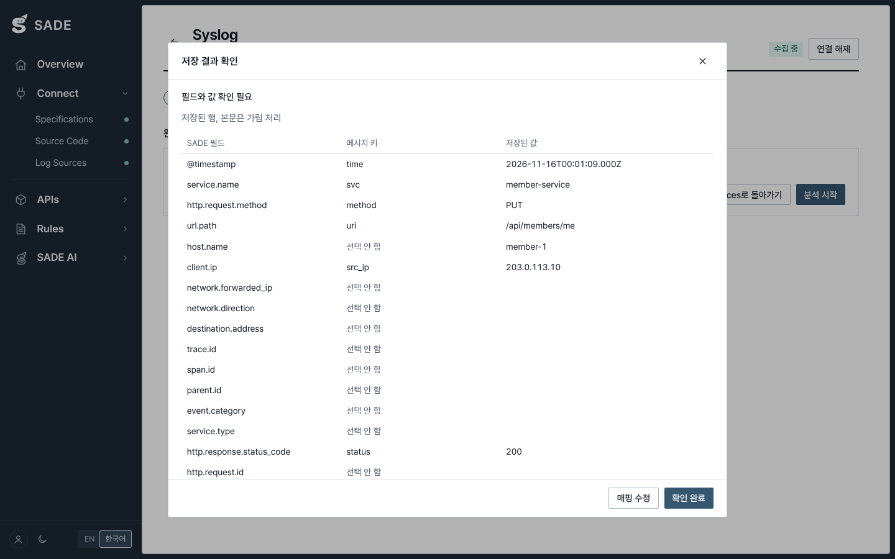
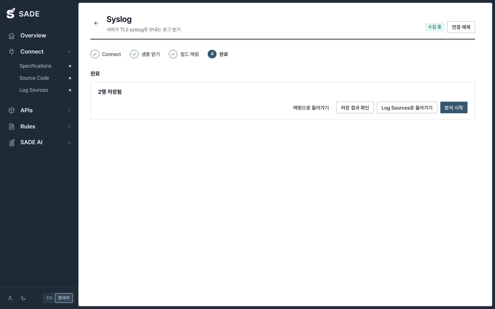
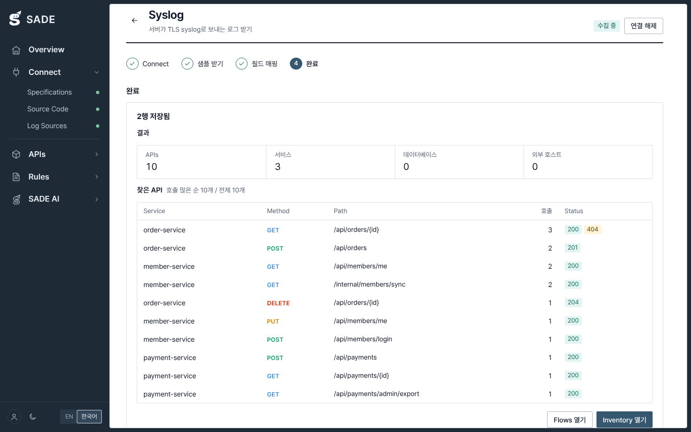

# syslog 수신

기업 서버나 게이트웨이가 rsyslog로 SADE에 로그를 보냅니다.

SADE는 TCP 6514에서 TLS syslog를 받습니다. 연결 뒤에는 보내는 대로 계속 저장합니다.

<div class="sade-slides sade-walk" markdown>

<div class="sade-slide" markdown data-title="syslog 연결 열기" data-spot="88.95,27.02,5.48,3.78" data-url="/#/logs">

<p class="sade-say">Connect > Log Sources의 소스 추가 탭에서 Syslog 줄의 연결하기를 누릅니다.</p>

[{ loading=lazy }](../../assets/screens/w-syslog-1.png)

</div>

<div class="sade-slide" markdown data-title="인증서 받기" data-spot="19.81,48.81,8.25,3.78" data-url="/#/syslog">

<p class="sade-say">인증서 다운로드로 인증서를 받아 보내는 서버마다 넣습니다.</p>

[{ loading=lazy }](../../assets/screens/w-syslog-2.png)

</div>

<div class="sade-slide" markdown data-title="rsyslog 설정" data-spot="19.81,57.84,74.62,13.7" data-url="/#/syslog">

<p class="sade-say">rsyslog 설정 예시를 보내는 서버의 /etc/rsyslog.d/60-sade.conf로 저장합니다.</p>

[{ loading=lazy }](../../assets/screens/w-syslog-3.png)

</div>

<div class="sade-slide" markdown data-title="샘플 받기 시작" data-spot="86.94,95.25,7.48,3.78" data-url="/#/syslog">

<p class="sade-say">보내는 서버에서 rsyslog를 다시 시작한 뒤 아래 샘플 받기 시작을 누릅니다.</p>

[{ loading=lazy }](../../assets/screens/w-syslog-4.png)

</div>

<div class="sade-slide" markdown data-title="샘플 확인" data-spot="83.61,75.95,10.82,3.78" data-url="/#/syslog">

<p class="sade-say">받은 메시지와 형식을 확인하고 필드 매핑을 누릅니다.</p>

[{ loading=lazy }](../../assets/screens/w-syslog-5.png)

</div>

<div class="sade-slide" markdown data-title="매핑 확인" data-spot="19.81,38.07,74.62,23.22" data-url="/#/syslog">

<p class="sade-say">요청 시각, 서비스, 메서드, 경로 네 칸에 추천된 키와 값을 확인합니다. 틀린 칸은 다른 키로 바꿉니다.</p>

[{ loading=lazy }](../../assets/screens/w-syslog-6.png)

</div>

<div class="sade-slide" markdown data-title="저장 시작" data-spot="85.2,70.05,9.23,3.78" data-url="/#/syslog">

<p class="sade-say">반영하고 저장 시작을 누릅니다.</p>

[{ loading=lazy }](../../assets/screens/w-syslog-7.png)

</div>

<div class="sade-slide" markdown data-title="저장 결과 확인" data-spot="67.92,41.7,7.62,3.78" data-url="/#/syslog">

<p class="sade-say">저장된 행 수가 나오면 저장 결과 확인을 눌러 저장된 행을 봅니다.</p>

[{ loading=lazy }](../../assets/screens/w-syslog-8.png)

</div>

<div class="sade-slide" markdown data-title="저장된 줄 확인" data-spot="74.21,87.19,5.5,3.78" data-url="/#/syslog">

<p class="sade-say">값이 맞는 필드에 들어갔으면 확인 완료를 누릅니다.</p>

[{ loading=lazy }](../../assets/screens/w-syslog-9.png)

</div>

<div class="sade-slide" markdown data-title="분석 시작" data-spot="88.93,32.93,5.5,3.78" data-url="/#/syslog">

<p class="sade-say">분석 시작을 누릅니다.</p>

[{ loading=lazy }](../../assets/screens/w-syslog-10.png)

</div>

<div class="sade-slide" markdown data-title="결과 보기" data-spot="86.35,95.27,8.08,3.78" data-url="/#/syslog">

<p class="sade-say">찾은 API를 확인하고 Inventory 열기로 목록을 엽니다.</p>

[{ loading=lazy }](../../assets/screens/w-syslog-11.png)

</div>

</div>

## 준비

| 항목 | 내용 |
|---|---|
| SADE 서버 | `.env`의 `SADE_SYSLOG_HOST`에 보내는 서버가 부를 이 서버의 이름이나 IP를 넣고 시작합니다. 이 이름으로 인증서를 만듭니다 |
| 보내는 서버 | rsyslog와 TLS 모듈(`rsyslog-gnutls` 패키지) |
| 방화벽 | 보내는 서버 → SADE 서버 TCP 6514 허용 |
| 형식 | RFC 5424, RFC 3164. 메시지 본문은 JSON 한 줄, 또는 nginx, Apache 접근 로그(combined, common, 뒤에 필드를 덧붙인 형식 포함) |

!!! warning "보내는 서버 IP만 허용하기"
    syslog는 보내는 쪽을 인증하지 않습니다.

    6514에 닿는 누구나 로그를 넣어 Inventory와 Flows를 바꿀 수 있습니다. 방화벽에서 보내는 서버 IP만 허용하세요. Docker가 연 포트는 호스트의 ufw 규칙을 거치지 않으므로 `DOCKER-USER` 체인이나 앞단 방화벽에서 막습니다.

    ```bash
    sudo iptables -I DOCKER-USER -i eth0 -p tcp --dport 6514 ! -s 10.0.1.0/24 -j DROP
    ```

??? note "다른 팀에 요청할 것: 서버, 네트워크 담당"

    설치 서버 이름과 보내는 서버 목록을 채워 보냅니다.

    ```text
    [요청] 접근 로그 syslog(TLS) 전송 설정

    - 용도: 사내 설치형 API 점검 도구(SADE)로 게이트웨이, 서버 접근 로그를 보냅니다.
    - 보내는 서버: <서버 목록>
    - 받는 곳: <SADE 서버 이름>:6514, TCP, TLS (RFC 5425)
    - 보내는 서버 작업
      1. rsyslog-gnutls 패키지 설치
      2. 첨부한 인증서를 /etc/rsyslog.d/sade-syslog.crt로 저장
      3. 첨부한 설정을 /etc/rsyslog.d/60-sade.conf로 저장 후 rsyslog 재시작
    - 방화벽: 보내는 서버 → SADE 서버 TCP 6514 허용. SADE 서버의 6514는 위 서버 IP만 허용
    - 메시지 형식: JSON 한 줄, 또는 nginx, Apache 접근 로그 형식
    ```

## 1. Connect

<div class="sade-steps" markdown>

1. Connect > Log Sources의 소스 추가 탭에서 Syslog 줄의 연결하기를 누릅니다.

2. 화면에 주소(`SADE_SYSLOG_HOST:6514`), 프로토콜(TCP + TLS, RFC 5425), 형식이 나옵니다.

3. 인증서 다운로드로 인증서를 받아 보내는 서버마다 `/etc/rsyslog.d/sade-syslog.crt`로 둡니다.

4. rsyslog 설정 예시를 보내는 서버의 `/etc/rsyslog.d/60-sade.conf`로 저장합니다. 주소는 화면에 나온 값으로 채워져 있습니다.

    ```text
    # /etc/rsyslog.d/60-sade.conf  (package rsyslog-gnutls)
    global(DefaultNetstreamDriverCAFile="/etc/rsyslog.d/sade-syslog.crt")
    action(type="omfwd" target="sade.example.internal" port="6514" protocol="tcp"
           StreamDriver="gtls" StreamDriverMode="1"
           StreamDriverAuthMode="x509/name" StreamDriverPermittedPeers="sade.example.internal")
    ```

5. 보내는 서버에서 rsyslog를 다시 시작합니다.

    ```bash
    sudo systemctl restart rsyslog
    ```

6. 로그 시각에 시간대가 없으면 로그 시간대를 고릅니다. 기본은 `SADE_LOG_TIMEZONE`(기본 Asia/Seoul)입니다.

7. 맨 아래 샘플 받기 시작을 누릅니다.

</div>

`StreamDriverAuthMode="x509/name"`은 인증서 이름이 `StreamDriverPermittedPeers`와 같아야 연결합니다. 보내는 서버가 IP로 부르면 `SADE_SYSLOG_HOST`도 그 IP여야 합니다.

## 2. 샘플 받기

- 받은 메시지를 10초마다 최대 50개씩 넘겨 받고, 최근 50개를 보여 줍니다. 이 단계에서는 저장하지 않습니다. 화면 오른쪽 위에 "아직 저장 안 함"이 나옵니다.
- 표에 받은 시각, 형식(json, nginx, apache, 해석 안 됨), 호스트와 앱 이름, 메시지 앞부분이 나옵니다.
- "받은 메시지 n개, 읽음 m개, 못 읽음 k개"에서 못 읽은 메시지는 JSON도 접근 로그도 아닌 메시지입니다. 매핑에서 빠집니다.
- 화면에 오기 전에 Vector가 알려진 민감정보 형식을 가립니다. token, cookie, password 같은 키와 토큰, 이메일, 카드번호, 전화번호, 주민등록번호 형식의 값입니다. 다른 형식은 보일 수 있으니 실제 기업 로그를 연결하기 전에 샘플을 확인합니다.
- 메시지를 확인했으면 필드 매핑(메시지 n건)을 누릅니다.

20초가 지나도 메시지가 없으면 아래를 확인합니다.

- 보내는 서버에 인증서가 있는지
- 보내는 서버에서 SADE 서버 6514로 연결되는지 (`nc -vz sade.example.internal 6514`)
- 보내는 서버의 rsyslog 오류 (`journalctl -u rsyslog`)

## 3. 필드 매핑

받은 메시지의 키 목록에서 SADE 항목에 맞는 키를 고릅니다. 화면 구성은 [CSV 열 지정](logs-csv.md#mapping)과 같습니다. 위쪽 네 칸(요청 시각, 서비스, 메서드, 경로)과 더 정확하게 보기 아래의 선택 항목입니다.

- 흔한 키 이름으로 추천합니다. 예: `uri` → 경로, `src_ip` → 호출한 쪽 IP. 오른쪽 값을 보고 틀린 칸은 다른 키로 바꿉니다.
- syslog 헤더의 hostname은 서버, appname은 서비스로 씁니다.
- nginx, Apache 접근 로그는 요청 줄에서 메서드와 경로, 출발지 IP, 응답 코드를 자동으로 읽습니다(자동으로 읽음).
- 샘플 수가 적으면 샘플 더 받기로 돌아가 더 받습니다.
- 네 칸 중 빈 칸이 있으면 저장하지 않고 그 칸을 표시합니다. 선택 항목은 비워 두어도 됩니다.
- 다 고르면 반영하고 저장 시작을 누릅니다. 이때부터 저장합니다. 화면 오른쪽 위 표시가 "수집 중"으로 바뀝니다.

## 4. 완료

Vector가 새 매핑을 읽고 행을 저장하면 "n행 저장됨"이 나옵니다.

<div class="sade-steps" markdown>

1. 저장 결과 확인을 눌러 저장된 행 하나를 엽니다. 꼭 하지 않아도 되지만 처음 연결할 때는 권합니다.

2. 값이 맞는 필드에 들어갔는지 봅니다. 맞으면 확인 완료, 틀렸으면 매핑 수정을 누릅니다.

3. 분석 시작을 누릅니다. 결과 화면은 [CSV](logs-csv.md#apply)와 같습니다.

</div>

연결은 그 뒤에도 유지되고, 들어오는 로그는 계속 저장됩니다. 새로 저장된 로그는 Log Sources 위쪽 로그 분석에서 다시 분석을 눌러야 분석됩니다.

## 운영 중 상태

Log Sources의 연결된 소스 탭에 상태가 나옵니다.

| 상태 | 뜻 | 할 일 |
|---|---|---|
| 수집 중 | 매핑을 적용했고 로그를 저장하고 있음 | |
| 확인 필요 | 1시간 넘게 저장한 로그가 없음, 또는 메시지는 기다리는데 저장되지 않음 | 보내는 서버의 rsyslog와 방화벽, 네 칸의 매핑을 확인합니다 |
| 매핑 대기 | 연결했지만 매핑을 아직 적용하지 않음 | 필드 매핑을 눌러 매핑을 마칩니다 |

- 줄 오른쪽 매핑 수정으로 연결 화면을 다시 엽니다. 연결 설정을 바꾸면 매핑을 다시 적용할 때까지 저장을 멈춥니다.
- 로그 수집기(Vector)가 멈추면 Log Sources 위에 "로그 수집기가 꺼져 있어 로그를 저장할 수 없습니다"가 나옵니다. `docker compose ps vector`로 상태를 확인합니다.
- 연결 화면의 연결 해제는 받기를 멈춥니다. 이미 저장한 행과 저장한 매핑은 남습니다. 저장한 행은 연결된 소스 탭의 저장된 로그 지우기로 지웁니다.

??? info "기업 인증서 쓰기"

    자체 서명 인증서 대신 기업 인증서를 쓰려면 `syslog-certs` 볼륨에 `server.crt`, `server.key`를 넣고 SADE를 다시 시작합니다. 보내는 서버의 `DefaultNetstreamDriverCAFile`은 기업 CA 인증서로 바꿉니다.

??? warning "평문 syslog (내부망 전용)"

    TLS를 보내지 못하는 장비는 평문 TCP, UDP로 받습니다. 기본은 꺼져 있습니다.

    <div class="sade-steps" markdown>

    1. Connect 단계 아래쪽 평문 syslog (내부망 전용)에서 TCP나 UDP를 체크하고, 허용할 발신지에 보내는 서버의 IP나 대역(예: `10.0.0.0/8`)을 넣습니다. Vector가 1514를 듣습니다.

    2. 다른 서버에서 받으려면 `.env`에 `SADE_SYSLOG_PLAIN_BIND`, `SADE_SYSLOG_PLAIN_PORT`를 넣고 다시 시작합니다. 기본은 이 서버(`127.0.0.1`)에만 열립니다.

    3. 보내는 서버의 rsyslog는 TLS 설정 없이 `action(type="omfwd" target="..." port="1514" protocol="tcp")`로 보냅니다.

    </div>

    - 허용하지 않은 주소에서 온 TCP 연결은 거절합니다. UDP는 받은 뒤에 버리고 수를 셉니다. UDP는 `DOCKER-USER` 체인이나 앞단 방화벽에서도 막습니다.
    - 내용이 암호화되지 않습니다. 내부망에서만 쓰고, IP 제한을 TCP와 UDP에 모두 겁니다.
