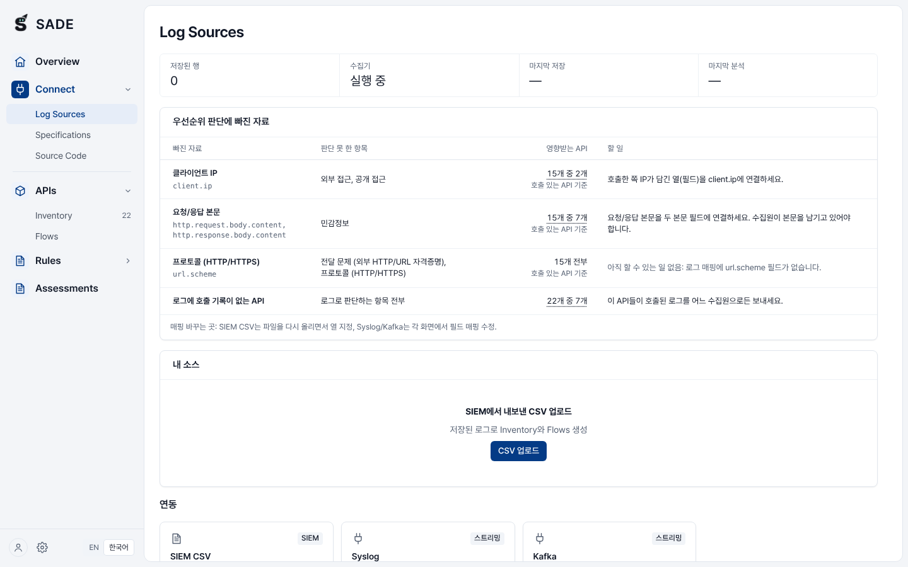
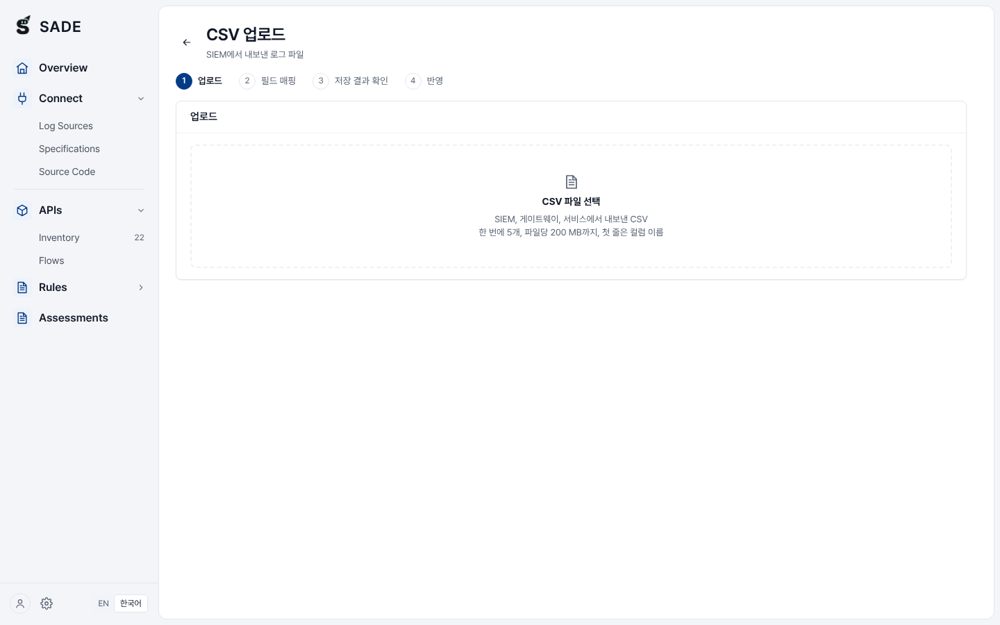
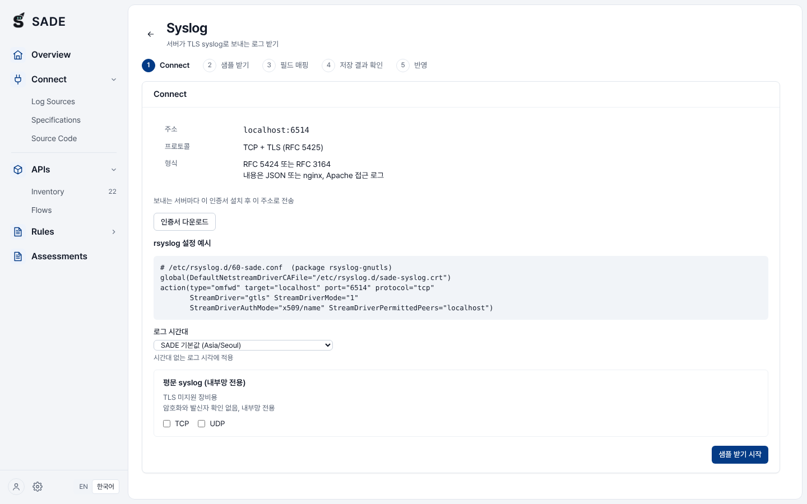
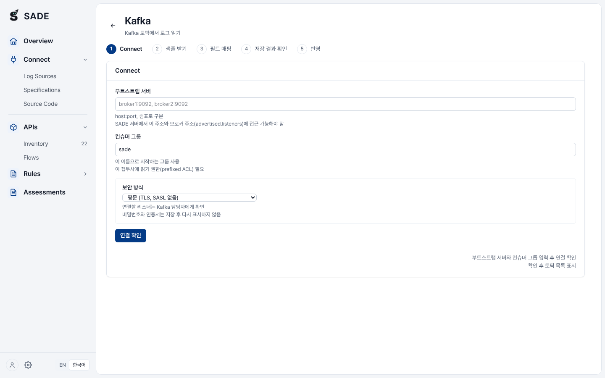

# 로그 (CSV, syslog, Kafka)

Connect > Log Sources에서 로그를 연결합니다. 로그로 실제 호출된 API, 호출 수, 호출한 주소, 서비스 사이 흐름을 확인합니다.


[{ loading=lazy }](../../assets/screens/logs.png)
<small>예시 화면 (가상 데이터)</small>

위쪽 "우선순위 판단에 빠진 자료" 표는 관리 우선순위를 판단하지 못한 항목과 그 자료가 있는 로그 필드, 영향받는 API 수를 보여 줍니다.

## 방식 고르기

| 방식 | 맞는 환경 | 방향 | 기업에서 준비할 것 |
|---|---|---|---|
| CSV 업로드 | 연동 승인 전 시험 | 사람이 파일을 올림 | SIEM, 게이트웨이, 서비스에서 기간을 정해 내보낸 CSV |
| syslog 수신 | 서버나 게이트웨이가 rsyslog로 보낼 수 있을 때 | 기업 서버 → SADE (TCP 6514, TLS) | rsyslog 설정, 방화벽 허용 |
| Kafka 구독 | 로그가 Kafka 토픽에 모일 때 | SADE → Kafka 브로커 (읽기만) | 브로커 주소, 읽기 권한, 인증 정보 |

!!! tip "CSV로 먼저 확인하기"
    하루치 로그를 CSV로 올려 필드 매핑을 확인한 뒤 syslog나 Kafka를 연결하기를 권합니다. 같은 로그 줄은 어느 경로로 들어와도 한 번만 저장합니다.

세 방식 모두 처리 순서가 같습니다.

1. 받은 로그를 [로그 필드](schema.md) 이름으로 바꿉니다.
2. Vector가 본문 값을 타입으로 가립니다.
3. ClickHouse에 저장합니다.
4. 로그를 분석하면 Inventory와 Flows를 다시 만듭니다.

## CSV 업로드

[{ loading=lazy }](../../assets/screens/csv.png)
<small>예시 화면 (가상 데이터)</small>

| 조건 | 내용 |
|---|---|
| 파일 | 한 번에 5개, 파일당 200 MB |
| 형식 | 첫 줄이 열 이름. UTF-8 또는 CP949. 구분자는 쉼표, 탭, `;`, `|` |

1. 파일을 고르면 열 이름을 보고 SADE 필드를 추천합니다. 기업의 열 이름이 달라도 대응 관계만 고릅니다(예: `svc` → `service.name`).
2. 서비스 이름 열이 없으면 파일마다 고정 서비스 이름을 넣습니다.
3. 보내면 파일마다 행을 나눠 보여 줍니다.
    - 저장함
    - 이미 저장돼 있음
    - 보관 기간보다 오래돼 버림
    - 매핑한 칸이 비어 버림
4. Apply to inventory and flows를 누르면 로그 분석이 시작됩니다. 분석이 끝나면 Inventory와 Flows가 바뀝니다.

!!! note "시각 열을 매핑하세요"
    `@timestamp`를 매핑하지 않으면 저장 시각을 로그 시각으로 씁니다. 이때 같은 파일을 다시 올리면 같은 줄을 다시 저장합니다.

## syslog 수신

[{ loading=lazy }](../../assets/screens/syslog.png)
<small>예시 화면 (가상 데이터)</small>

SADE가 TCP 6514에서 TLS syslog를 받습니다. 보내는 서버에는 화면에서 받은 인증서와 rsyslog 설정 예시를 넣습니다.

| 항목 | 내용 |
|---|---|
| 형식 | RFC 5424, RFC 3164. 메시지 본문은 JSON 또는 nginx, Apache 접근 로그 한 줄 |
| 인증서 | `.env`의 `SADE_SYSLOG_HOST`(이 서버의 이름이나 IP)로 자체 서명 인증서를 만듭니다. 기업 인증서는 `syslog-certs` 볼륨에 `server.crt`, `server.key`로 넣습니다 |
| 기본 매핑 | syslog의 hostname은 `host.name`, appname은 `service.name`이 됩니다 |
| 상태 | 1시간 넘게 저장한 로그가 없으면 "확인 필요"로 표시합니다 |

!!! warning "보내는 서버 IP만 허용하기"
    syslog는 보내는 쪽을 인증하지 않습니다. 6514에 닿는 누구나 로그를 넣어 Inventory와 Flows를 바꿀 수 있습니다. 방화벽에서 보내는 서버 IP만 허용하세요. Docker가 연 포트는 호스트의 ufw 규칙을 거치지 않으므로 `DOCKER-USER` 체인이나 앞단 방화벽에서 막습니다.

    ```bash
    sudo iptables -I DOCKER-USER -i eth0 -p tcp --dport 6514 ! -s 10.0.1.0/24 -j DROP
    ```

### 평문 syslog (내부망 전용)

TLS를 보내지 못하는 장비는 평문 TCP, UDP로 받습니다. 기본은 꺼져 있습니다.

- 화면에서 보내는 서버의 IP나 대역(예: `10.0.0.0/8`)을 넣고 켜면 Vector가 1514를 듣습니다.
- 화면의 허용 목록은 TCP에만 적용됩니다. UDP는 방화벽에서 막습니다.
- 포트는 기본으로 이 서버(`127.0.0.1`)에만 열립니다. 다른 서버에서 받으려면 `.env`에 `SADE_SYSLOG_PLAIN_BIND`, `SADE_SYSLOG_PLAIN_PORT`를 넣고 다시 시작합니다.
- 내용이 암호화되지 않습니다. 내부망에서만 쓰고, 위의 IP 제한을 TCP와 UDP에 모두 겁니다.

## Kafka 구독

[{ loading=lazy }](../../assets/screens/kafka.png)
<small>예시 화면 (가상 데이터)</small>

SADE는 Kafka 토픽을 읽기만 합니다.

1. 브로커 주소와 보안 방식을 넣고 연결을 확인합니다.
2. 읽을 토픽을 고르면 샘플 메시지로 필드를 추천합니다.
3. 토픽 하나에 한 서비스의 로그만 있으면 토픽별 서비스 이름과 시간대를 정합니다.
4. 연결하면 받은 메시지, 저장한 메시지, 버린 메시지 수가 나옵니다.

| 항목 | 지원 | 미지원 |
|---|---|---|
| 보안 | 평문, TLS(사내 CA), mTLS, SASL PLAIN, SCRAM-SHA-256, SCRAM-SHA-512, SASL과 TLS 함께 | Kerberos(GSSAPI), OAUTHBEARER(AWS MSK IAM 등) |
| 메시지 | JSON, nginx와 Apache 접근 로그 한 줄, Filebeat, Fluent Bit, Logstash가 감싼 메시지(`message`, `log`) | Avro, Protobuf(Schema Registry) |

- 브로커 이름이 DNS에 없고 서버의 `/etc/hosts`에만 있으면 컨테이너가 찾지 못합니다. `.env`에 `SADE_EXTRA_HOSTS=kafka1.corp.example=10.0.0.5`처럼 넣고 다시 시작합니다.
- SASL 비밀번호는 연결 확인과 연결에만 쓰고 `kafka-secrets` 볼륨에 둡니다.
- 기간을 정해도 Kafka는 남은 메시지를 처음부터 읽고, 기간 밖 메시지는 저장 전에 버립니다. 큰 토픽은 첫 연결 때 읽는 양이 많으니 기업과 시간을 맞춥니다.

## 로그 시각과 시간대

- 시간대가 적힌 시각(`Z`, `+09:00`)은 그대로 읽습니다.
- 시간대가 없는 시각은 소스에 정한 시간대(기본 Asia/Seoul)로 읽습니다. UTC로 찍는 서버를 그대로 두면 9시간 밀립니다.

## 서비스 이름이 없는 로그

`service.name`과 `host.name`이 모두 없는 줄은 API에 들어가지 않습니다. Log Sources의 요약에서 이런 줄을 확인하고, 서버나 IP로 서비스 이름을 붙이는 규칙을 저장한 뒤 다시 분석합니다.
