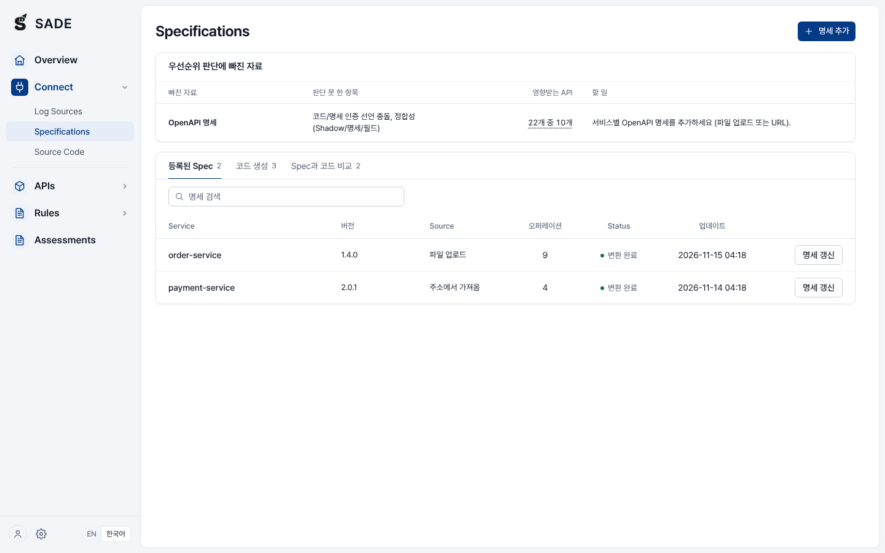
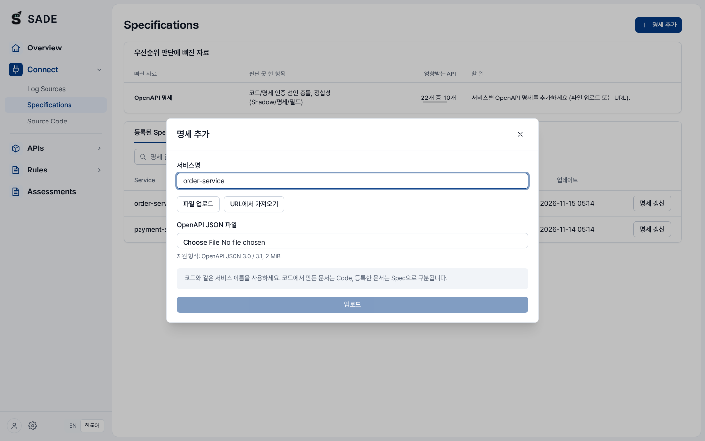

# OpenAPI 명세

Connect > Specifications에서 기업이 관리하는 OpenAPI 명세를 등록합니다. 등록한 명세는 Inventory의 `Spec` 출처가 되고, 명세에 없는 API(Undocumented, Shadow)를 가리는 기준이 됩니다.

[{ loading=lazy }](../../assets/screens/specs.png)
<small>예시 화면 (가상 데이터)</small>

위쪽 "우선순위 판단에 빠진 자료" 표는 명세가 없어 관리 우선순위를 판단하지 못한 항목과 영향받는 API 수를 보여 줍니다.

## 명세로 채워지는 것

| 결과 | 설명 |
|---|---|
| 명세 상태(Spec Status) | Documented(등록됨), Undocumented(Spec 누락), Shadow, No Spec(Spec 없음) |
| 명세의 인증 선언 | operation이나 문서 전체의 `security`. 코드의 인증 선언과 다르면 관리 우선순위의 충돌 신호(H) |
| 필드 차이 | 명세와 코드의 요청, 응답 필드가 다르면 검토 신호(D) |
| 필드의 민감 유형 | 명세 필드 이름으로 찾은 민감 유형 |
| Base URL | 명세 `servers`의 공개 도메인 |

## 준비

| 조건 | 내용 |
|---|---|
| 형식 | OpenAPI 3.0.x, 3.1.x JSON. YAML과 Swagger 2.0은 JSON 3.x로 바꿔 올립니다 |
| 크기 | 2 MiB 이하 |
| 참조 | 다른 파일을 가리키는 `$ref`는 거절합니다. 한 파일로 묶어 올립니다 |
| 서비스 이름 | 코드 스캔의 서비스 이름과 같게 넣습니다. 이름이 다르면 같은 API가 두 서비스로 나뉩니다 |

YAML이나 Swagger 2.0 파일은 공개된 변환 도구(예: `swagger2openapi`, `yq`)로 바꿉니다. 여러 파일로 나뉜 명세는 `redocly bundle` 같은 도구로 한 파일로 묶습니다.

## 1. 파일로 등록

<div class="sade-steps" markdown>

1. Connect > Specifications에서 Add specification(명세 추가)을 누릅니다.

2. File upload를 고릅니다.

3. Service에 서비스 이름을 넣습니다. 코드 스캔을 했다면 Inventory의 Service 열에 나온 이름 그대로 씁니다.

4. OpenAPI JSON 파일을 고르고 Upload를 누릅니다.

5. 목록의 Status에서 변환이 끝났는지 봅니다. 끝나면 매핑이 자동으로 다시 돕니다.

</div>

[{ loading=lazy }](../../assets/screens/specs-add.png)
<small>명세 추가 창 (가상 데이터). 파일 업로드와 URL에서 가져오기 중 하나를 고릅니다</small>

## 2. 내부 주소에서 가져오기

서비스가 `/v3/api-docs` 같은 주소로 명세를 내준다면 파일 대신 주소로 가져옵니다.

<div class="sade-steps" markdown>

1. 서버 관리자가 `.env`의 `SADE_SPEC_FETCH_ALLOWED_URLS`에 가져올 주소를 정확히 적고 SADE를 다시 시작합니다.

    ```bash
    SADE_SPEC_FETCH_ALLOWED_URLS=http://orders:8080/v3/api-docs,http://payments:8080/v3/api-docs
    ```

2. Add specification > From URL을 고릅니다.

3. Service와 허용한 주소를 넣고 Import를 누릅니다.

</div>

- 기본은 꺼져 있습니다. 목록에 없는 주소는 가져오지 않습니다.
- 주소의 이름은 backend 컨테이너에서 사설 주소로 풀려야 합니다.
- 토큰이나 비밀번호를 주소에 넣지 않습니다.

## 3. 목록 확인

| 탭 | 내용 | 출처 표시 |
|---|---|---|
| Registered Spec | 직접 올리거나 가져온 명세. 서비스, 버전, 상태, 갱신 시각 | `Spec` |
| Generated from Code | 코드 스캔이 서비스마다 만든 명세. 저장소, 커밋, 스캔 시각 | `Code` |

- 두 목록은 서로 덮어쓰지 않습니다.
- 코드에서 만든 명세는 명세 상태 판정의 기준으로 쓰지 않습니다. 코드에 있는 API가 모두 Documented로 보이는 일을 막기 위해서입니다.
- 같은 서비스에 두 명세가 다 있으면 Spec vs code에서 차이를 봅니다.

## 4. 결과 확인

명세를 등록한 서비스는 Inventory의 Spec Status가 바뀝니다.

| 상태 | 한국어 화면 | 뜻 | 할 일 |
|---|---|---|---|
| Documented | 등록됨 | 등록한 명세에 있음 | |
| Undocumented | Spec 누락 | 코드에는 있고 명세에는 없음 | 명세에 추가할지, 쓰지 않는 API인지 확인 |
| Shadow | Shadow | 코드와 명세에 없고 로그에서만 불림 | 관리 대장에 없는 API인지, 게이트웨이 경로 차이인지 확인 |
| No Spec | Spec 없음 | 그 서비스에 비교할 명세가 없음 | 명세 등록 |

로그에서만 보인 경로라도 응답이 모두 404나 405면 Shadow로 올리지 않습니다. 없는 경로를 두드린 호출로 봅니다.

## 새 버전 올리기

- 같은 서비스의 새 명세는 목록에서 Update Spec으로 올립니다. 최근 명세가 기준이 됩니다.
- 명세의 `servers` 경로(예: `http://host/shop`의 `/shop`)는 `paths` 앞에 붙여 비교합니다. 코드의 context path와 맞추기 위해서입니다.
