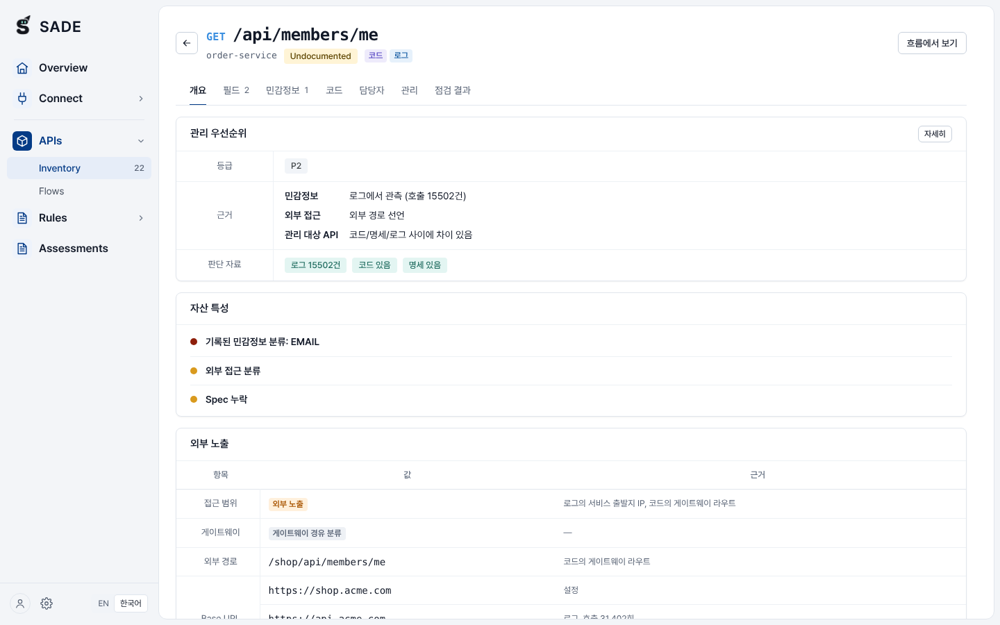
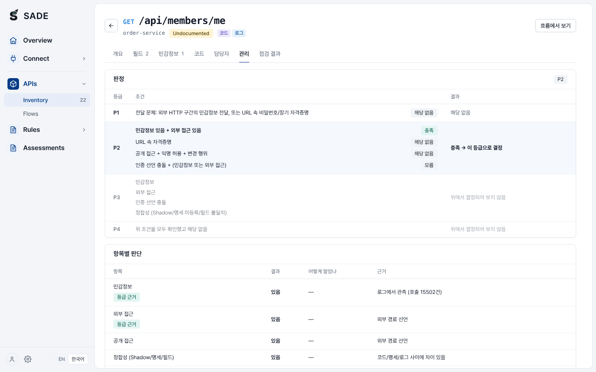
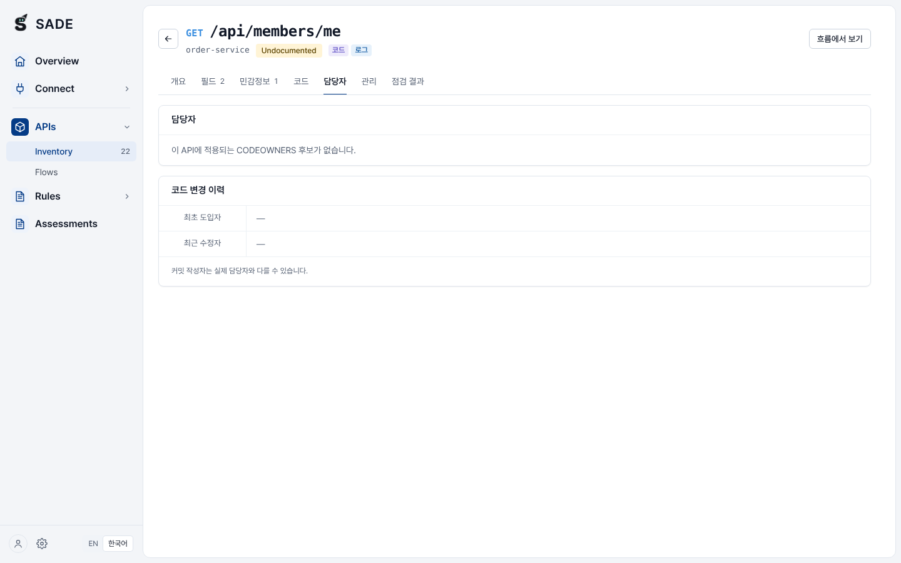

# API 상세

Inventory에서 API를 누르고 Full Screen을 누르면 API 상세가 열립니다. 위쪽에 서비스, 메서드, 경로, 관리 우선순위, 출처(`Code`, `Spec`, `Log`)가 나옵니다.

[{ loading=lazy }](../../assets/screens/api-overview.png)
<small>예시 화면 (가상 데이터)</small>

| 탭 | 한국어 화면 | 내용 |
|---|---|---|
| Overview | 개요 | 우선순위 요약, 검토 신호, 근거(노출, 인증 선언, 민감정보, 실제 호출, 명세 일치) |
| Fields | 필드 | 요청, 응답 필드와 타입, 필드별 출처, 응답 코드별 표 |
| Sensitive Data | 민감정보 | 민감 유형, 판정 근거(필드 이름 일치, 값 형식), 찾은 출처 |
| Code | 코드 | 핸들러 파일과 줄, 다른 서비스 호출, DB 접근, 명세와 코드 필드 비교(Spec vs code) |
| Owners | 담당자 | CODEOWNERS 담당 후보와 근거 줄, API 코드의 최초, 최근 변경 커밋 |
| Management | 관리 | [관리 우선순위](priority.md) 근거. 신호별 예, 아니요, 모름, 더 높아질 수 있는 등급, 빠진 자료 |
| Assessment Results | 점검 결과 | 프레임워크 점검 결과 ([준비 중](assessments.md)) |

[{ loading=lazy }](../../assets/screens/api-manage.png)
<small>Management(관리) 탭 예시 화면 (가상 데이터)</small>

[{ loading=lazy }](../../assets/screens/api-owners.png)
<small>Owners(담당자) 탭 예시 화면 (가상 데이터)</small>

## 화면 문구

- 인증 선언(Declared Auth): 코드와 명세에 적힌 인증입니다. 요청이 실제로 막히는지는 확인하지 않습니다.
- 검토 신호: 확인이 필요한 특징입니다. 신호가 없어도 안전으로 판정하지 않습니다.
- 로그의 민감 유형: 로그는 API 단위로 유형을 기록합니다. 어느 필드에 실렸는지는 알 수 없습니다.
- 담당 후보: CODEOWNERS 규칙에서 찾은 후보입니다. 커밋 작성자는 담당자와 다를 수 있습니다. 담당자 지정 버튼(Assign Owner)은 아직 동작하지 않습니다.

## 다른 화면으로

- View in Flows: 이 API의 서비스와 연결을 [Flows](flows.md)에서 봅니다.
- Back to Inventory: 필터를 그대로 두고 목록으로 돌아갑니다.
