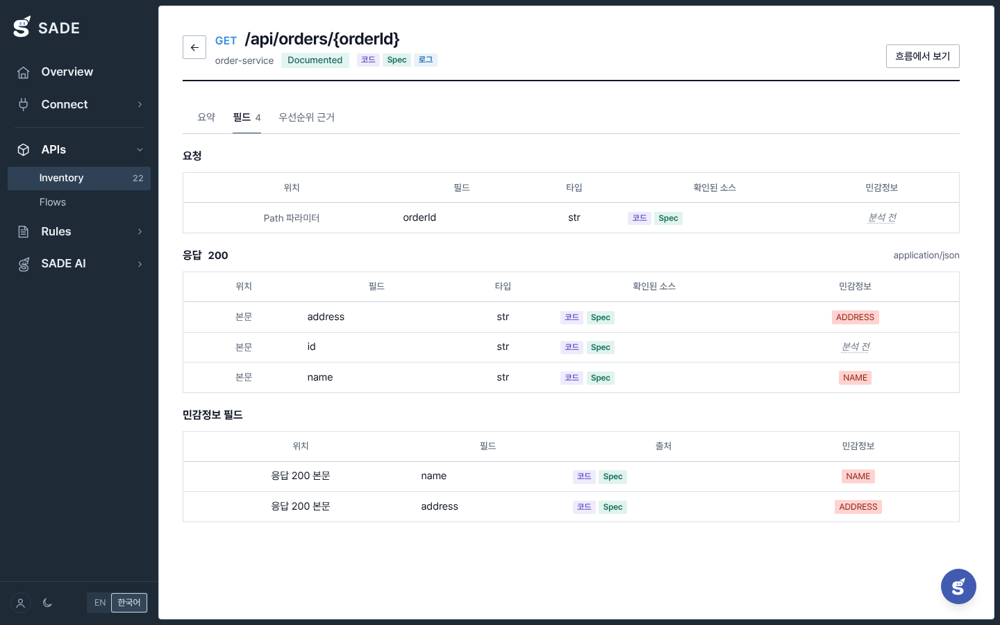

# API 상세

Inventory에서 API를 누르면 오른쪽에 패널이 열리고, 패널의 전체 화면 아이콘을 누르면 API 상세가 열립니다. 위쪽에 메서드, 경로, 서비스, Spec 등록 상태, 출처(코드, Spec, 로그)가 나옵니다.

[{ loading=lazy }](../../assets/screens/api-overview.png)

<small>관리 우선순위, 접근 범위, 확인할 점, 기본 정보 (가상 데이터)</small>

[{ loading=lazy }](../../assets/screens/api-fields.png)

<small>요청, 응답 필드와 민감정보 필드 (가상 데이터)</small>

[{ loading=lazy }](../../assets/screens/api-manage.png)

<small>확인된 것, 확인하지 못한 것, 필요한 자료 (가상 데이터)</small>

| 탭 | 내용 |
|---|---|
| 요약 | 관리 우선순위와 근거, 접근 범위와 근거, 민감정보, 호출 수, 확인할 점, 기본 정보(담당자 포함) |
| 필드 | 요청, 응답 필드와 타입, 필드별 출처, 민감정보 필드 |
| 우선순위 근거 | [관리 우선순위](priority.md) 판정. 확인된 것, 확인하지 못한 것과 필요한 자료 |

이 API가 걸린 프레임워크 점검은 [Assessment](assessments.md)에서 봅니다. 예전의 점검 결과 탭은 AI 점검 의견이 없어지면서 함께 없어졌습니다.

## 요약 {#summary}

API를 처음 열었을 때 보는 화면입니다.

| 영역 | 내용 |
|---|---|
| 관리 우선순위 | 등급과 판정 이유 한 줄. 예: P2, 외부 접근, 민감정보 |
| 접근 범위 | 외부 노출, 내부, `—`와 판정 근거. 예: 로그의 서비스 출발지 IP, 코드의 게이트웨이 라우트 |
| 민감정보 | 민감 유형 |
| 호출 수 | 분석 기간의 호출 수와 마지막 호출 시각 |
| 확인할 점 | 검토 신호. 예: 기록된 민감정보 분류, 외부 접근 분류, Spec 누락 |
| 기본 정보 | 서비스, 서버, 출처, Spec 등록, 담당자, 핸들러 파일, 접근 규칙(인증 선언), Base URL, 외부 경로, 상태 코드별 호출 수, 처음 발견 |

확인할 점은 확인이 필요한 특징입니다. 확인된 취약점이 아니며, 없어도 안전으로 판정하지 않습니다.

### 담당자 {#owner}

- 처음에는 코드 스캔이 CODEOWNERS에서 찾은 담당 후보가 나옵니다. 후보가 없으면 "지정된 담당자 없음"입니다.
- 담당자 변경을 누르고 담당자 계정을 쉼표로 이어 넣은 뒤 저장합니다.
- 직접 바꾼 담당자는 이후 코드 스캔에서도 유지됩니다. CODEOWNERS로 되돌리기로 스캔 결과로 돌아갑니다.
- 가장 최근 분석에서만 바꿀 수 있습니다.

## 필드

- 요청은 위치별(Path, Query, Header, Cookie, 본문)로, 응답은 응답 코드와 형식(예: `application/json`)별로 나눕니다.
- 필드마다 타입, 확인된 소스(코드, Spec, 로그), 민감정보 유형을 표시합니다. 민감 판정 전이면 "분석 전"입니다.
- 중첩 객체는 `items[].price`처럼 점과 `[]`로 이어 씁니다.
- 아래 민감정보 필드 표는 민감 유형이 붙은 필드만 위치, 필드, 출처, 유형으로 모아 보여 줍니다.
- 로그는 API 단위로 유형을 기록합니다. 어느 필드에 실렸는지는 알 수 없어 필드 없이 따로 나옵니다.
- 탐지 방식은 [민감정보 탐지](../how-it-works/sensitive-data.md)에 있습니다.

## 우선순위 근거

| 영역 | 내용 |
|---|---|
| 판정 | 등급과 판정 이유 |
| 확인된 것 | 예로 확인된 신호와 근거. 등급에 쓰인 신호는 "등급 근거"로 표시 |
| 확인하지 못한 것 | 모르는 신호와 필요한 자료. 자료를 넣을 화면(Specifications, Source Code 등)으로 가는 링크 |
| SADE가 아직 판단하지 않는 항목 | 프로토콜처럼 아직 판정하지 않는 항목 |
| 등급 기준 | 해당 없음으로 확인된 신호 수 |

### 검토 순서

1. 판정에서 등급과 판정 이유를 봅니다.

2. 확인된 것에서 등급 근거로 쓰인 신호의 근거를 봅니다. 예: 외부 접근이면 어느 근거로 판정했는지

3. 확인하지 못한 것이 있으면 필요한 자료 옆 링크로 가서 자료를 넣습니다.

4. 다시 분석된 뒤 등급이 바뀌었는지 봅니다.

## 화면 문구

- 접근 규칙: 코드와 명세에 적힌 인증 선언입니다. 요청이 실제로 막히는지는 확인하지 않습니다.
- 인증 선언이 없다는 표시는 코드에서 선언을 찾지 못했다는 뜻입니다. 전역 보안 설정으로 막고 있을 수 있습니다.

## 다른 화면으로

- 흐름에서 보기: 이 API의 서비스와 연결을 [Flows](flows.md)에서 봅니다.
- 이 화면에서 [SADE AI 채팅](assessments.md#chat)을 열면 이 API의 필드와 호출 관계를 함께 보내 묻습니다.
- 핸들러 파일: 누르면 GitHub의 그 줄을 엽니다.
