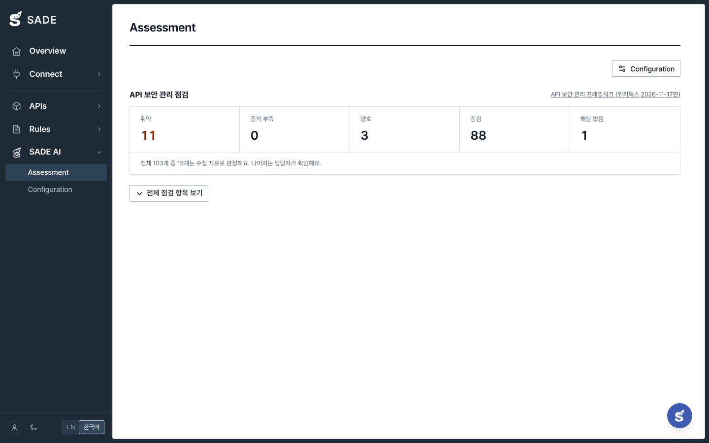
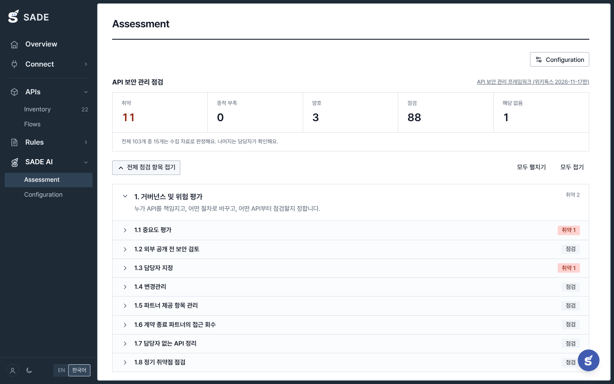
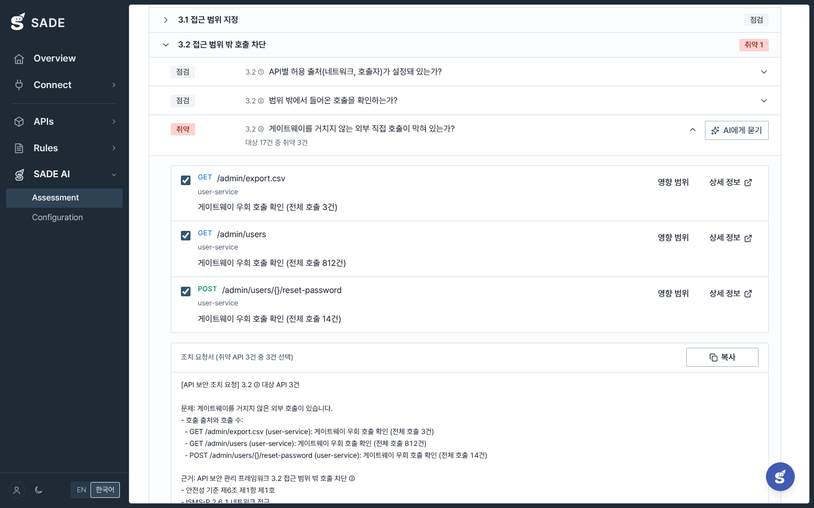
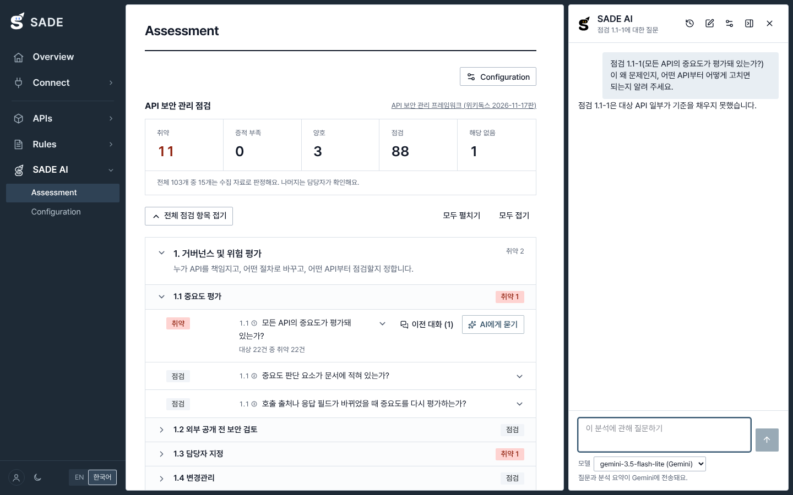
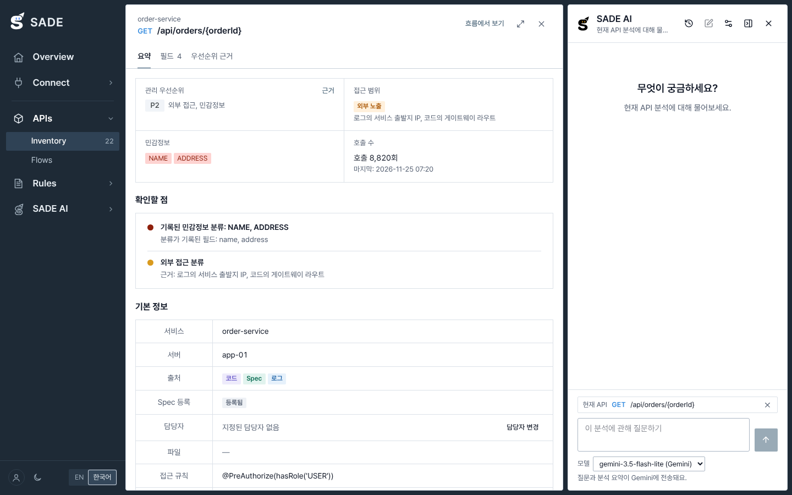
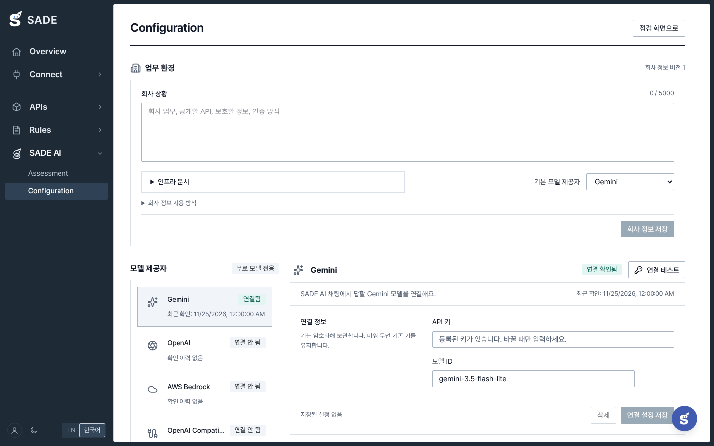

# 보안 점검과 SADE AI

SADE AI 메뉴에는 Assessment(점검)와 Configuration(설정)이 있습니다.

- Assessment는 [API 보안 관리 프레임워크](https://wikidocs.net/book/22142)의 점검 103개를 보여 줍니다. 그중 15개는 SADE가 분석 결과로 판정하고, 나머지는 담당자가 확인합니다. 판정에는 AI 모델을 쓰지 않습니다.
- SADE AI 채팅은 분석 결과와 점검 항목에 대해 묻고 답하는 창입니다. 모든 화면 오른쪽 아래 버튼으로 엽니다. 답은 참고 의견이며 판정, 관리 우선순위를 바꾸지 않습니다.

[{ loading=lazy }](../../assets/screens/assessments.png)

<small>판정 결과별 점검 수 (가상 데이터)</small>

[{ loading=lazy }](../../assets/screens/assessments-checks.png)

<small>영역, 항목, 점검 순서로 펼친 목록 (가상 데이터)</small>

[{ loading=lazy }](../../assets/screens/assessments-check-detail.png)

<small>취약 API, 영향 범위, 조치 요청서 (가상 데이터)</small>

[{ loading=lazy }](../../assets/screens/ai-chat.png)

<small>점검에서 AI에게 묻기로 연 채팅 (가상 데이터)</small>

[{ loading=lazy }](../../assets/screens/ai-chat-api.png)

<small>Inventory 패널에서 연 채팅. 입력창 위에 현재 API (가상 데이터)</small>

[{ loading=lazy }](../../assets/screens/ai-config.png)

<small>업무 환경과 모델 제공자 (가상 데이터)</small>

## 점검 (Assessment)

선택한 분석 결과로 점검을 판정합니다. 화면을 열 때마다 다시 계산하고, 아무것도 바꾸지 않습니다. 점검 목록은 프레임워크 위키독스 2026-11-17판에서 만든 팀 초안입니다.

### 판정 결과

위쪽 다섯 칸은 결과별 점검 수입니다. 칸을 누르면 그 결과의 점검만 펼쳐 보여 줍니다.

| 결과 | 뜻 |
|---|---|
| 취약 | 대상 API 중 하나라도 판정 기준에 걸림 |
| 증적 부족 | 걸린 API는 없지만, 자료가 모자라 판단하지 못한 API가 있음. 로그, 명세, 소스 코드를 더 연결하면 판정할 수 있습니다 |
| 양호 | 대상 API가 모두 기준을 충족함 |
| 점검 | SADE가 판정하지 않는 점검. 조직 절차처럼 SADE 자료로 볼 수 없는 것이라 담당 부서가 직접 확인합니다 |
| 해당 없음 | 판정 규칙은 있지만 대상 API가 없음 |

- 양호는 수집한 자료 안에서 기준을 충족했다는 뜻입니다. 안전하다는 인증이 아닙니다.
- [Overview](overview.md)의 Assessments Score는 판정한 점검(취약, 양호) 중 양호의 비율입니다. 증적 부족, 점검, 해당 없음은 빼고 셉니다.

### SADE가 판정하는 점검 {#rules}

| 점검 | 대상 API | 취약 | 증적 부족 |
|---|---|---|---|
| 1.1 중요도 평가 | 전체 | 관리 우선순위 등급이 없음 | |
| 1.3 담당자 지정 | 전체 | 지정한 담당자가 없음(CODEOWNERS 후보는 근거에 적음) | |
| 2.1 명세 작성 | 전체 | 명세를 연결했는데 이 API가 명세에 없음 | 연결한 명세가 없음 |
| 2.2 명세와 구현 일치 | 코드와 명세가 모두 있는 API | 필드 차이가 있음 | 비교하지 못함 |
| 2.5 Shadow 처리 | Shadow API | 등록이나 차단을 정하기 전까지 항상 | |
| 2.9 미사용 API | 로그가 있는 서비스의 API | 로그 기간 동안 호출 없음 | |
| 3.2 게이트웨이 우회 | 게이트웨이 경로를 아는 API | 게이트웨이를 거치지 않은 호출이 있음 | |
| 3.3 테스트, 디버그 경로 | 경로에 actuator, debug, test, swagger, api-docs, h2-console 등이 들어간 API | 외부에서 호출됨 | 외부 노출을 모름 |
| 4.1 인증 방식 정의 | 코드나 명세가 있는 API | 있는 출처 모두에 인증 선언이 없음 | 선언을 읽지 못함 |
| 4.3 서버 인증 확인 | 민감 필드가 있고 코드가 있는 API | 코드에 인증 선언이 없음 | 선언을 읽지 못함 |
| 5.1 중요 필드 식별 | 전체 | 민감 필드가 있음(분류 확인 요청) | 필드 분석을 못 함 |
| 5.2 Public 응답 최소화 | 외부 노출 API | 응답에 민감 필드가 있음 | 응답 필드를 모름 |
| 5.4 전송 구간 암호화 | 주소를 아는 외부 API | `http://` 주소가 있음 | 프로토콜을 모름 |
| 5.7 주민등록번호 | 요청에 주민등록번호 필드가 있는 API | 항상(법령 근거 확인 요청) | |
| 6.1 로그의 인증정보 | 로그가 있는 API | 로그에서 비밀번호, 토큰, 키 필드가 발견됨 | |

- 번호는 프레임워크 3장 안의 항목 번호입니다. 예: 3.2 게이트웨이 우회는 프레임워크 3.3.2입니다.
- 테스트 경로, 중요 필드, 주민등록번호, 로그의 인증정보 점검은 필드 이름과 경로 이름으로 고르는 좁은 규칙입니다. 이름이 특이하면 놓칩니다.

### 점검 하나 읽기

1. 전체 점검 항목 보기를 누릅니다. 6개 영역 아래 항목과 점검이 나옵니다. 모두 펼치기, 모두 접기로 한 번에 엽니다.

2. 점검을 누르면 걸린 API와 근거가 나옵니다. 예: 게이트웨이 우회 호출 확인(전체 호출 812건)

3. API마다 영향 범위는 그 API의 흐름을 [Flows](flows.md#api)의 API별 흐름에서 엽니다. 상세 정보는 [API 상세](api-details.md)를 엽니다.

4. 조치 요청서에 넣을 취약 API를 체크하고 복사를 누릅니다. 문제, API별 근거, 프레임워크와 법령 근거, 조치 방법이 채워진 글이 복사됩니다. 메일이나 메신저에 붙여 담당자에게 보냅니다.

5. 아래 조치 사항, 적용 대상, 확인 증적에서 점검 기준을 봅니다.

- 근거에는 이름, 횟수, 시각만 나옵니다. 로그 값은 나오지 않습니다.
- 조치 요청서는 복사만 합니다. SADE가 자동으로 보내지 않습니다.
- 조치 요청서는 프레임워크에 복사용 문구가 있는 점검에만 나옵니다.

## SADE AI 채팅 {#chat}

화면 오른쪽 아래 SADE 버튼을 누르면 오른쪽에 채팅 창이 붙습니다.

- 본문은 채팅 창 폭만큼 비켜 줍니다. 창 왼쪽 경계를 끌어 폭을 320~720px 사이로 바꿉니다. 접으면 얇은 막대로 남고 대화는 그대로 있습니다.
- 답변 속 API 경로를 누르면 창은 열린 채 뒤 화면만 그 API로 바뀝니다.
- 창 아래 모델 목록에서 답할 모델을 고릅니다. 연결 테스트를 마친 모델만 나오고, 기본값은 Configuration의 기본 모델 제공자입니다.
- 이전 대화에서 이 분석에 대한 대화를 다시 열거나 지웁니다. 새 대화로 새로 시작합니다.

### 점검에서 묻기

취약이나 증적 부족인 점검에는 AI에게 묻기 버튼이 있습니다.

1. AI에게 묻기를 누릅니다. 그 점검 번호가 붙은 새 대화가 열리고, "왜 문제인지, 어떤 API부터 어떻게 고치면 되는지" 묻는 질문이 채워집니다.

2. 질문을 고치거나 그대로 보냅니다. 보내기 전에는 아무것도 전송하지 않습니다.

3. 그 점검에서 시작한 대화가 있으면 이전 대화 (n) 버튼으로 다시 엽니다.

### API에 대해 묻기

API 상세나 Inventory 오른쪽 패널에서 채팅을 열면 그 API가 입력창 위에 "현재 API"로 붙습니다. 질문과 함께 그 API의 필드 이름과 호출 관계를 보냅니다. X를 누르면 API를 빼고 묻습니다.

### 대화 저장

- 대화는 SADE의 PostgreSQL에만 저장합니다. 질문은 흔한 비밀 패턴(키, 토큰, 비밀번호)을 가린 뒤 저장합니다.
- 이어서 물으면 최근 질문과 답 3번을 함께 보냅니다.
- 분석을 지우면 그 분석의 대화도 지워집니다.

## 설정 (Configuration) {#config}

채팅을 쓰려면 모델을 하나 이상 연결합니다. 점검 판정은 모델 없이 동작합니다.

1. 업무 환경의 회사 상황에 회사 업무, 공개할 API, 보호할 정보, 인증 방식을 적습니다. 최대 5,000자입니다.

2. 인프라 문서에 게이트웨이, 서비스, 인증 방식, 네트워크 구성을 Markdown으로 적거나 MD 파일 불러오기로 넣습니다. 최대 24,000자, 파일은 96KB 이하입니다.

3. 기본 모델 제공자를 고르고 회사 정보 저장을 누릅니다.

4. 모델 제공자를 고르고 연결 정보를 넣은 뒤 연결 설정 저장을 누릅니다.

5. 연결 테스트를 누릅니다. 테스트에 성공한 모델만 채팅에서 고를 수 있습니다.

| 제공자 | 넣는 값 |
|---|---|
| Gemini | API 키, 모델 ID |
| OpenAI | API 키, 모델 ID |
| AWS Bedrock | AWS 액세스 키 또는 Bedrock API 키, 리전, 모델 ID. 액세스 키는 세션 토큰(선택)을 받습니다 |
| OpenAI Compatible | Base URL, 모델 ID, API 키(서버에 필요할 때만). Ollama, vLLM처럼 직접 운영하는 모델용입니다 |

- 회사 상황과 인프라 문서는 채팅에서 질문할 때마다 모델에 함께 갑니다. 모델에는 검증된 사실이 아니라 회사 설명으로 다루라고 지시합니다.
- 같은 PC에서 도는 모델 서버는 `localhost`가 아니라 `host.docker.internal`로 적습니다(예: `http://host.docker.internal:11434`). SADE가 Docker 안에서 돌기 때문입니다.
- 키는 `SADE_SECRET_KEY`로 암호화해 PostgreSQL에 둡니다. 화면과 API 응답에 키를 다시 보여 주지 않습니다. 키 칸을 비워 두고 저장하면 기존 키를 유지합니다.
- `SADE_SECRET_KEY`가 없거나 형식이 틀리면 저장할 때 원인을 적은 오류가 나옵니다. 설치 스크립트(`sade.sh`, `sade.cmd`)는 이 값을 자동으로 채웁니다.
- `.env`의 `SADE_AI_GEMINI_KEY`로 기본 Gemini 키를 줄 수 있습니다. 화면에 저장한 키가 우선합니다.
- 삭제는 저장된 제공자 설정만 지웁니다. 회사 정보와 대화는 남습니다.

### 무료 모델 전용 {#free-only}

기본 설정(`SADE_AI_FREE_ONLY=1`)에서는 아래 두 가지만 실행합니다. 화면에는 "무료 모델 전용"으로 나옵니다.

- 무료 Gemini 모델(`gemini-3.5-flash-lite`)
- 내부망 주소의 OpenAI Compatible 서버. 사설 IP, `localhost`, `host.docker.internal`, 점 없는 이름, `.local`, `.internal`, `.lan`으로 끝나는 이름을 내부망으로 봅니다

OpenAI, Bedrock, 외부 주소의 호환 서버를 쓰려면 `.env`에서 `SADE_AI_FREE_ONLY=0`으로 바꾸고 SADE를 다시 시작합니다.

- 이 설정은 주소 이름과 모델 이름만 봅니다. 실제로 비용이 없는지, Google 계정에 결제가 연결됐는지는 확인하지 않습니다.
- 무료 등급 Gemini에 보낸 자료는 Google이 제품 개선에 쓰고 사람이 검토할 수 있습니다. 실제 고객 자료로 묻기 전에 [보안 검토 자료](../getting-started/security-review.md#ai)를 봅니다.

## 모델에 보내는 것과 보내지 않는 것 {#data}

!!! warning "질문을 보낼 때만 모델을 부릅니다"
    분석이 끝나거나 화면을 열어도 모델을 부르지 않습니다. 질문을 보내면 그때마다 아래 자료가 모델 제공자로 갑니다. 외부 모델이면 채팅 창 아래에 "질문과 분석 요약이 Gemini에 전송돼요"처럼 표시합니다. 쓰기 전에 사내 보안 검토를 받습니다.

| 구분 | 내용 |
|---|---|
| 보냄 | 질문, 지금 연 화면의 종류. API 수와 등급별 수, API 최대 16개의 근거 요약(우선순위, 출처, 명세 상태, 노출 판정, 인증 선언, 민감 유형 이름, 호출 집계), 점검 103개의 개요와 관련 점검 최대 16개. 현재 API의 필드 이름, 위치, 형식, 민감 유형 이름(최대 60개)과 호출 관계(닿는 테이블, 읽기와 쓰기 포함). 회사 상황과 인프라 문서의 앞부분 |
| 보내지 않음 | 요청과 응답 본문, 필드 값, 헤더 값, 로그 원문, 소스 코드, 호스트와 IP 목록, 담당자 이름, 모델 키 |

- 회사 정보와 질문에서 `password=`, `api_key=` 같은 흔한 비밀 패턴은 가린 뒤 보냅니다. 모든 비밀을 찾지는 못하므로 문서에 비밀번호, 키, 내부 주소를 적지 않습니다.
- 모델에는 도구나 실행 권한을 주지 않습니다. 답변 속 API 경로는 서버가 Inventory와 맞춰 본 것만 링크로 만듭니다.

## 관리 우선순위와의 관계

- [관리 우선순위](priority.md)는 API마다 먼저 검토할 순서를 정합니다.
- 점검은 프레임워크 기준에 걸린 API를 보여 줍니다. P1~P4를 바꾸지 않습니다.
- 채팅의 답은 둘 다 바꾸지 않습니다.
