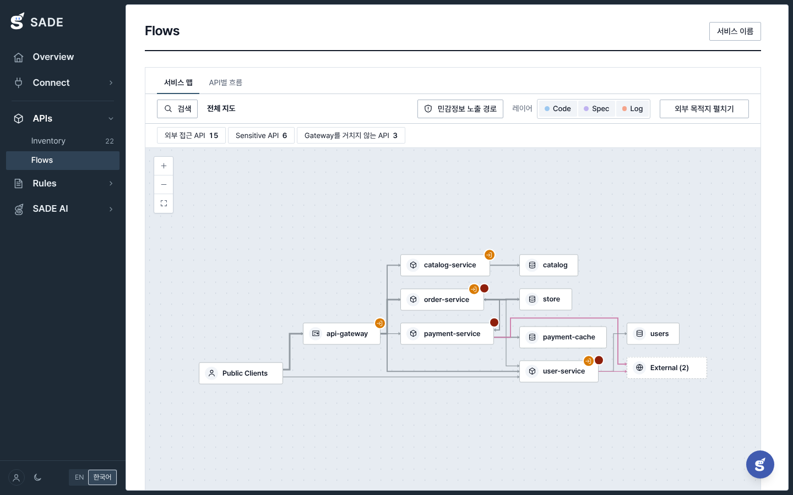
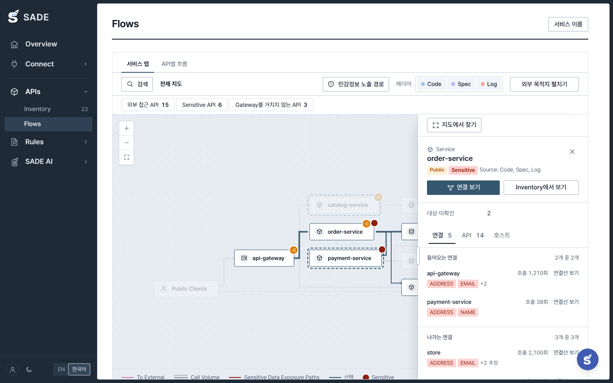
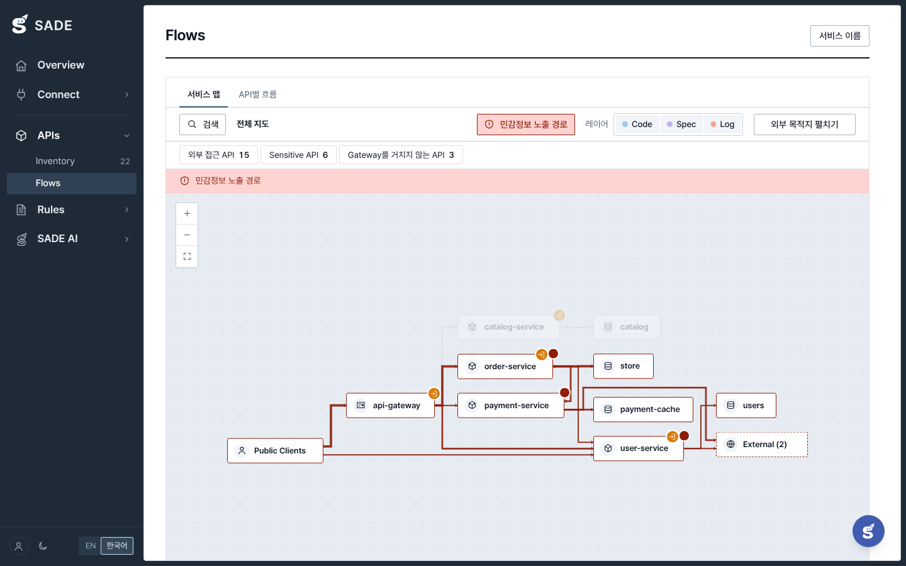
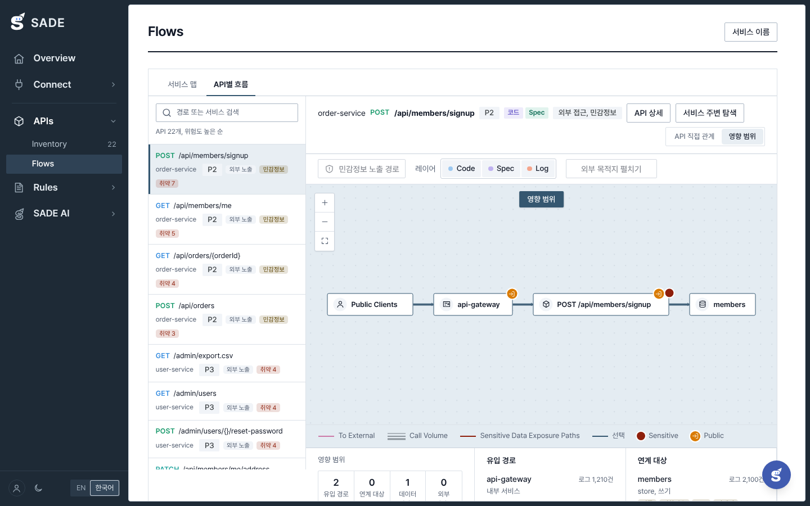
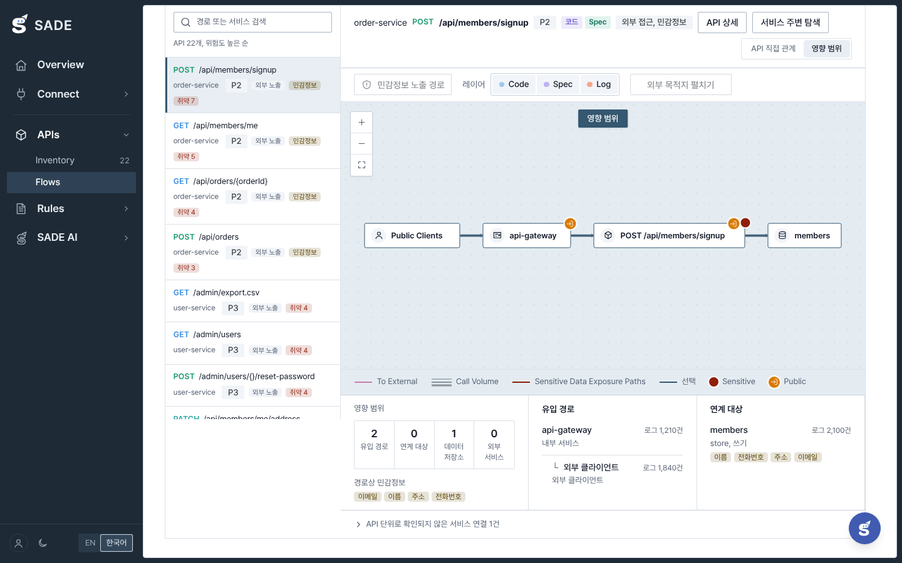

# Flows

APIs > Flows는 클라이언트, 서비스, DB, 외부 목적지 사이의 연결을 지도로 그립니다. 보안 담당자는 이 화면에서 입구(외부에서 닿는 서비스), 민감정보가 있는 곳, 입구에서 그곳까지의 경로를 찾습니다.

위쪽 탭이 두 개입니다.

| 탭 | 보는 것 |
|---|---|
| 서비스 맵 | 전체 서비스의 연결 지도 |
| [API별 흐름](#api) | 왼쪽 API 목록에서 고른 API 하나의 영향 범위 |

[{ loading=lazy }](../../assets/screens/flows.png)

<small>도구 막대, 요약 칩, 지도, 범례 (가상 데이터)</small>

[{ loading=lazy }](../../assets/screens/flows-service.png)

<small>서비스를 누르면 연결, API, 호스트 탭이 열림 (가상 데이터)</small>

[{ loading=lazy }](../../assets/screens/flows-paths.png)

<small>경로 위 노드와 선만 진하게, 나머지는 흐리게 (가상 데이터)</small>

[{ loading=lazy }](../../assets/screens/flows-api.png)

<small>왼쪽 API 목록, 오른쪽 고른 API의 영향 범위 (가상 데이터)</small>

[{ loading=lazy }](../../assets/screens/flows-impact.png)

<small>유입 경로, 연계 대상, 경로상 민감정보 (가상 데이터)</small>

## 서비스 맵

### 지도의 노드와 선

| 노드 | 뜻 |
|---|---|
| Clients | 로그에서 관측한 바깥 호출자. 출발지 IP로 공개(Public), 협력사, 내부를 나눕니다 |
| Gateway | 게이트웨이로 판정한 서비스 |
| Service | 요청을 처리하는 서비스. 같은 서비스의 다른 이름은 [서비스 이름](../policy/access-scope.md#settings)에서 합칩니다 |
| DB | 코드나 로그에서 찾은 DB와 테이블 |
| External | 기업 밖 주소(SaaS, 외부 API). 처음에는 하나로 묶여 있습니다 |

- 선 하나에 코드 근거와 로그 근거가 함께 있을 수 있습니다. 로그 근거가 있으면 호출 수가 나옵니다.
- 코드 근거만 있는 선은 코드에 호출이 있지만 로그에서 관측되지 않은 선입니다.
- 서비스 노드의 주황 표시(Public)는 밖에서 닿는 서비스입니다. 그 서비스의 API 하나라도 외부 접근이거나, Clients가 직접 부릅니다.
- 빨간 점(Sensitive)은 민감 유형이 있는 API를 가진 서비스입니다.
- 점선 테두리(Same Server)는 같은 서버에서 도는 서비스입니다.

### 도구 막대

| 도구 | 하는 일 |
|---|---|
| 검색 | 서비스 또는 API를 골라 이름이나 메서드, 경로로 찾습니다. 서비스를 고르면 그 서비스 주변만 보여 줍니다 |
| 전체 지도 | 지금 보는 범위. 주변 탐색 중이면 기준 노드 이름과 방향, 깊이가 나오고 전체 보기로 돌아갑니다 |
| 민감정보 노출 경로 | 공개 또는 협력사 Clients에서 민감 서비스를 거쳐 DB나 외부 목적지로 가는 경로만 진하게 보여 줍니다 |
| 레이어 Code, Spec, Log | 근거별로 노드와 선을 켜고 끕니다. 하나는 항상 켜져 있습니다 |
| 외부 목적지 펼치기 | 묶인 External을 목적지별로 펼칩니다. 외부 목적지 묶기로 다시 묶습니다 |
| 서비스 이름 | 오른쪽 위 버튼. 서비스 이름 합치기 창을 엽니다 |

### 요약 칩

도구 막대 아래 칩은 이번 분석 전체의 API 수입니다. 칩을 누르면 해당 API가 있는 서비스만 진하게 보이고 나머지는 흐려집니다. 같은 칩이나 빈 곳을 누르면 풀립니다.

| 칩 | 세는 것 |
|---|---|
| 외부 접근 API | 외부 접근으로 판정한 API |
| Sensitive API | 민감 유형이 있는 API |
| Gateway를 거치지 않는 API | 게이트웨이 우회로 판정한 API. 0이어도 모든 API가 게이트웨이를 거친다는 뜻은 아닙니다 |

- 수가 0인 칩은 나오지 않습니다.
- 지금 레이어에서 해당 서비스가 보이지 않으면 칩을 누를 수 없습니다.

### 패널

노드를 누르면 오른쪽에 패널이 열립니다. 위쪽 지도에서 찾기는 그 노드로 지도를 옮깁니다.

| 노드 | 패널 내용 |
|---|---|
| 서비스 | 종류, Public, Sensitive 표시와 출처. 탭: 연결(들어오는 연결, 나가는 연결), API, 호스트. 대상 미확인 수 |
| Clients | 보존된 식별 IP 수. 탭: 연결, 출발지 IP |
| External | 현재 지도의 외부 목적지 목록. 목적지마다 호출 수와 호출한 서비스 |
| DB | 테이블과 테이블을 쓰는 API |

- 연결 보기: 그 노드를 가운데 두고 방향(호출하는 쪽, 호출받는 쪽, 양방향)과 깊이(1~5)만큼 이어진 노드만 보여 줍니다.
- Inventory에서 보기: 그 서비스의 API 목록을 Inventory에서 엽니다.
- 연결선 보기: 연결 목록에서 그 선을 고르고 선의 근거를 엽니다. 선 패널에는 근거(코드, 로그), API 쌍, 요청과 응답의 민감 라벨, DB 테이블과 읽기, 쓰기가 나옵니다.
- 출발지 IP 탭에서 IP나 대역(예: `203.0.113.0/24`)으로 찾고, 공개, 협력사, 내부 분류를 봅니다.

## API별 흐름 {#api}

API 하나를 고르면 그 API를 호출하는 쪽, 그 API가 호출하는 쪽, 닿는 데이터 저장소를 한 그림으로 보여 줍니다. 모델을 쓰지 않고 저장된 호출 흐름으로 계산합니다.

1. API별 흐름 탭을 누릅니다. 왼쪽에 이번 분석의 API가 위험도 높은 순으로 나옵니다. 관리 우선순위, 취약 점검 수, 경로 순서입니다.

2. 목록에서 API를 누릅니다. 경로나 서비스 이름으로 찾을 수 있습니다. 고르지 않으면 맨 위 API를 보여 줍니다.

3. 오른쪽 위 API 직접 관계와 영향 범위 중 하나를 고릅니다.

4. 아래 영향 범위 요약에서 유입 경로, 연계 대상, 경로상 민감정보를 봅니다.

| 보기 | 내용 |
|---|---|
| API 직접 관계 | 그 API와 바로 이어진 서비스와 DB 테이블 |
| 영향 범위 | 호출하는 쪽과 호출받는 쪽을 각각 최대 3단계까지 따라간 흐름 |

| 요약 | 내용 |
|---|---|
| 유입 경로 | 이 API를 호출하는 쪽. 게이트웨이로 들어오는 호출은 게이트웨이를 부르는 쪽까지 붙입니다 |
| 연계 대상 | 이 API가 호출하는 API와 서비스, 읽고 쓰는 테이블 |
| 경로상 민감정보 | 경로의 요청, 응답, 테이블에 나온 민감 유형 이름. 값은 없습니다 |
| API 단위로 확인되지 않은 서비스 연결 | 서비스끼리는 이어져 있지만 이 API가 끼는지 자료로 알 수 없는 연결 |

- 단계마다 근거가 붙습니다. 로그 n건은 로그에서 관측한 호출, 코드는 코드에서 확인한 호출, 코드(후보)는 코드에서 찾은 후보입니다. 추정은 API 필드로 짐작한 값입니다.
- 테이블의 읽기, 쓰기와 민감 유형은 테이블을 쓰는 API의 필드로 추정한 값입니다.
- API 상세로 API 상세를, 서비스 주변 탐색으로 서비스 맵의 그 서비스 주변을 엽니다.
- Inventory의 흐름에서 보기, [Assessment](assessments.md)의 영향 범위를 누르면 이 탭에서 그 API의 영향 범위가 열립니다.

## 이렇게 씁니다

??? tip "밖에서 들어오는 입구 찾기"

    

    1. Clients 노드를 눌러 나가는 연결을 봅니다. 클라이언트가 직접 부르는 서비스가 입구입니다.

    2. Gateway를 거치지 않는 API 칩을 눌러 우회 후보 서비스를 봅니다.

    3. 그 서비스를 눌러 API 탭에서 외부 접근 API를 봅니다.

    

??? tip "민감정보가 밖으로 나가는 경로 보기"

    

    1. 민감정보 노출 경로를 누릅니다. 경로가 없으면 "해당 경로 없음"이 나옵니다.

    2. 외부 목적지 펼치기로 목적지별로 봅니다.

    3. 경로 위 선을 눌러 근거가 로그(실제 호출)인지 코드(선언된 호출)인지 봅니다.

    4. 경로 위 서비스의 API 탭에서 API를 눌러 [API 상세](api-details.md)의 필드 탭으로 어떤 필드가 민감한지 봅니다.

    

??? tip "API 하나가 닿는 곳 보기"

    

    1. Inventory의 API 패널에서 흐름에서 보기를 누릅니다. API별 흐름 탭에서 그 API의 영향 범위가 열립니다.

    2. 연계 대상에서 이 API가 닿는 테이블과 경로상 민감정보를 봅니다.

    3. 유입 경로에서 외부 클라이언트가 게이트웨이를 거쳐 들어오는지 봅니다.

    4. 서비스 주변을 더 보려면 서비스 주변 탐색을 누르고 연결 보기에서 깊이를 늘립니다.

    

??? tip "출발지 IP 확인하기"

    

    1. Clients를 누르고 출발지 IP 탭을 엽니다.

    2. IP나 대역을 넣어 찾습니다.

    3. 기업 대역이 공개로 잡혔다면 [Access Scope](../policy/access-scope.md)의 내부 목록에 대역을 넣습니다.

    

## 제한

- 지도는 여러 요청을 모은 집계입니다. 이어진 선이 요청 한 건의 실제 경로와 같다고 보지 않습니다.
- 민감정보 노출 경로는 지도 위 가능한 경로입니다. 공격이나 값 전달을 확인한 것이 아니며, 경로가 없다고 안전하다는 뜻도 아닙니다.
- 민감 라벨은 분류 결과입니다. 값이 실제로 전달됐는지는 확인하지 않습니다.
- 호출 수는 서비스 사이 방향별 합계입니다. API 쌍별 실행 횟수가 아닙니다.
- DB 선의 읽기, 쓰기는 API 필드로 추정한 방향입니다. SQL 실행은 확인하지 않습니다.
- 노드나 연결이 너무 많으면 일부만 그리고 "일부 그래프"를 표시합니다. 연결 보기로 범위를 좁힙니다.
- 영향 범위는 저장된 호출 흐름에서 3단계까지만 따라갑니다. 테이블에서 거꾸로 그 테이블을 쓰는 API를 모두 찾는 기능은 아직 없습니다.
- 실행 중에 정해지는 주소처럼 대상을 확정하지 못한 호출은 대상 미확인으로 셉니다.
- External에는 로그를 수집하지 않는 내부 서비스도 보일 수 있습니다. 그 서비스의 로그를 수집하면 서비스로 나옵니다.
