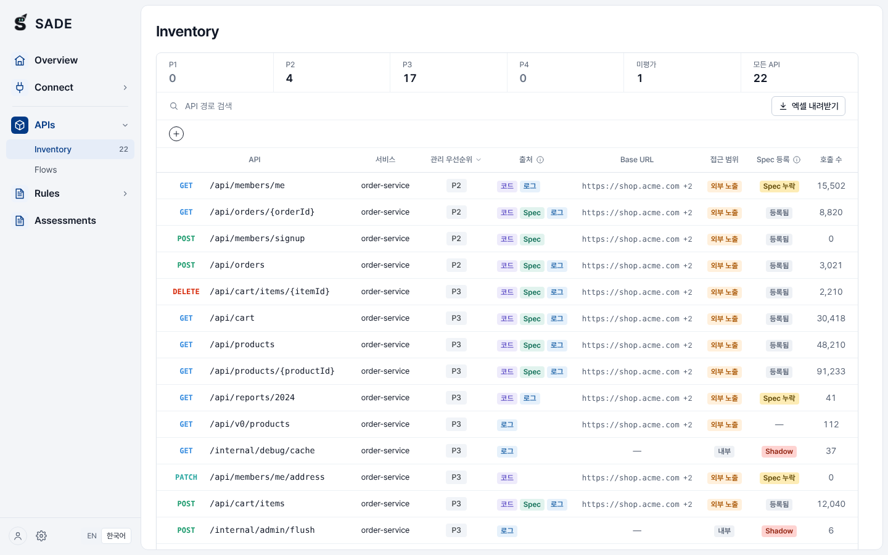

# Inventory

APIs > Inventory는 코드, 명세, 로그를 합친 전체 API 목록입니다. SADE는 서비스, 메서드, 경로 틀이 같은 API를 한 줄로 묶습니다. 예를 들어 `/users/123`과 `/users/{id}`는 한 줄입니다.

목록은 기본으로 P1, P2, P3, P4, 미평가 순서입니다. 등급 기준은 [관리 우선순위](priority.md)에 있습니다. 열 제목을 누르면 다른 기준으로 정렬합니다.

[{ loading=lazy }](../../assets/screens/inventory.png)
<small>예시 화면 (가상 데이터)</small>

## 열

| 열 | 내용 |
|---|---|
| API | 메서드와 경로 |
| Service | 서비스 |
| Management Priority | P1~P4, 잠정(provisional), 미평가 |
| Source | 확인한 입력. `Code`(코드 스캔), `Spec`(등록한 명세), `Log`(수집한 로그) |
| Base URL | 서비스 주소 |
| Access Scope | Public, Partner, Internal |
| Spec Status | Documented, Undocumented, Shadow, No Spec |
| Calls | 분석 기간의 호출 수 |

표 위의 줄에 이번 분석의 등급별 API 수가 나옵니다.

| 명세 상태 | 한국어 화면 | 뜻 |
|---|---|---|
| Documented | 등록됨 | 등록한 명세에 있는 API |
| Undocumented | Spec 누락 | 코드에 있고 명세에 없는 API |
| Shadow | Shadow | 코드와 명세에 없고 로그에서만 보인 API |
| No Spec | Spec 없음 | 비교할 명세가 없는 서비스의 API |

민감정보와 인증 선언은 열에 없습니다. API를 누르면 열리는 패널과 필터에서 봅니다.

## 필터

Add filter로 조건을 더합니다. 조건은 주소에 남아서 새로 고침이나 뒤로 가기 뒤에도 같은 목록이 나옵니다.

- 관리 우선순위 등급, 평가 상태(평가됨, 잠정, 미평가)
- 서비스, 메서드, 경로 검색
- 출처(Code, Spec, Log), 명세 상태
- 접근 범위, 외부 노출, 게이트웨이 우회
- 민감정보 여부, 민감 유형
- 인증 선언
- 호출 있음, 호출 없음

## Excel 내보내기

Export to Excel은 화면과 같은 필터, 정렬, 분석 실행으로 전체 목록을 내려받습니다. 페이지를 나누지 않습니다.

- Summary 시트: 등급별 수, 빠진 자료
- 등급별 시트: P1부터 미평가까지
- 각 줄: 출처별 확인 여부, 우선순위, 평가 상태, 판정 이유, 더 높아질 수 있는 등급, 빠진 자료
- 화면이 한국어면 한국어로 씁니다. 원문 값은 넣지 않습니다.

## 다른 화면으로

- API를 누르면 오른쪽에 요약 패널이 열립니다.
- Full Screen은 [API 상세](api-details.md)를 엽니다.
- View in Flows는 그 API를 [Flows](flows.md)에서 보여 줍니다.
