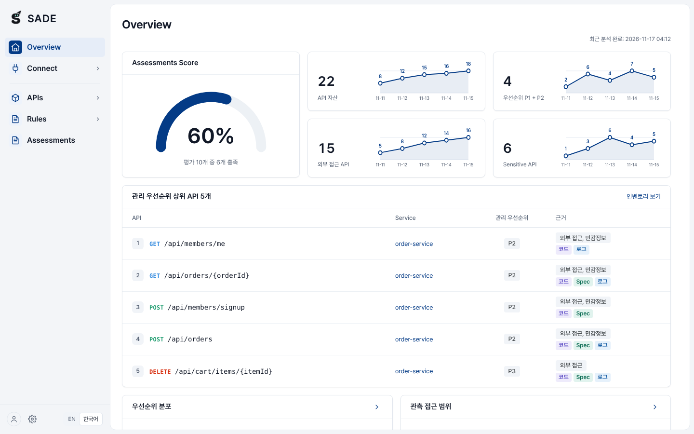

# Overview

Overview는 마지막으로 끝난 분석 결과를 요약합니다. 화면 위의 분석 완료 시각은 선택한 분석이 끝난 시각입니다. 실시간 수집 시각과 다릅니다.

[{ loading=lazy }](../../assets/screens/overview.png)
<small>예시 화면 (가상 데이터). 점검이 준비 중이어서 Assessments Score 값은 화면 예시입니다</small>

| 영역 | 내용 |
|---|---|
| Management Priority | P1~P4와 미평가(Unassessed) API 수. 누르면 그 등급으로 거른 Inventory가 열립니다 |
| Top 5 by Management Priority | 우선순위가 가장 높은 API 5개와 판정 근거 |
| Asset Snapshot Counts | API Assets(전체 API 수), External Access APIs(외부 접근 API 수), Priority P1 + P2, Sensitive APIs(민감 API 수) |
| Observed Access Scope | 로그에서 관측한 호출 주소로 나눈 Public, Partner, Internal API 수 |
| Sensitive Types | 민감 유형별 API 수. API 하나에 여러 유형이 있으면 겹쳐 셉니다 |
| Spec Status | Documented, Undocumented, Shadow, No Spec API 수 |
| Assessments Score | 프레임워크 점검 점수. 점검이 준비 중이어서 미리보기만 나옵니다 ([프레임워크 점검](assessments.md)) |

!!! note "관측한 접근 범위와 외부 접근"
    Observed Access Scope는 로그에 남은 호출 주소로만 셉니다. External Access APIs는 저장된 외부 도달 판정(설정, 게이트웨이 경로 포함)으로 셉니다. 관리 우선순위의 외부 접근 신호(E)는 외부 도달 판정을 씁니다.

검토를 시작할 때는 P1, P2 API의 [API 상세](api-details.md) Management 탭에서 판정 근거를 확인합니다.
