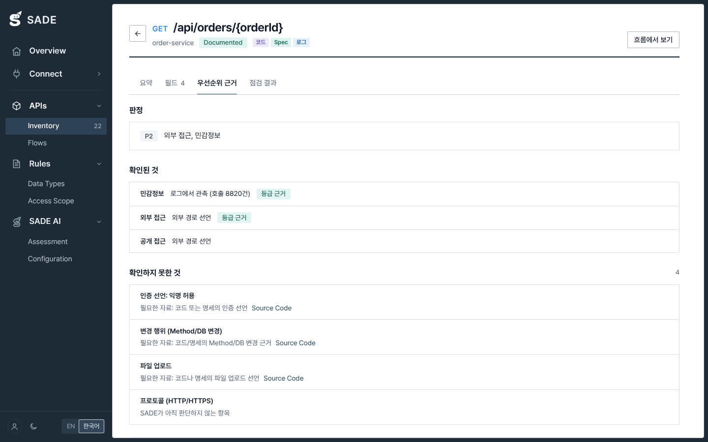

# 관리 우선순위 (P1~P4)

SADE는 수집한 근거로 API마다 관리 우선순위를 P1~P4로 매깁니다.

분석(매핑)할 때마다 서버가 같은 규칙으로 계산합니다. Overview, Inventory, API 상세, Flows, Excel 내보내기는 같은 값을 씁니다.

!!! note "우선순위의 뜻"
    우선순위는 검토할 순서입니다.

    취약점과 법 위반은 판정하지 않습니다. 근거가 없는 신호는 "모름"으로 남기고 안전으로 세지 않습니다.

## 신호

| 기호 | 신호 | 근거 |
|---|---|---|
| S | 민감정보를 다룸 | 코드, 명세 필드의 민감 유형, 로그 본문에서 찾은 민감 유형 |
| E | 외부에서 접근함 | Public, Partner 주소에서 온 호출 관측, 외부로 열린 게이트웨이 경로 |
| H | 인증 선언 충돌 | 같은 API의 코드 인증 선언과 명세 `security`가 서로 다름 |
| U | 인증 키가 URL에 실림 | 비밀번호, 토큰 같은 인증 키 유형이 경로나 쿼리에 있음 |
| M | 누구나 바꿀 수 있는 공개 API | Public 접근, 인증 없이 허용(예: `permitAll`), 변경 기능(PUT, PATCH, DELETE 선언)이 모두 있음 |
| O | 외부 구간에서 민감정보 전달 관측 | 외부 HTTP 구간에서 민감정보 전달을 관측했거나, 비밀번호나 오래 쓰는 인증 키가 URL로 전달된 것을 관측함 |
| D | 관리 검토 신호 | Shadow API, 명세 미등록, 명세와 필드 차이 |

## 등급 규칙

위에서부터 먼저 맞는 등급을 고릅니다.

| 등급 | 조건 | 예 |
|---|---|---|
| P1 | O | 외부 HTTP 구간에서 민감정보가 오가는 것을 관측함 |
| P2 | (S 그리고 E) 또는 U 또는 M 또는 (H 그리고 (S 또는 E)) | 외부에서 호출되는 민감 API, 인증 없이 열린 공개 삭제 API |
| P3 | S, E, H, D 중 하나 | 외부 접근 근거가 없는 민감 API, Shadow API |
| P4 | 관련 평가를 마쳤고 S, E, H, D가 모두 없음 | |
| 미평가 | 근거가 모자라 등급을 정하지 못함 | |

## 계산 예시

??? example "예시 6개 보기"

    | API | 신호 | 등급 | 이유 |
    |---|---|---|---|
    | `PUT /api/members/me` | S 예, E 예, O 모름 | P2 잠정 | S와 E가 함께 있어 P2. 외부 HTTP 구간 관측(O)을 모르니 P1이 될 수 있음 |
    | `DELETE /api/orders/{id}` | 공개, 인증 없이 허용, 변경 메서드 → M 예 | P2 | 누구나 지울 수 있는 공개 API |
    | `GET /internal/members/sync` | S 예, E 아니요, D 아니요, H 아니요 | P3 | 민감정보는 있지만 외부 접근 근거가 없음 |
    | `GET /api/payments/admin/export` | D 예(Shadow), S 모름, E 모름 | P3 잠정 | 로그에서만 보인 API. 민감정보나 외부 접근이 확인되면 올라감 |
    | `GET /health` | S, E, H, D 모두 아니요 | P4 | 관련 평가를 모두 마쳤고 신호가 없음 |
    | `GET /api/items` | 모든 신호 모름 | 미평가 | 근거가 모자라 등급을 정하지 못함 |

    표에 적지 않은 신호는 아니요로 봅니다. 예시 값은 가상입니다.

## 등급을 정하는 순서

1. 신호마다 근거를 모아 예, 아니요, 모름을 정합니다.

2. P1 조건(O)부터 아래로 내려가며 처음 맞는 등급을 고릅니다.

3. 고른 등급보다 높은 등급의 조건이 모름 신호 때문에 아직 맞을 수 있으면 잠정으로 표시하고, 더 높아질 수 있는 등급을 함께 남깁니다.

4. 어느 등급도 맞지 않고 모름이 남아 있으면 미평가입니다.

## 잠정과 미평가

- 신호는 예, 아니요, 모름 세 값입니다. 모름은 아니요로 세지 않습니다.
- 지금 근거로 등급을 정했어도, 모르는 신호가 확인되면 등급이 올라갈 수 있으면 "잠정"으로 표시합니다.
    - 예: 민감 API인데 외부 접근을 모르면 P3 잠정입니다. 외부 접근이 확인되면 P2가 됩니다.
- P1과 P4에는 잠정이 없습니다. P1은 위 등급이 없고, P4는 모든 관련 평가를 마친 경우에만 붙습니다.
- 근거가 모자라 어떤 등급도 정하지 못하면 미평가입니다.

## 근거 확인 {#evidence}

[{ loading=lazy }](../../assets/screens/api-manage.png)
<small>예시 화면 (가상 데이터)</small>

[API 상세](api-details.md)의 우선순위 근거 탭에 아래 내용이 나옵니다.

- 판정: 등급과 판정 이유
- 확인된 것: 예로 확인된 신호, 근거와 출처(코드 선언, 명세, 로그 관측), 등급에 쓰였는지
- 확인하지 못한 것: 모르는 신호와 필요한 자료, 자료를 넣을 화면
- 등급 기준: 해당 없음으로 확인된 신호 수

빠진 자료를 채우면 미평가와 잠정이 줄어듭니다.

| 빠진 자료 | 채우는 방법 |
|---|---|
| 외부 접근 모름 | 게이트웨이나 서비스 로그의 `client.ip`, [Access Scope](../policy/access-scope.md) 대역 설정 |
| 민감정보 모름 | 코드 스캔, 로그 본문(`http.request.body.content` 등) |
| 인증 선언 모름 | 코드 스캔, 명세의 `security` |
| 명세 비교 불가 | 코드와 같은 서비스 이름으로 명세 등록 |

## 제한

- 인증 선언은 코드와 명세에 적힌 선언입니다. 요청이 실제로 막히는지는 확인하지 않습니다.
- 호출 수와 최초, 마지막 호출 시각은 참고 정보입니다. 등급 계산에 넣지 않으며, 호출이 적은 API를 덜 위험하다고 보지 않습니다.
- 규칙이 바뀌면 다음 분석부터 적용합니다. 지난 분석 결과를 다시 계산하지 않습니다.
