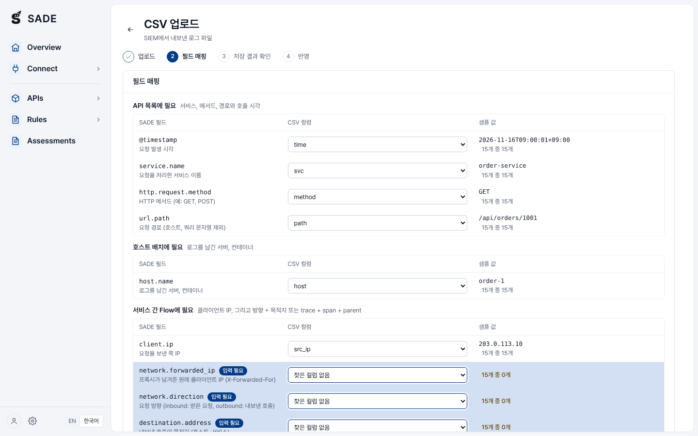
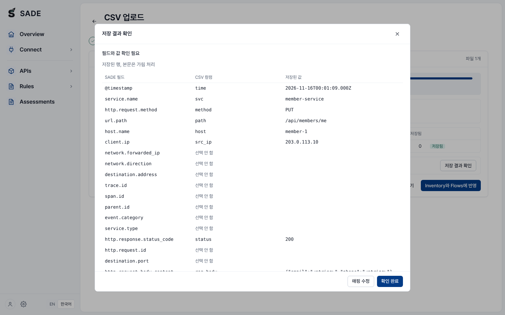
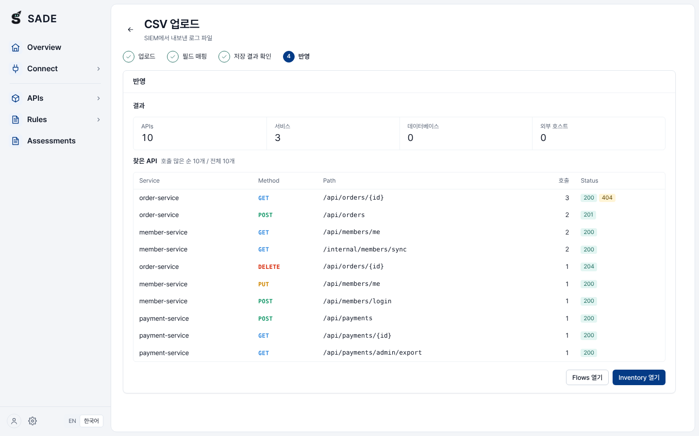

# 샘플 로그로 첫 결과 보기

설치를 마쳤다면 샘플 CSV 하나로 Inventory, 관리 우선순위, Flows가 채워지는 과정을 확인합니다.

기업 로그를 받기 전에 화면과 매핑 방식을 익히는 용도입니다. 10분 정도 걸립니다.

## 준비

- [설치와 첫 연결](quickstart.md)의 4단계(확인)까지 끝낸 SADE
- 샘플 파일 [sade-sample-access.csv](../../assets/samples/sade-sample-access.csv) (15줄, 가상 데이터)

샘플은 서비스 3개(order-service, member-service, payment-service)의 접근 로그입니다. 출발지 IP는 문서용 대역(`203.0.113.0/24`)과 사설 대역(`10.0.0.0/8`)을 씁니다.

```text
time,svc,method,path,status,src_ip,host,req_body
2026-11-16T09:00:01+09:00,order-service,GET,/api/orders/1001,200,203.0.113.10,order-1,
2026-11-16T09:01:09+09:00,member-service,PUT,/api/members/me,200,203.0.113.10,member-1,"{""email"":""user01@example.com"",""phone"":""010-0000-0000""}"
2026-11-16T09:03:10+09:00,payment-service,POST,/api/payments,200,10.0.2.15,pay-1,"{""order_id"":1001,""card_no"":""4111111111111111""}"
```

<div class="sade-slides" markdown>

<div class="sade-slide" markdown data-title="필드 매핑">

[{ loading=lazy }](../../assets/screens/csv-map.png)

<small>샘플 CSV를 올린 직후 자동으로 맞춘 매핑</small>

</div>

<div class="sade-slide" markdown data-title="저장된 줄 확인">

[{ loading=lazy }](../../assets/screens/csv-stored.png)

<small>저장된 줄 확인 창</small>

</div>

<div class="sade-slide" markdown data-title="반영">

[{ loading=lazy }](../../assets/screens/csv-apply.png)

<small>반영이 끝난 화면</small>

</div>

</div>

## 1. CSV 올리기

<div class="sade-steps" markdown>

1. 왼쪽 메뉴에서 Connect > Log Sources를 엽니다.

2. CSV 카드의 Upload CSV(CSV 업로드)를 누릅니다.

3. Choose CSV files(CSV 파일 선택)로 샘플 파일을 고릅니다.

    화면 위에 단계 표시가 나옵니다: 업로드 → 필드 매핑 → 저장 결과 확인 → 반영

</div>

## 2. 필드 매핑

SADE가 열 이름을 보고 필드를 추천합니다. 추천이 비었거나 다르면 아래처럼 고릅니다.

| 샘플 열 | SADE 필드 | 쓰임 |
|---|---|---|
| `time` | `@timestamp` | 호출 시각 |
| `svc` | `service.name` | 서비스 이름 |
| `method` | `http.request.method` | 메서드 |
| `path` | `url.path` | 경로 |
| `status` | `http.response.status_code` | 응답 코드 |
| `src_ip` | `client.ip` | 출발지 IP. 접근 범위(Public, Internal) 판정 |
| `host` | `host.name` | 서버 이름 |
| `req_body` | `http.request.body.content` | 요청 본문. 민감정보 탐지 |

- 파란색으로 표시된 칸이 아직 채우지 않은 필드입니다.
- `service.name`, `http.request.method`, `url.path` 세 칸은 꼭 채웁니다. 비어 있으면 API 목록이 비거나 모자랄 수 있습니다.
- 다 고르면 Send to Vector(로그 저장)를 누릅니다.

## 3. 저장 결과 확인

파일별로 저장한 줄, 이미 저장된 줄, 버린 줄 수가 나옵니다. 저장된 줄 하나를 열어 각 필드에 맞는 값이 들어갔는지 봅니다.

- 본문은 값이 타입으로 바뀌어 저장됩니다. 예: `{"email":"<string>","phone":"<string>"}`
- 값이 엉뚱한 필드에 들어갔으면 Fix mapping(매핑 수정)으로 돌아갑니다.
- 맞으면 Looks right(확인 완료)를 누릅니다.

!!! note "샘플 날짜와 보관 기간"
    보관 기간(기본 30일)보다 오래된 줄은 저장하지 않고 "보관 기간보다 오래돼 버림"으로 셉니다. 샘플 날짜가 오래됐다면 `time` 열의 날짜를 오늘 근처로 바꿔 올립니다.

## 4. 반영

Apply to inventory and flows(Inventory와 Flows에 반영)를 누릅니다.

로그 분석과 매핑이 이어서 돌고, 끝나면 화면이 바뀝니다. 진행 중에는 이전 결과가 그대로 보입니다.

## 5. 결과 보기

<div class="sade-steps" markdown>

1. Overview

    API 수, 등급별 수, 접근 범위별 수가 나옵니다. 로그만 넣었으므로 Spec Status는 모두 No Spec(Spec 없음)입니다.

2. Inventory

    - `/api/orders/1001`, `/api/orders/1002`처럼 값만 다른 경로가 `/api/orders/{id}` 한 줄로 묶입니다.
    - Source 열에는 `Log`만 표시됩니다.
    - `203.0.113.x`에서 불린 API는 Access Scope가 Public, `10.x`에서만 불린 API는 Internal입니다.

3. 관리 우선순위

    `PUT /api/members/me`를 눌러 Full Screen(전체 화면) > Management(관리) 탭을 엽니다.

    - 민감정보(S): 본문의 `email`, `phone`에서 찾은 유형
    - 외부 접근(E): Public 주소에서 온 호출
    - 인증 선언(H): 코드와 명세가 없어 모름

    S와 E가 함께 있으면 P2 조건에 맞습니다. 확인하지 못한 신호가 남아 있으면 잠정(provisional)으로 표시됩니다.

4. Flows

    Clients에서 세 서비스로 가는 선과 호출 수가 보입니다. 샘플에는 서비스 사이 호출 로그가 없어 서비스끼리 잇는 선은 없습니다.

</div>

## 다음 단계

샘플에서 비어 있던 근거는 다른 자료를 붙이면 채워집니다.

| 붙일 자료 | 채워지는 것 | 안내 |
|---|---|---|
| 소스 코드 | 인증 선언, 핸들러 위치, 서비스 사이 호출, Shadow 판정 | [소스 코드 (GitHub)](../connect/code.md) |
| OpenAPI 명세 | Documented, Undocumented 판정, 명세와 코드 인증 선언 비교 | [OpenAPI 명세](../connect/specs.md) |
| 기업 로그 | 실제 호출, 접근 범위, 민감 유형 | [로그 연결 방식](../connect/logs.md) |
| 내부 대역 | Internal, Partner 구분 | [Access Scope](../policy/access-scope.md) |

샘플로 저장한 로그는 보관 기간이 지나면 지워집니다. 바로 지우려면 설치를 처음부터 다시 합니다(`docker compose down -v`, 모든 데이터 삭제).
