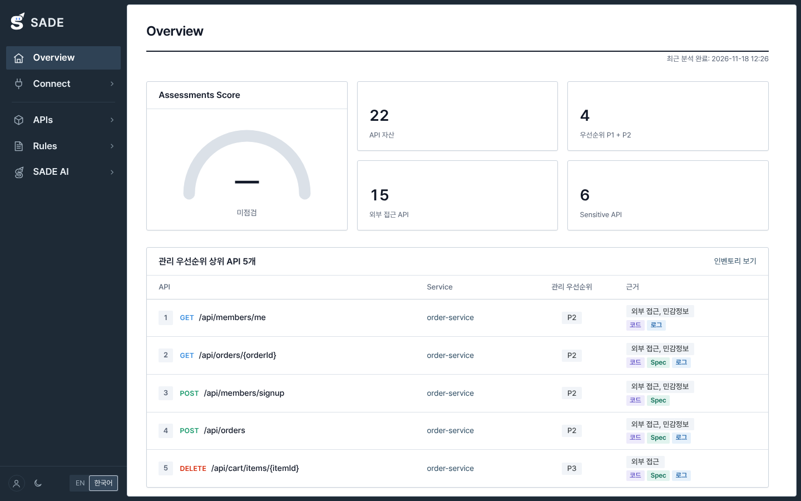
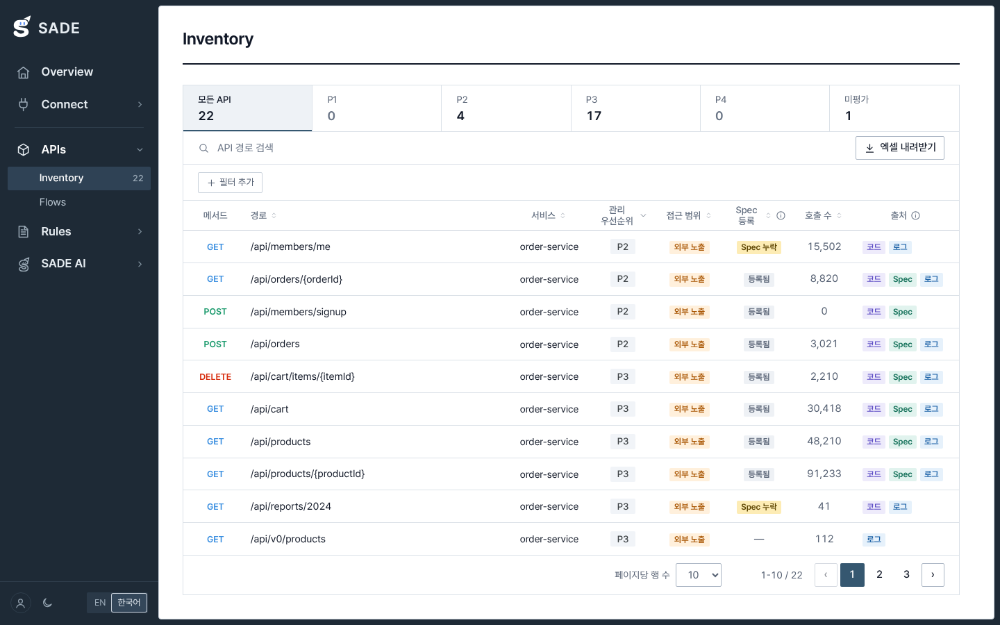
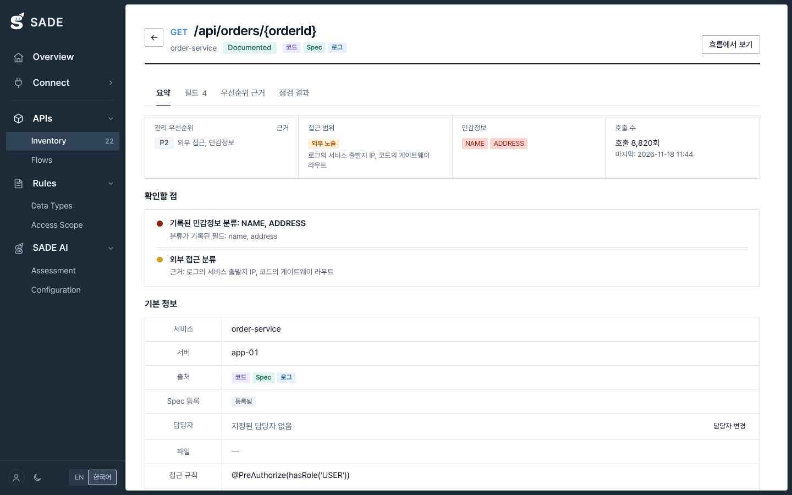
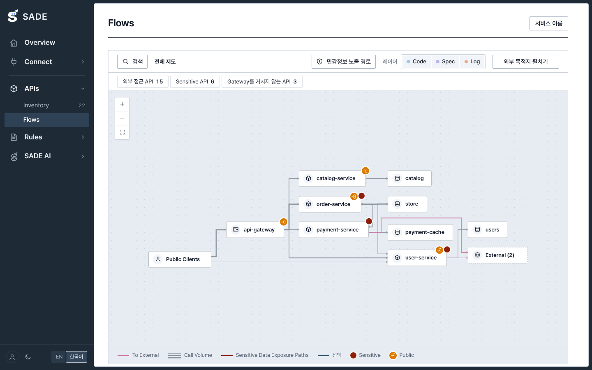
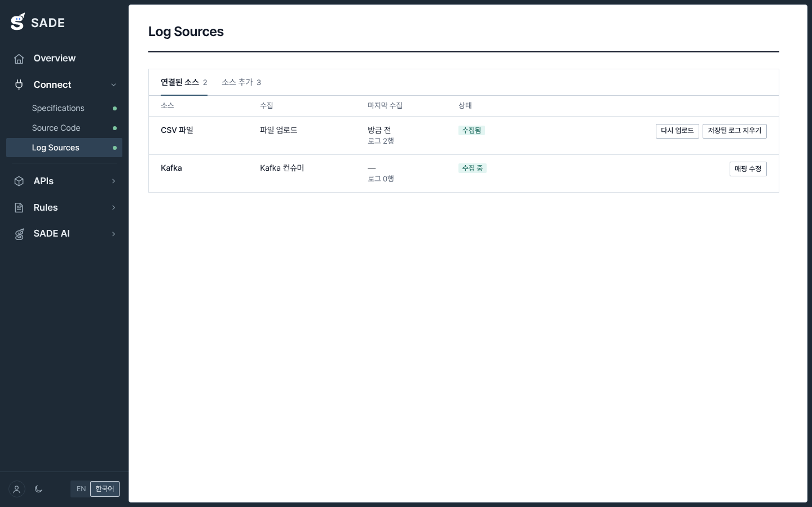
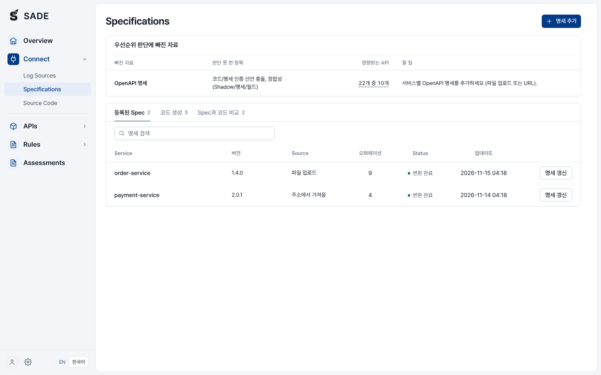
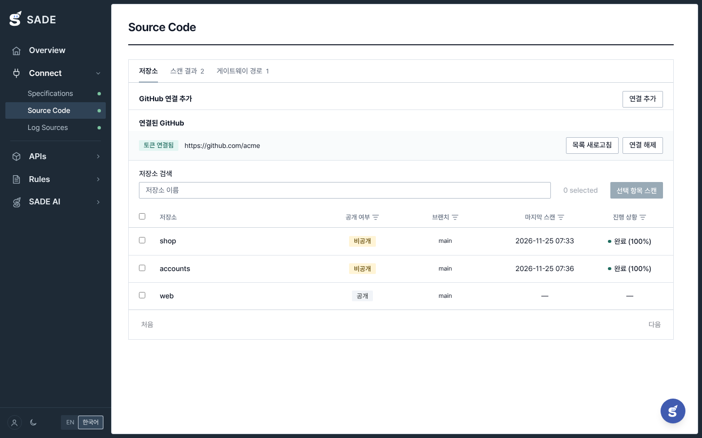
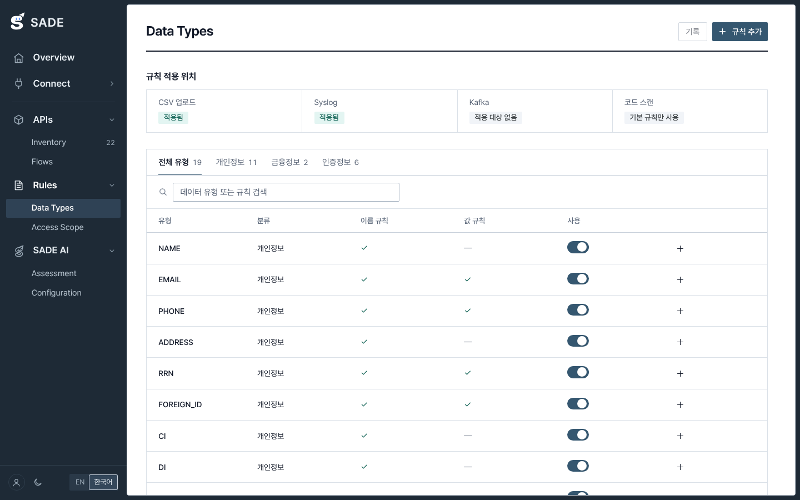
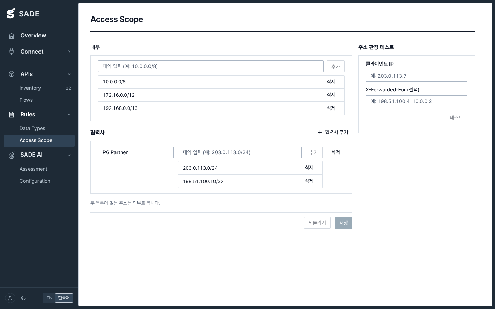
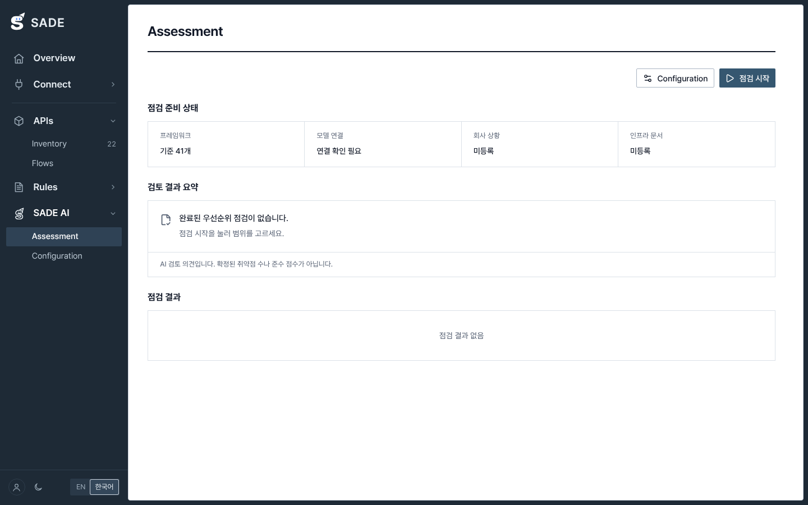

# 화면 둘러보기

메뉴와 화면 제목은 영어, 설명은 한국어로 표시합니다. 화면 왼쪽 아래 EN, 한국어 버튼으로 언어를 바꿉니다.

[{ loading=lazy }](../../assets/screens/overview.png)

<small>자산 수, 상위 5개 API, 우선순위 분포, 접근 범위, 민감 유형, Spec 등록 (가상 데이터)</small>

[{ loading=lazy }](../../assets/screens/inventory.png)

<small>등급별 타일과 전체 API 목록 (가상 데이터)</small>

[{ loading=lazy }](../../assets/screens/api-overview.png)

<small>요약, 필드, 우선순위 근거, 점검 결과 탭 (가상 데이터)</small>

[{ loading=lazy }](../../assets/screens/flows.png)

<small>클라이언트, 서비스, DB, 외부 목적지 연결 (가상 데이터)</small>

[{ loading=lazy }](../../assets/screens/logs.png)

<small>연결된 로그 소스 (가상 데이터)</small>

[{ loading=lazy }](../../assets/screens/specs.png)

<small>등록한 명세와 코드에서 만든 명세 (가상 데이터)</small>

[{ loading=lazy }](../../assets/screens/code.png)

<small>GitHub 저장소 스캔과 코드 인벤토리 (가상 데이터)</small>

[{ loading=lazy }](../../assets/screens/datatypes.png)

<small>민감정보 유형 19개, 탐지 규칙, 기업 규칙 추가 (가상 데이터)</small>

[{ loading=lazy }](../../assets/screens/scope.png)

<small>내부, 협력사 대역과 주소 판정 테스트 (가상 데이터)</small>

[{ loading=lazy }](../../assets/screens/assessments.png)

<small>AI 모델로 프레임워크 기준 점검 (가상 데이터)</small>

| 메뉴 | 화면 | 기능 |
|---|---|---|
| Overview | [Overview](../features/overview.md) | 자산 수, 우선순위 상위 API 5개, 우선순위 분포, 관측 접근 범위, 민감 유형, Spec 등록 |
| Connect | [Log Sources](../connect/logs.md) | [CSV 업로드](../connect/logs-csv.md), [syslog 수신](../connect/logs-syslog.md), [Kafka 구독](../connect/logs-kafka.md), 연결된 소스 관리 |
| | [Specifications](../connect/specs.md) | OpenAPI 명세 등록, 코드에서 만든 명세 |
| | [Source Code](../connect/code.md) | GitHub 저장소 스캔, 코드 인벤토리, 라우트 맵 |
| APIs | [Inventory](../features/inventory.md) | 전체 API 목록과 필터 |
| | [Flows](../features/flows.md) | 서비스, DB, 외부 목적지 연결 지도. [서비스 이름](../policy/access-scope.md#settings) 합치기 |
| Rules | [Data Types](../policy/data-types.md) | 민감정보 유형 19개, 탐지 규칙, 기업 규칙 추가 |
| | [Access Scope](../policy/access-scope.md) | 내부, 협력사 주소 대역과 주소 판정 테스트 |
| SADE AI | [Assessment](../features/assessments.md) | AI 모델로 고른 API를 프레임워크 기준과 대조 |
| | [Configuration](../features/assessments.md#config) | 회사 상황, 인프라 문서, 모델 제공자 연결 |

Inventory에서 API를 누르면 [API 상세](../features/api-details.md)가 열립니다.

## 공통 표시

- 화면 사진은 개발용 가짜 API로 띄운 화면입니다. 서비스, 주소, 숫자는 모두 가상 값입니다.
- 출처 `코드`, `Spec`, `로그`: API나 필드를 확인한 입력입니다. Flows 레이어와 지도에서는 Code, Spec, Log로 나옵니다.
- 분석 실행(run): 화면의 숫자는 마지막으로 끝난 분석 결과입니다. 로그를 새로 넣거나 설정을 바꾸면 다시 분석하라는 안내가 나옵니다. 분석이 끝난 뒤 Inventory와 Flows가 바뀝니다.
- 모름, 미평가: 근거가 없는 항목에 붙습니다.
