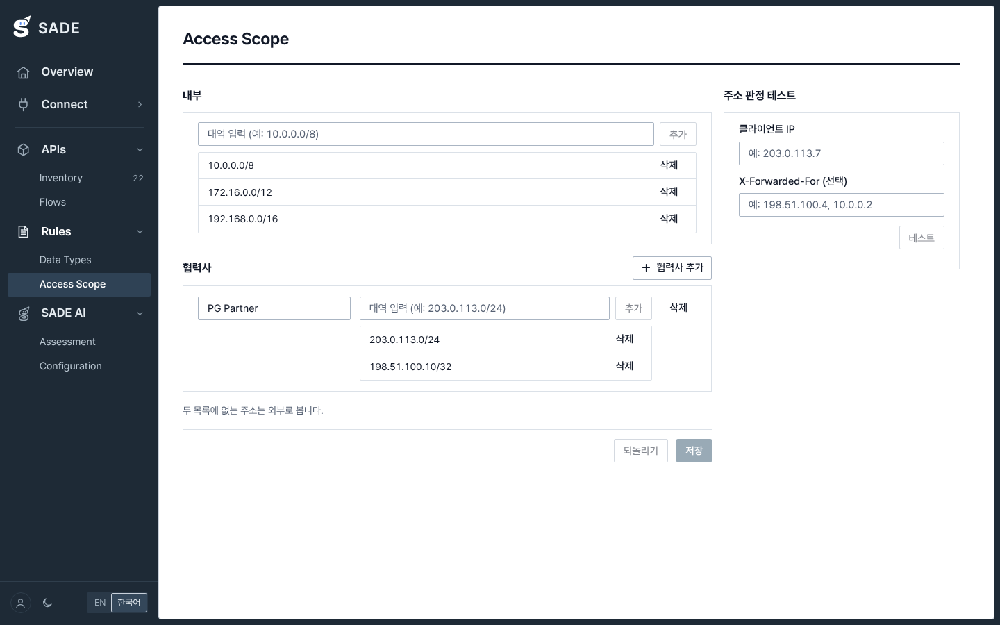
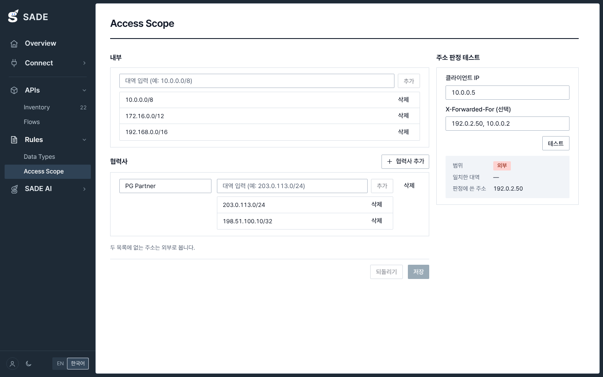
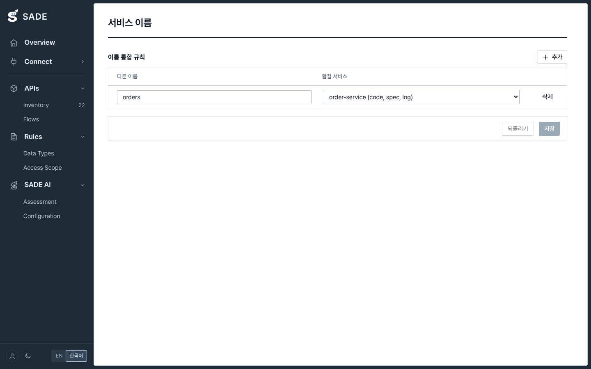

# Access Scope와 서비스 이름

## Access Scope (접근 범위)

Rules > Access Scope에서 호출 주소를 내부, 협력사, 외부로 나누는 기준을 정합니다.

SADE는 이 기준으로 로그의 출발지 IP를 나눠 API마다 접근 범위를 판정합니다. 판정 결과는 [관리 우선순위](../features/priority.md)의 외부 접근 신호(E)에 들어갑니다.

판정 방식은 [노출 판정](../how-it-works/exposure.md)에 있습니다.

[{ loading=lazy }](../../assets/screens/scope.png)

<small>내부, 협력사 대역 (가상 데이터)</small>

[{ loading=lazy }](../../assets/screens/scope-test.png)

<small>클라이언트 IP는 내부 주소지만 X-Forwarded-For의 주소로 판정해 외부 (가상 데이터)</small>

[{ loading=lazy }](../../assets/screens/settings.png)

<small>다른 이름을 합칠 서비스에 합침 (가상 데이터)</small>

| 범위 | 정하는 방법 |
|---|---|
| 내부 | 기업 내부 대역을 CIDR로 넣습니다. 쉼표로 여러 개를 한 번에 넣을 수 있고, `/비트`가 없으면 주소 하나입니다 |
| 협력사 | 협력사마다 이름을 붙이고 대역을 넣습니다 |
| 외부 | 두 목록에 없는 모든 주소. 따로 넣지 않습니다 |

### 내부 대역 넣기

1. 네트워크 담당자에게 기업 내부 대역 목록을 받습니다. 사무망, 서버망, VPN, 클라우드 VPC 대역을 모두 포함합니다.

2. 내부의 입력칸에 대역을 넣고 추가를 누릅니다. 예: `10.0.0.0/8, 172.20.0.0/16, 100.64.10.0/24`

3. 저장을 누릅니다. 매핑이 다시 돌고 Inventory와 Flows의 접근 범위가 바뀝니다.

- 내부 대역을 저장하지 않으면 기본 사설 대역(`10.0.0.0/8`, `172.16.0.0/12`, `192.168.0.0/16`, `127.0.0.0/8`, IPv6 사설, 링크 로컬)을 내부로 봅니다. 화면에는 "기본값"으로 나옵니다.
- 빈 목록을 저장해도 기본 사설 대역을 내부로 봅니다.
- 공인 IP 대역을 쓰는 사내망이 있으면 꼭 넣습니다. 넣지 않으면 그 대역의 호출이 외부로 잡힙니다.
- 저장 전에는 되돌리기로 마지막 저장 상태로 돌아갑니다.

### 협력사 넣기

1. 협력사 추가를 누르고 협력사 이름을 넣습니다. 예: 결제 대행, 물류 연동

2. 그 협력사가 호출하는 출발지 대역을 넣고 추가를 누릅니다.

3. 저장을 누릅니다. 이름이 빈 협력사가 있으면 저장되지 않습니다.

협력사에서만 불린 API는 Inventory의 접근 범위에서 외부 노출로 보입니다. 관측 접근 범위 필터와 API 상세에서 협력사로 따로 봅니다.

### 주소 판정 테스트

1. 클라이언트 IP에 IP를 넣습니다. X-Forwarded-For (선택)에 게이트웨이가 넘긴 값도 넣을 수 있습니다.

2. 테스트를 누르면 판정된 범위, 일치한 대역, 판정에 쓴 주소가 나옵니다.

- 테스트는 저장한 설정으로 합니다. 저장하지 않은 수정은 반영되지 않습니다.
- X-Forwarded-For의 어느 값을 출발지로 쓸지는 SADE가 정하며 화면에서 바꿀 수 없습니다. 결과의 판정에 쓴 주소로 확인합니다.

### 게이트웨이 뒤 서비스

게이트웨이 뒤 서비스의 로그에는 게이트웨이 주소(대개 사설 IP)가 출발지로 찍힙니다.

- 게이트웨이가 넘긴 원래 주소(`X-Forwarded-For`)를 `network.forwarded_ip`로 매핑합니다.
- 게이트웨이 접근 로그를 함께 수집하면, 게이트웨이가 받은 호출의 출발지가 서비스 API 판정에 더해집니다.

## 서비스 이름 합치기 {#settings}

같은 서비스가 코드, 명세, 로그에서 다른 이름으로 찍히면 노드 두 개로 나뉩니다.

예를 들어 코드는 `order-service`, 로그는 `orders`인 경우입니다. Flows 오른쪽 위의 서비스 이름 버튼을 누르면 이름 통합 규칙 창이 열립니다.

1. Inventory의 서비스 필터나 Flows에서 같은 서비스가 두 이름으로 나오는지 봅니다.

2. Flows에서 서비스 이름을 누르고 추가를 누릅니다.

3. 다른 이름에 합칠 이름(`orders`)을 넣고, 합칠 서비스에서 기준 이름(`order-service`)을 고릅니다. 목록에는 서비스마다 이름이 나온 출처(code, spec, log)가 함께 나옵니다. 기준 이름은 코드 스캔의 이름을 쓰기를 권합니다.

4. 저장을 누릅니다. 설정 버전이 올라가고 매핑이 다시 돕니다.

- 이름 하나는 한 번만 넣습니다.
- 자기 자신으로는 합치지 못합니다.
- 다른 서비스에 이미 합쳐진 서비스를 기준으로 고르지 못합니다. 그 서비스가 합쳐진 기준 서비스를 고릅니다.
- 현재 결과에 없는 이름은 "지금 결과에 없음"으로 표시됩니다. 다음 수집에 나올 이름이면 그대로 두어도 됩니다.
- 저장했는데 다시 계산이 실패하면 화면에 알림이 나옵니다. 저장한 설정은 남고, 다음 매핑 때 적용됩니다.
- 같은 화면은 주소 `/#/settings`로도 열립니다.
