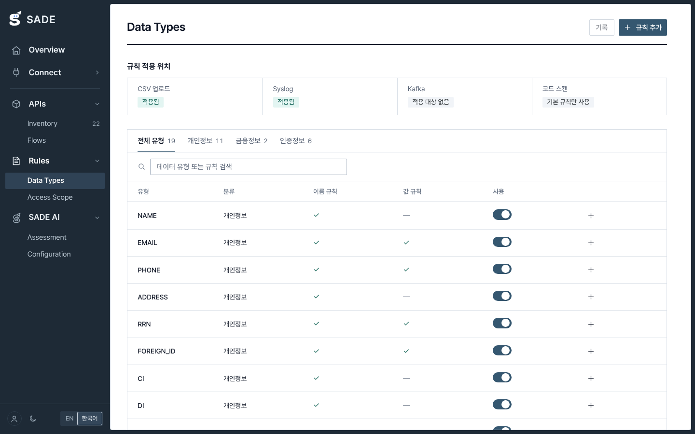

# Data Types (민감정보 유형)

Rules > Data Types에서 SADE가 찾는 민감정보 유형과 탐지 규칙을 봅니다.

[{ loading=lazy }](../../assets/screens/datatypes.png)
<small>예시 화면 (가상 데이터)</small>

## 기본 유형 19개

| 분류 | 유형 |
|---|---|
| 개인정보 (11) | NAME, EMAIL, PHONE, ADDRESS, RRN(주민등록번호), FOREIGN_ID(외국인등록번호), CI, DI, DRIVER_LICENSE, PASSPORT, BIRTH_DATE |
| 금융 (2) | ACCOUNT_NO, CARD_NO |
| 인증 정보 (6) | PASSWORD, ACCESS_TOKEN, REFRESH_TOKEN, API_KEY, SESSION_COOKIE, SECRET |

## 탐지 규칙

| 규칙 | 찾는 방법 | 적용 대상 |
|---|---|---|
| 필드 이름 규칙 | 필드 이름이 목록과 맞는지 봅니다 (예: `phone`, `mobile_no`, `cust_nm`) | 코드, 명세, 로그 |
| 값 규칙 | 값의 형식을 봅니다. EMAIL, PHONE, RRN, FOREIGN_ID, CARD_NO(카드번호 검증 포함), ACCESS_TOKEN(JWT 형식) | 로그 본문 |

- 코드에서는 이름만으로 정하기 어려운 필드를 주변 코드로 한 번 더 확인합니다. 예: `name`이 사람 이름인지 상품 이름인지
- 로그 본문은 저장 전에 검사합니다. 유형 이름만 남기고 값과 값의 위치는 남기지 않습니다.

유형별 필드 이름 예, 값 규칙, 코드에서만 쓰는 문맥 판정은 [민감정보 탐지](../how-it-works/sensitive-data.md)에 있습니다.

## 기업 규칙 더하기 {#custom}

기업마다 쓰는 필드 이름(예: `cust_eml`, `rcv_tel`)은 기본 규칙에 없을 수 있습니다. 사용자 규칙으로 더합니다.

1. 규칙 추가를 누릅니다. 유형 줄 오른쪽 + 를 누르면 그 유형으로 시작합니다.

2. 유형과 일치 기준을 고릅니다.

    - 필드 이름: 이름을 쉼표나 줄바꿈으로 나눠 넣습니다. 대소문자, `-`, `_`는 구분하지 않습니다.
    - 값 (정규식): 값 전체와 맞아야 하는 정규식을 넣습니다.

3. 테스트 샘플에 예시 값을 넣어 맞는지 봅니다. 샘플은 시험에만 쓰고 저장하지 않습니다.

4. 저장합니다.

- 사용자 규칙 표에서 규칙마다 편집, 삭제, 사용 여부를 바꿉니다. 유형 표의 사용 칸으로 기본 유형을 끄고 켭니다.
- 저장하면 코드 스캔과 등록한 명세의 민감 판정을 다시 돌리고, 이어서 매핑이 돕니다.
- CSV는 다음 업로드부터 새 규칙을 씁니다. Syslog, Kafka는 수집 설정을 다시 써서 이후 들어오는 로그부터 적용합니다. 이미 저장한 로그는 값이 가려져 있어 새 규칙으로 다시 검사하지 못합니다.
- 위쪽 규칙 적용 위치에서 CSV 업로드, Syslog, Kafka, 코드 스캔이 지금 규칙을 쓰는지(적용됨, 적용 대상 없음, 기본 규칙만 사용) 봅니다.
- 기록 버튼은 아직 동작하지 않습니다.

찾은 유형은 다음 곳에 쓰입니다.

- Inventory의 민감 유형 필터
- API 상세의 필드 탭
- [관리 우선순위](../features/priority.md)의 민감정보 신호(S)
